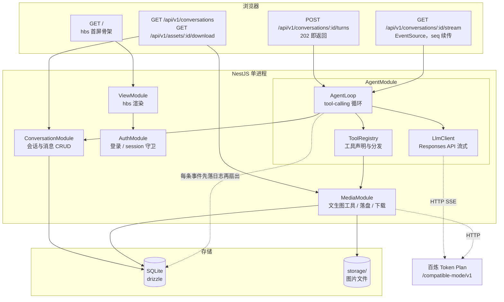
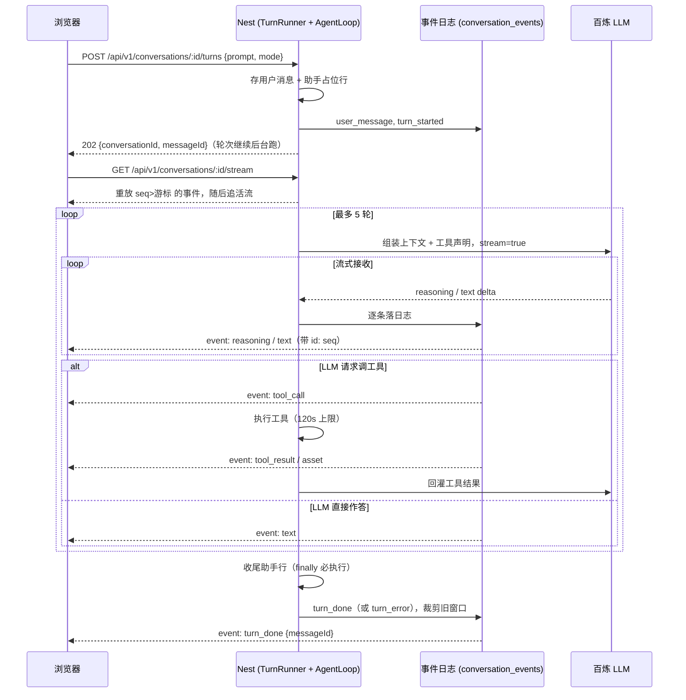
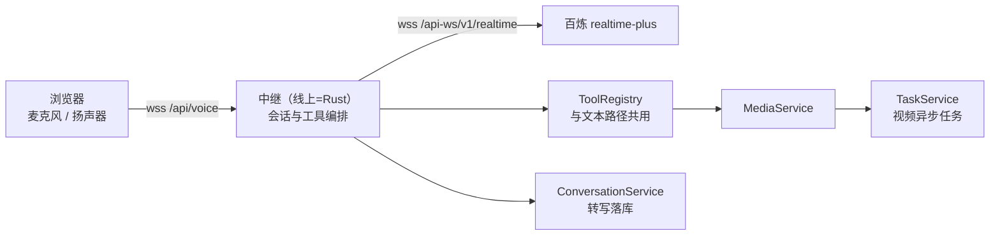

# kestrel-studio 架构设计

> 本文只回答一个问题：**这个系统是什么**——定位、选型、分层、关键设计决策与数据模型。
> 其余关注点已拆为独立文档，见文末「相关文档」。

## 1. 定位与命名

`kestrel/` 是 Rust 实现的 Agent harness 内核。`kestrel-studio` 是它面向**生成式媒体**的 Web 化实现：
用户在网页里给一句话，LLM 流式思考、调用生成工具、把产出的图片或视频渲染到页面上，可预览可下载。
能力按轮次分四种模式——对话（零工具）、图片、视频，另有智能模式由模型自行路由；**语音另有一条
独立入口**（`/voice`），不是第五个模式，理由见 §11。

语言从 Rust 换成 NestJS，但「Agent 循环 + 工具注册表」的分层思路沿用 kestrel。

参考实现：`playground/bailian-media-mcp`（百炼 Token Plan 文生图/文生视频的 MCP 封装）。
那里的 API 调用方式与凭据解析策略可直接复用；MCP 协议外壳不复用。

## 2. 技术选型

| 层 | 选型 | 理由 |
|---|---|---|
| 服务端 | NestJS 12 + Express | 指定 |
| 服务端（第二实现） | Rust：axum 0.8 + sqlx + tokio | 与 Nest 版并行的同端实现，见 §13。**2026-11-02 起线上跑的是这一套**，Nest 版不是待下架的对象——两套后端长期并存（roadmap.md §4.5，2026-11-07） |
| 渲染 | hbs (Handlebars) | 单进程 SSR，无独立前端服务，8G 机器内存友好 |
| 前端 | 原生 TS + Vite 打包 | 无框架，Vite 只做 TS/CSS 打包，产物由 Nest 静态托管 |
| 传输 | 对话级 SSE（GET + EventSource）+ 持久事件日志 | 提交与订阅分开；seq 续传见 §4.2。轮次事件曾挂在 POST 响应上，已改 |
| 实时语音 | 裸 `ws` + 短时效票据鉴权 | 见 §11。只要裸 WS 的帧控制，不引入 socket.io 及其自有协议 |
| 数据库 | SQLite + drizzle-orm + better-sqlite3 | 轻量、类型安全、无 Prisma 的引擎二进制开销 |
| 登录 | express-session + passport-local + bcrypt | SSR 下 session cookie 比 JWT 自然 |
| 账号与权限 | `users.role` 单列 + 一处可见性规则 | 见 §12。只有一级特权，不引入角色表与权限中间件 |
| LLM 客户端 | 手写 fetch + SSE 解析（依据见 [verification.md](verification.md) §1） | Token Plan 兼容 OpenAI 协议，但端点带非标准注释行 |

## 3. 分层架构



## 4. 关键设计决策

### 4.1 SSR 与流式渲染是两条独立的路

hbs 只负责渲染首屏骨架：登录态判断、历史会话侧栏、页面外壳（顶栏 / 主体区 / 底部输入区）。
**主体区域从第一个 token 起就全部由客户端 JS 拼 DOM**，服务端不流式吐 HTML 片段。
这条边界必须在实现时守住，否则容易出现「服务端模板里塞了流式占位逻辑」的拧巴写法。

`GET /` 的首屏画哪一条会话，只有三个来源（两侧同形：`rust/server/src/view/controller.rs::chat`、
`nest/server/src/view/view.controller.ts::chat`）：

| 请求 | 首屏 |
|---|---|
| `/?c=<id>`，且是本人未删除的会话 | 打开它 |
| `/?c=` 缺失、解析不出、或指向别人的会话 | **回落到最近更新的那条**（`ORDER BY updated_at DESC, id DESC` 的第一行）；账号下一条会话都没有时是空舞台 |
| `/?new=1` | **空舞台**：不回落，主体区不画任何东西，`data-conversation-id` / `data-start-seq` 留空，侧栏照旧列出全部会话但不高亮 |

`?new=1` 存在的原因是「新会话」这个状态在地址栏里得有地方放：回落**不由 query 决定**，所以
「没有 `?c=`」表达不了「从头开始」，它表达的正是「我最近那条」。两个客户端点新会话（以及删掉
当前会话）时把地址栏写成 `pathname?new=1`，刷新才停在空舞台上；一旦提交出新会话，`create`
回来的 id 会把地址栏改写成 `?c=<id>`，那个标记不会跟着一条已存在的会话赖在栏里。
值只认 `1`（与 `/login?error=1` 同口径），其余写法等同于不带这个参数。

### 4.2 提交与订阅分开：一条对话级事件流

轮次不再挂在发起它的 POST 上。产品 API（`/api/v1`，为 App / 小程序预留同一张
边界，docs/roadmap.md §2.3）只有一个流式端点：

| 调用 | 语义 |
|---|---|
| `POST /api/v1/conversations` | 建会话，返回 `{conversationId}` |
| `POST /api/v1/conversations/:id/turns` | 提交一轮，立即 `202 {conversationId, messageId}` |
| `GET /api/v1/conversations/:id/stream` | 对话级事件流，事件带会话内自增 `seq`，支持 `Last-Event-ID` 断线续传 |

要点的取舍：

- **轮次在服务端跑（`TurnRunner`），客户端断开不再取消轮次。** 移动端断网、
  切后台是日常，付费生成不能是连接的殉葬品——这正是二期的目的。代价是旧的
  「断开即中止」语义没了；防跑偏靠既有的 `MAX_TOOL_ROUNDS` 与单次工具 120s
  超时，不再有连接可拆。
- **一个会话同时只跑一轮**，第二次提交吃 `409`。以前「一条连接」本身就是锁，
  分开之后必须显式记账——防的是重复计费。
- 每条事件（思考增量、工具调用、资产、后台任务进度、追加的消息）先写进
  `conversation_events` 表（`seq` 会话内自增）再扇出到连接，SSE 的 `id:` 字段
  就是它。重连时从表里重放 `seq > 游标` 的事件；**新连接（无游标）也自动定位**：
  会话有未完轮次时游标回退到该轮第一件事之前——首屏 SSR 刻意不画未完成的
  助手占位行，页面与流因此能无缝接上。`?from=` 参数是客户端已知游标的入口
  （首屏 stamp 在 `body[data-start-seq]`；新建会话传 0）。
- **游标低于保留窗口时只发一帧 `resync`**，客户端从落库的行重建（重载页面）。
  日志只补「尚未在别处落定」的部分——正文、思考、工具记录、资产始终以
  `messages` / `assets` 为真源，所以宁可重建，不给半个回放。
- 流是纯 GET + 同源 cookie，浏览器直接用最自然的 `EventSource`：自动重连、
  自动带 `Last-Event-ID`。手写 fetch+ReadableStream 帧读取器随它伺候的 POST
  流一起退役。服务端仍用 `@Res()` 裸写（`common/sse.ts` 的 `SseWriter`），
  `@Sse()` 装饰器带不了心跳注释帧与自定义头。
- 轮次事件的 `messageId` 就是该轮助手行的 id（roadmap 草案里的 `turnId`）：
  不另造一个只有服务端认识的标识符。

### 4.3 心跳与超时

文生图单次耗时几十秒，期间没有任何数据帧，长连接会被中间层或浏览器判定为空闲而掐断。

- **心跳**：每 15s 发一个 `: ping` 注释帧（SSE 规范中以 `:` 开头的行为注释，客户端会忽略）。
  会话事件流是常态长连接，这条比旧的轮次流更要靠它。
- **工具超时**：单次工具执行设上限（文生图 120s）。超时不挂死连接，而是把
  `tool_result {ok: false}` 回灌给 LLM 并进日志，由它决定重试还是换 prompt。

### 4.4 reasoning 实测可用

已实测（2026-09-20）：`deepseek-v4.1-flash` 在 Responses API 上以 `response.reasoning_text.delta`
事件流式吐思考内容，正文走 `response.output_text.delta`。两者事件名前缀不同，
前端可分列渲染——思考过程进折叠区，正文进主体区。

降级兜底：若日后模型换成不吐 reasoning 的版本，思考区退化为**工具调用步骤时间线**
（「正在生成图片… → 完成，耗时 23s」）。
前端事件模型不变，只是内容源从 `reasoning` 事件切换为 `tool_call` / `tool_result` 事件。

## 5. 数据模型

| 表 | 字段 |
|---|---|
| `users` | id, username, password_hash, role, created_at |
| `sessions` | sid, sess, expire —— Nest 侧由 better-sqlite3-session-store 独占管理，不纳入 drizzle schema；Rust 侧由 `auth/session.rs` 读写同一张表，形状差异见 §13.2 |
| `conversations` | id, user_id, title, deleted_at, created_at, updated_at |
| `messages` | id, conversation_id, role, content, reasoning, tool_calls, mode, created_at |
| `assets` | id, message_id, kind, file_path, source_url, mime, bytes, created_at |
| `generation_tasks` | 异步生成任务（视频）：提交即落库、后台轮询、成功即镜像落盘并追加一条 assistant 消息 |
| `conversation_events` | id, conversation_id, seq, message_id, type, payload, created_at —— 流日志，见 §4.2 |

设计要点：

- 登录会话由 better-sqlite3-session-store 独占写入 `sessions` 表（Rust 服务在跑时写的是它自己
  那份实现，同表不同形状，两侧都读得懂，见 §13.2）。drizzle schema 故意不建模它，
  避免两个写入方共管同一张表——代价是没有类型检查兜底，格式变更只能靠对拍测试钉住。
- **`conversation_events.seq` 是会话内计数，不是全局 id**：全局 id 会把「新会话的
  第一条事件」与「重放窗口已被裁剪」混淆（前者该重放，后者该 resync）。
  保留窗口每会话最新 2000 条，轮次结束时裁剪；会话硬删除时随会话级联。
  日志行是派生数据，不是第二个真源——可从 `messages` 重建的事实都在那里。
- **用户侧的"删除会话"是软删除**：只写 `conversations.deleted_at`，消息、资产与磁盘文件一律不动，
  于是超管那边整段历史仍可读（见 §12）。真要抹掉数据的是**删除账号**那条路径，它走硬级联。
  两者的实现分别是 `softDeleteConversations()` 与 `deleteConversations()`，同一个 service 里并存，
  用途写在各自己的注释里。
- `reasoning` 与 `tool_calls` 单独存列（`tool_calls` 为 JSON 文本），
  目的是刷新页面或重进会话时能完整回放思考过程，而不只剩最终文本。
- 图片二进制不入库，只存元数据 + **文件名**，避免单库文件膨胀。
  `assets.file_path` 存的是文件**名**，读取时按运行中的 `STORAGE_DIR` 解析
  （`nest/server/src/media/asset-path.ts`）——目录是运行环境的属性，写进数据就等于绑死一次部署。
  搬迁前写入的绝对路径仍被兼容：文件还在原处就原样用。踩坑经过见
  [implementation-notes.md](implementation-notes.md) §7。
- 初始化时 seed 账号（`admin` 本地引导账号；超管凭据来自 `SUPER_ADMIN_*` 环境变量），
  密码经 bcrypt 哈希后入库，不存明文。`NODE_ENV=production` 下 `admin` 不建号。
  约束与权限模型见 §12。

## 6. Agent 循环



一轮最多 5 次 LLM 往返，防止工具调用死循环。事件先落日志再扇出，顺序因此
只有一个定义；正在跑的会话不接收第二个轮次（409）。

### SSE 事件表

真源是 `nest/server/src/common/sse.ts` 的闭合联合类型（轮次与会话事件都在内）。
带 `id` 的事件都进了日志，可按游标重放；连接级事件不带 id，不得移动客户端游标。

| event | id | data | 说明 |
|---|---|---|---|
| `connected` | — | `{conversationId}` | 这条连接已就绪（连接级，不落日志） |
| `resync` | — | `{conversationId, cursor}` | 游标低于保留窗口：客户端应从落库行重建 |
| `user_message` | seq | `{message}` | 用户那句话的完整行（提交方也从流里看到它） |
| `turn_started` | seq | `{messageId, mode}` | 助手占位行建立，一轮开始 |
| `reasoning` | seq | `{messageId, delta}` | 模型思考增量 |
| `text` | seq | `{messageId, delta}` | 助手正文增量 |
| `tool_call` | seq | `{messageId, name, arguments, status}` | 开始调用工具 |
| `tool_result` | seq | `{messageId, name, ok, summary}` | 工具执行结果 |
| `asset` | seq | `{messageId, id, kind, url, mime, bytes}` | 生成出的图片/视频 |
| `turn_done` | seq | `{messageId}` | 该轮结束（助手行已收尾落库） |
| `turn_error` | seq | `{messageId, message}` | 该轮失败（同样已收尾）。上一进程被硬杀留下的轮次，**由启动收尾补发这一帧**（2026-11-06 实现见 verification.md §25.2，线上实测见 §26：断开 11 秒的客户端靠这条重放拿到终态并自己解锁 composer，不需要重载）——只把 `messages` 行改掉不够：看着那一轮的页面只有这条流 |
| `task_updated` | seq | `{taskId, kind, status, error}` | 后台任务进度（视频渲染） |
| `message_added` | seq | `{message}` | 无请求在飞时追加的消息（任务结果） |

## 7. 工具集

一期只上 `generate_image(prompt, size, model, count)`。

视频三件套（`generate_video` / `get_video_task`）放二期：视频任务耗时从几十秒到几分钟，
与「多轮 tool-calling 循环」的交互语义需要单独设计（会话级异步任务 + 主动推送），
混进一期会把复杂度拉满。

## 8. 前端结构

无框架，但上构建工具。**一个页面一个入口**，`nest/client/vite.config.mts` 的 `input` 键就是产物名：

| 文件 | 页面 | 职责 |
|---|---|---|
| `nest/client/scripts/main.ts` | `GET /` | 提交轮次、订阅会话事件流并按事件绘制 DOM、图片预览（原生 `<dialog>`）、下载弹窗。单文件 |
| `nest/client/scripts/voice.ts` | `GET /voice` | 麦克风采集（AudioWorklet）、WS 客户端、音频播放、会话事件流订阅 |
| `nest/client/styles/main.css` | 两者共用 | 布局与主题，按 `:root` 变量 + 章节横幅组织 |
| `nest/client/__tests__/test-setup.ts` | — | 测试用，补 jsdom 缺失的 `scrollIntoView` 与 `<dialog>` 的 `showModal`/`close` |
| （无） | `/admin` 各页 | 管理页刻意不引客户端脚本：纯表单 + 302，见 §12 |

**助手**的最终文本用 `marked` 渲染成 HTML；用户自己那句话是**纯文本**——服务端转义后直接输出，
客户端用 `textContent` 追加，两条通路必须一致。把用户输入也喂给 `marked` 会多出一个 `<p>`
连同它的段间距，于是重载后的一轮比实时那轮高一截。思考过程按纯文本流式追加，不解析。模板只负责
首屏骨架，其余全部由客户端拼 DOM（见 §4.1）。

**输入框里的快捷键提示**（`Enter 发送，Shift + Enter 换行`）不是页脚的一行，而是画在输入框内：
`.composer-field` 包着 `textarea#prompt` 与 `p.composer-hint`，提示绝对定位在 textarea 的下内边距带里
（那条带从不放正文，多行输入也压不到它），显隐只由 `.composer-input:focus ~ .composer-hint` 决定——
用兄弟选择器而不是 `:focus-within`，是为了让 Tab 到发送键时不冒出这行字。**两侧模板必须保持这个
嵌套**：漂回 `</form>` 之后，提示会静默消失（CSS 不再命中，控制台一个字都不报），所以位置由
`rust/server/src/view/tests.rs::the_shortcut_hint_sits_inside_the_input_box` 与
`nest/server/__tests__/view/view.controller.test.ts` 的同形用例钉住。

页面布局（用户给定）：

```
+------------------------------------------------------+
| [红隼 logo]  菜单区                     账号信息区   |
+------------------------------------------------------+
|                                                      |
|                主体区：流式渲染内容                  |
|                                                      |
|                                                      |
+------------------------------------------------------+
|            [ 输入框                    ] [ 发送 ]    |
+------------------------------------------------------+
```

## 9. 目录结构

monorepo：仓库根只放**跨 app 的东西**（pnpm workspace 根清单、命令入口、镜像与部署脚本、文档、
运行时数据），代码按 app 分树，每棵树带上自己的 `package.json`、构建配置、类型配置与测试配置。

```
kestrel-studio/
  Makefile              命令入口（make help 列全部）
  package.json          workspace 根：**不声明依赖**，只有 `pnpm -r build|typecheck|test` 三条聚合脚本
  pnpm-lock.yaml        全仓一份（workspace 只有一份锁）
  pnpm-workspace.yaml   `packages: [nest/server, nest/client]` + pnpm 12 的 allowBuilds（放行原生模块构建脚本）
  Dockerfile            服务器上零下载构建（见 deployment.md §1）
  docker-compose.yml
  scripts/              deploy.sh / bootstrap-host.sh
  scripts/gen-blowfish-tables.mjs
                        从 bcryptjs 抽 Blowfish π 常量表，供 rust/server/src/auth 使用
  docs/
    README.md             文档索引与维护约定
    architecture.md       本文：系统设计与关键决策
    roadmap.md            产品扩展、内核选型与分期
    implementation-notes.md  实现期环境踩坑台账
    deployment.md         服务器部署与运维
    verification.md       端点实测与端到端验证
  nest/server/               NestJS 后端（Node 栈，契约源与并存的第二后端；2026-11-02 起线上不跑它，但按 roadmap.md §4.5 长期保留，P4 已取消）
    package.json        本包的依赖与脚本；nest / drizzle 脚本先 `cd ../..`（cwd 必须是仓库根）
    vitest.config.mts   node 环境的测试配置（`pnpm --dir nest/server test`）
    tsconfig.json       后端；tsconfig.test.json 覆盖测试
    nest-cli.json       assets 把 view/views/** 拷进 nest/server/dist
    drizzle.config.ts
    dist/               nest build 产物（gitignore）
    src/
      main.ts              入口：装配 hbs / session / passport / 静态资源
      alias-bootstrap.ts   运行时别名注册，必须是入口的第一个 import
      app.module.ts
      config/              环境变量读取
      database/            drizzle 连接、schema、建表 DDL、admin seed
      bailian/             凭据解析、Responses API 流式客户端
      auth/                本地登录、session 序列化、守卫
      conversation/        会话、消息与资产的 CRUD 与投影；事件日志（conversation_events，扇出+重放+裁剪）
      agent/               AgentLoop、轮次登记与提交（TurnRunner）、模式表、工具注册表
      media/               文生图 / 视频任务提交、文件落盘
      task/                异步任务：任务表、后台轮询 worker（事件经 conversation/ 的日志扇出）
      voice/               语音：协议、上游 WS 客户端、编排、网关、票据
      chat/                产品 API（/api/v1）：轮次提交、会话事件流、下载与签名帧端点
      admin/               账号管理：超管守卫、账号 CRUD、管理页控制器
      view/                hbs 控制器与共用的模板预处理（render.ts）
        views/             chat.hbs / voice.hbs / login.hbs / admin*.hbs / partials/turn.hbs
      common/              SSE 写入与解析、工具参数读取、错误描述、签名 URL
      types/               .d.ts 声明（express / session store）
    __tests__/           node 环境，按 src 的模块结构镜像
  nest/client/                 Nest 栈的浏览器客户端：代码与配置同目录
    package.json        本包的依赖与脚本（vite / tsc / vitest 都在本目录直接跑）
    tsconfig.json        DOM lib、noEmit
    vite.config.mts      前端打包：一个页面一个入口，产物写进仓库根的 public/
    vitest.config.mts    jsdom 环境的测试配置（`pnpm --dir nest/client test`）
    scripts/main.ts      对话页：提交轮次、事件流绘制、图片预览
    scripts/voice.ts     语音页：采集、WS、播放
    styles/main.css      两页共用
    public/              静态资源（logo.svg），由 Vite 复制
    vite-env.d.ts
    __tests__/           jsdom 环境：main.test.ts / voice.test.ts / test-setup.ts
  crates/               服务端与浏览器**共享**的 Rust 库（谁都不能自己抄一份）
    proto/               线类型 kestrel-proto：语音帧、会话事件、历史列表行、TaskKind、Mode
    md/                  线渲染 kestrel-md：HTML 转义 + Markdown 子集
  rust/server/                 同一服务端的 Rust 实现（见 §13），2026-11-02 起是线上在跑的那一套
    Cargo.toml
    src/
      main.rs            装配：.env 叠加 → 配置 → 建表/seed → 后台 worker → axum 路由
      config/ db/ common/ sse.rs state.rs
      auth/              bcrypt（手写）、签名 cookie 会话表、两级角色、守卫
      conversation/      仓储与可见性规则、事件日志（同 seq/重放/断档/裁剪语义）
      bailian/         凭据解析、Responses 流式客户端、realtime 上游握手
      agent/             模式、工具注册表、轮次循环、turn-runner
      media/ task/        文生图/视频与后台轮询落盘
      http/              /api/v1、SSR 路由、静态资源、签名帧
      view/              页面模板（无模板引擎，手写）+ Markdown 子集
      admin/             超管面
      net/ws.rs          RFC6455 帧编解码（无 tungstenite 可用）
      voice/             票据、协议帧、字节泵、通话状态机、上游中继
  rust/client/                浏览器客户端：Rust 实现，编译为 WASM（kestrel-client）
    Cargo.toml
    public/capture.js   AudioWorklet processor（由 Makefile 在 Vite 构建后复制到 public/）
    src/
      lib.rs            宿主可测的核心模块 + wasm32 门控的 DOM 层
      voice_core.rs     语音帧序列状态机（无 DOM，宿主 cargo test）
      chat_core.rs      对话页判定层（重放去重、resync、下载计算）
      audio.rs          getUserMedia / AudioWorklet / PCM 播放
      voice_page.rs     语音页 DOM 绑定
      chat_page.rs      对话页 DOM 绑定
      wire.rs           WS/SSE 线格式与鉴权
  public/               Vite 产物 + logo + wasm/（构建生成，gitignore）——两个服务端读同一份
  data/                  sqlite 文件（gitignore）
  storage/               生成的图片与视频（gitignore）
```

决定这个形状的三条约定：

- **Node 侧是 pnpm workspace，依赖声明在用到它的那棵树里**。根 `package.json` 不声明任何依赖，
  只留 `pnpm -r` 的聚合脚本；这个形状原本的动机是 roadmap.md §4 P4「删 Node 栈」= 删 `nest/server/`
  与 `nest/client/` 的 TS 面（配置与依赖跟着树走）+ 根清单和锁整个删掉。**2026-11-07 P4 已取消**
  （§4.5：双后端长期并存），布局不改——按技术栈归属依赖这件事与删不删无关。
  **Rust 侧不合并 Cargo workspace**：四棵 crate 各自解析依赖，合并成一份的收益只是少一个 `target/`。
  仓库只跟踪 `rust/server/Cargo.lock` 与 `rust/client/Cargo.lock`；单独构建 `crates/*` 会就地生成一份
  未跟踪的 lock（`docs/implementation-notes.md` §18）。
- **`public/` 与 `data/` `storage/` 留在仓库根**。`public/` 是两个服务端共用的静态目录
  （Nest 走 `useStaticAssets`，Rust 走 `STATIC_DIR`），`data/`/`storage/` 是运行时状态；
  三者都不属于任何一棵源码树。
- **nest / drizzle 起的进程 cwd 必须是仓库根**。`.env`、`DATABASE_FILE`、`STORAGE_DIR` 都按 cwd
  解析，cwd 挪进 `nest/server/` 会让本地跑打开一个全新的空库。所以 `nest/server/package.json` 里这几条脚本
  先 `cd ../..` 再带配置指针执行（`nest build -c nest/server/nest-cli.json -p nest/server/tsconfig.json`、
  `drizzle-kit push --config nest/server/drizzle.config.ts`）——pnpm 在跑脚本前已把本包的
  `node_modules/.bin` 放进 PATH，`cd ../..` 不会丢二进制。`vite` / `tsc` / `vitest` 不受这条约束，
  在本包目录直接跑，配置与路径都相对自身解析。连带两条硬规则：`nest/server/nest-cli.json` 的
  `sourceRoot` 写的是 `nest/server/src`（CLI 把它与 cwd 拼接），`assets` 不写 `outDir`（写了就按 cwd
  拼成仓库根的 `dist/`；不写则沿用 tsconfig 的 `nest/server/dist`，正是 `main.ts` 找模板的位置）。

## 10. 配置与凭据

沿用 `bailian-media-mcp` 的策略：`BAILIAN_API_KEY` 环境变量优先，回退读 cc-switch 库中的
`bailian-token-plan` provider。这样切换 provider 不需要改配置，key 也不会落到仓库文件里。

配置来源有两层，顺序不能反：入口先由 `nest/server/src/config/env-file.ts` 把项目根的 `./.env`（git 忽略，
镜像内不存在）**叠加**进 `process.env`——只填没有的键，绝不覆盖真实环境；之后
`configuration.ts` 才是唯一的读取点。所以线上容器（docker `env_file` 注入、镜像里没有 `.env`）
与本地（可选的 `.env`）走的是同一套语义，差别只在叠加层有没有文件。

| 变量 | 说明 |
|---|---|
| `BAILIAN_API_KEY` | 可选，未设时回退读 cc-switch 库 |
| `BAILIAN_BASE_URL` | 默认 Token Plan 端点 |
| `BAILIAN_CHAT_MODEL` / `BAILIAN_REASONING_EFFORT` | 文本轮次的模型与思考档位 |
| `BAILIAN_VIDEO_MODEL_T2V` / `_I2V` | 文生视频 / 图生视频模型 |
| `BAILIAN_VOICE_MODEL` | `/voice` 的实时语音模型。WS 地址由 `BAILIAN_BASE_URL` 换协议头得来（见 §11.1） |
| `PUBLIC_BASE_URL` | 图生视频交给供应商取首帧的公网前缀；签名帧 URL 由 `common/signed-url.ts` 拼出 |
| `DATABASE_FILE` | 默认 `data/kestrel-studio.db` |
| `PORT` | 默认 9949（服务器由 compose 注入 8848） |
| `NODE_ENV` | `production` 时不 seed 本地引导账号 `admin`（Dockerfile 设置） |
| `SESSION_SECRET` | express-session 签名密钥，同时用于资产帧 URL 签名。**无内置默认值**：`NODE_ENV=production` 下缺失即启动失败，本地每进程随机 |
| `STORAGE_DIR` | 图片落盘目录，默认 `storage/` |

## 11. 语音：第二条传输通路

语音是**与对话界面并列的独立入口**（`GET /voice`），**不是第五个模式**。理由是模式的语义决定的：
"模式"是**每一轮的属性**（见 [roadmap.md](roadmap.md) §2.4.3），而实时语音是一段**持续的双向
会话**，没有"提交—完成"的轮次边界。塞进模式选择器就得改造轮次模型本身，换来只是省一个入口。

代码在 `nest/server/src/voice/`（协议、上游客户端、编排、网关）与 `nest/client/scripts/voice.ts` + `views/voice.hbs`。
**2026-11-02 起线上跑的是那份 Rust 移植**（`rust/server/src/voice/`，线类型来自 `crates/proto/`），
Nest 那一份是契约源；两者的帧语义按 §13 逐条对照。本节的链路图与协议描述对两边都成立，
但**Rust 侧的语音通路至今一次都没实跑过**（见 §13.3 与 verification.md §13.5），别把它当已验证。
上游协议细节与实测数据见 [verification.md](verification.md) §3、§4，本节只写结构。

### 11.1 链路



**服务端代理是必须的，不是可选优化**：Token Plan 的凭据不能进浏览器。两端都是 WebSocket，
服务端只做转发与编排，**不做音频编解码**——音频在两个方向上都是 base64 的裸 PCM16 单声道 24kHz，
上游给的字符串原样转给浏览器。

线上还需要一个**单独的 nginx location**（`location = /api/voice`）：现有反代片段为了让 SSE 保持
普通长连接而显式清空了 `Connection`，那会一并杀掉 WS 的 upgrade。见 [deployment.md](deployment.md) §3。

### 11.2 鉴权：一次性票据，不在 upgrade 里碰 session

WebSocket 的 upgrade 不经过 Express，所以 `AuthenticatedGuard` 对它无效，而 session store 只活在
`main.ts` 的闭包里、也不在 DI 容器中。这里没有去 upgrade 路径里解析 cookie 查 session，而是：

1. `POST /api/voice/ticket`（挂现有守卫）签发**单次使用、60 秒有效、绑定 userId** 的票据；
2. 浏览器用它连 `wss /api/voice?ticket=…`，网关在 upgrade 时校验并作废。

这与 `common/signed-url.ts` 是同一个形状——**守卫够不着调用方时，改用短时效令牌**。区别只是这里
用内存 Map 而非 HMAC，因为不需要跨进程或存活过重启。

网关从 `onApplicationBootstrap` 里挂到 HTTP server 的 `upgrade` 事件上（不是从 `main.ts`）：这样
测试里 `init()` 就能触发它，且 `app.listen()` 是 `init()` + `listen()`，监听前处理器已就位。它是
**唯一**的 upgrade 监听者，因此每一个 upgrade 都必须由它终结——非 `/api/voice` 的路径会被显式拒绝，
放任不管会让 socket 挂到超时。

### 11.3 工具编排：成批处理，且必须等回执

一次响应可能包含多个 `function_call`，所以在 `response.done` 时才统一分发（在第一个
`arguments.done` 就动手会让 `response.create` 发得太早）。工具执行与文本路径**共用**
`ToolRegistry.execute()`，包括 120 秒超时与 abort 转发。

回灌 `function_call_output` 之后有**一条硬契约**：必须等该回执的 `conversation.item.created` 到达，
再发 `response.create`；同一 tick 内连发会让模型把同一次工具调用重发一遍（实测踩到过）。这条以及
"推挽模式下 `commit` 之后服务端不会自动应答，必须显式 `response.create`"都记在
[verification.md](verification.md) §4。

### 11.4 持久化与结果呈现在两条渠道上

- **转写与助手发言落 `messages`**，`mode` 写 `null`——语音不属于四种模式中的任何一种，落库是为了
  历史与 UI 回放（所以 `MessageView.mode` 是 `Mode | null`，`mode` 列本就可空）。语音**不把历史
  回放给模型**：上游会话自带上下文，落库不参与模型输入。
- **图片走语音 socket 推**：语音会话没有轮次 SSE 流，而图片要在通话中立刻看到。
- **视频走现有的会话事件流**（`GET /api/v1/conversations/:id/stream`）：一次渲染几分钟，届时通话早已
  结束，`task.worker` 会把结果作为新消息追加并推送——与文本路径完全一致。**注意现有的会话事件流
  不承载图片资产**（文本路径的图片走的是轮次流），所以两条渠道各司其职，不能只留一条。

### 11.5 边界

- 不做第五个模式（见 §11 开头）。
- 不改现有轮次 / SSE 抽象：语音是一条独立通路，文本路径不受影响。
- 不做独立 ASR / TTS：实测确认 `qwen-audio-3.0-asr-flash` 与 `qwen-audio-3.0-tts-plus` 在本
  Token Plan 上无可用路由，转写与合成只能由 realtime 会话提供——因此连"只做语音输入"也绕不开 WS。
- 未做的：**打断**（按住说话不会中断正在播的语音）、空闲保活（上游 180 秒无响应即关闭，客户端改为
  重连）、并发通话数未评估。见 [roadmap.md](roadmap.md) §3。

## 12. 账号与权限

多账号，但**只有一级特权**：`users.role` 取 `super` | `user`，`nest/server/src/auth/roles.ts` 是取值、标签与
可见性判定的唯一真源。不引入角色表，也不引入权限中间件——只有两条规则，写在一处比抽象更可靠。

| 能力 | 普通账号 | 超级管理员 |
|---|---|---|
| 自己的会话（读 + 写） | 是 | 是 |
| 普通账号的会话（**只读**） | 否 | 是 |
| 另一个超管的会话 | 否 | **否** |
| 把自己的会话从历史里删掉（软删除） | 是 | **否** |
| 账号管理（建号 / 重置密码 / 删除） | 否 | 是 |

两条规则值得单独说明：

- **可见性只放宽"读"。** 写路径（`POST /api/v1/conversations/:id/turns` 的发轮次、语音建会话）始终要求 `isOwnedBy`：
  超管能看别人的会话，但发不进消息——否则一个手滑的 conversationId 就会污染别人的历史。
  规则在 `ConversationService` 里落成两个方法：`canRead()`（读，含资产下载）与 `isOwnedBy()`（写），
  两者的 SQL 条件由同一个私有的 `readableBy(viewer)` 生成。
- **超管的会话连别的超管也看不到。** 判据取的是**被访问方**的角色：join `users` 后看会话属主的
  role 是否为 `user`，而不是只看访问方自称的身份。于是"超管的 session 只有超管自己可见"
  对超管之间也成立。

| 位置 | 职责 |
|---|---|
| `nest/server/src/auth/roles.ts` | 取值、中文标签、`parseRole()`（未知值降级为 `user`）、`isSuperAdmin()` |
| `nest/server/src/admin/admin.guard.ts` | `/admin` 的门：未登录 → `/login`；非超管 GET → `/`、POST → 403 |
| `nest/server/src/admin/admin.service.ts` | 账号列表与 CRUD、级联删除、密码哈希与形状校验 |
| `nest/server/src/admin/admin.controller.ts` | 页面与表单端点，服务端渲染 POST + 302 + `?notice=` 提示 |
| `nest/server/src/conversation/conversation.service.ts` | 可见性规则本身：`canRead()` / `isOwnedBy()`（共用私有的 `readableBy()`）、`softDeleteConversations()`、硬级联 `deleteConversations()` |

- **两个账号**：`admin`（普通用户，凭据代码内置但**生产环境不建号**）与超管（凭据只来自
  `SUPER_ADMIN_USERNAME` / `SUPER_ADMIN_PASSWORD`，**仓库里不内置超管口令**，缺省即不建号），启动时按需建出，
  **只在缺失时创建**——重启不会把改过的密码重置回去。
- `role` 在 `DDL` 与 `ADDED_COLUMNS` 两处都写：老库由 `ALTER TABLE … DEFAULT 'user'` 补列，
  于是所有既有账号自动落到最小权限，无需数据迁移。
- 删除账号是**级联**的：资产行 → 任务行 → 消息 → 会话 → 账号，最后删库外文件
  （只删 `STORAGE_DIR` 以内的路径，越界路径跳过）。拒绝删自己与删最后一个超管。
- 管理页**不加载任何客户端脚本**：纯表单 + 302 + 提示码，与 `/login` 同形。刻意的选择——
  这条通路不跑 JS，于是既没有控制台噪音，也没有"第二套渲染逻辑"要维护。
  代价是表单里必须放一个**可见**的账号名输入框（隐藏字段不算数），否则 Chrome 会对
  密码框报 DOM 提示，实测过程见 [verification.md](verification.md) §5。

### 12.1 用户侧的删除是"隐藏"，不是"抹掉"

历史会话下拉里的删除（`POST /api/v1/conversations/:id/delete`）只写 `deleted_at`：

| 谁 | 结果 |
|---|---|
| 会话属主（普通账号） | 从侧栏、`/api/v1/conversations`、消息回放、资产下载里全部消失；`?c=` 指过去会退回最近一个会话 |
| 超级管理员 | 在 `/admin/conversations` 里照旧看到，带「已删除 · 时间」标记；只读回放整段仍在，图片能打开 |

- **二次确认是一个原生 `<dialog>`**：第一次点「删除」只是 `showModal()` 问一次，点「删除」按钮
  才发请求。对话框里把**会话标题**写在问题下面，所以答案不可能落错行；Esc 就是取消，这是原生控件
  白送的能力。不是 `window.confirm`——原生对话框既不参与主题，也没法把「问的是哪一条」写进问题里。
  待删的 id 存在模块变量里，**在答案那次点击当场清空**（规范把 `close` 事件排进队列，只靠它清空会
  给重复提交留出窗口），所以一次确认最多发一次删除请求。
- **确认框的文案讲用户能做的事，不讲库里的状态**：写「无法恢复」是因为属主这一侧确实没有任何
  恢复入口；「消息与文件仍在、超管照旧可读」是实现与权限事实，只留在本节上方的表里，不进用户界面——
  它既会让「删除」显得不可信，又把一个内部角色暴露给终端用户。
- **只给普通账号**：超管的侧栏不渲染删除控件，端点对超管返回 403（对别人则是 404，不确认存在性）。
  理由是它存在的意义就是让用户整理自己的历史，而超管本来就看得见全部；真要抹掉数据，
  走账号删除那条硬级联。
- **比硬删除安全得多**：行没有消失，只是在属主视图里不可见，所以"生成中被删"不会留下半截状态——
  任务回填、`finalizeAssistant` 照常落在原处，只是不再显示给属主。

实测证据（浏览器里的两次点击、超管侧的标记与回放、库里的行数）见
[verification.md](verification.md) §6。

## 13. Rust 实现（`rust/server/`）

同一服务端的第二套实现，语言从 NestJS 换成 Rust。它**不是重写决策的结论**，
而是一次语言迁移：端点、事件语义、数据模型与权限规则都以上面各节描述的 Nest
版为契约源，逐条对照移植，`nest/server/src/` 保持原样未改动，两条管线可共存于同一个 SQLite
库——但**不是全都能双向**：口令格式与事件日志双向兼容，会话表只有 Nest → Rust 这一个方向通
（Rust 读得懂 passport 的行，反过来不行），细节见 §13.2。

**2026-11-02 起这一套是线上在跑的服务端**（`make deploy` → 10.2 MB 的 `scratch` 镜像），
实测与未覆盖项见 [verification.md](verification.md) §13。本节以下所有「Nest 版」的描述
仍是契约源，没有因为切换而改写。

### 13.1 为什么若干层是自己写的

开发机无出站网络，只能使用本地 cargo registry 已缓存的 crate。以下常用件缺失，
因此在本仓库内实现，而不是换用等价库：

| 缺失件 | 本仓库的替代 | 位置 |
|---|---|---|
| `bcrypt` | 手写 Blowfish + EksBlowfish，常量表由脚本从 `bcryptjs` 抽取 | `auth/bcrypt.rs`、`auth/blowfish_tables.rs` |
| `tokio-tungstenite` / `axum` 的 `ws` 特性 | 手写 RFC6455 帧编解码；升级不走 ws 抽象，用 `hyper::upgrade::on`（它对 body 类型泛型，因此 axum handler 内即可接管连接） | `net/ws.rs`、`voice/gateway.rs` |
| `handlebars` / `tera` / `minijinja` | 页面即函数；模板逐元素对齐 `nest/server/src/view/views/*.hbs`，Markdown 取子集 | `view/templates.rs`、`view/html.rs` |
| `tower-sessions` / `cookie` | `connect.sid` 签名 cookie + `sessions` 表（JSON 形状与 passport 一致） | `auth/session.rs` |
| `tower-http` 的 `fs` 特性 | 自带静态托管（ETag / If-None-Match / 穿越防护） | `http/static_files.rs` |
| rustls 默认 crypto provider（`aws-lc-rs`） | 显式选 `ring`（`tokio-rustls` 关默认特性） | `Cargo.toml` |

> **2026-10-30 更正本节前提**：上面那句「开发机无出站网络」不成立。实测
> `cargo add tera --dry-run` 正常 `Updating crates.io index` 并解析到 tera 2.4.0，
> `cargo check --target wasm32-unknown-unknown` 也成功拉取并编译了 web-sys 0.3.106
> （命令与数字见 [verification.md](verification.md) §10）。当时看到的「离线」是
> **执行环境的网络沙箱**，不是这台机器；缺件的真实原因是本地 registry 从未下载过它们
> （实测 `~/.cargo/registry` 两个源 606 + 368 个 `.crate`，模板 / WebSocket / bcrypt
> 类命中 0）。仍然成立的约束只剩一条：**服务器侧零下载**（[deployment.md](deployment.md) §1）。
>
> 这张表**不因更正而重做**：已写好的手写层各有测试钉住（bcrypt 对拍两套独立实现、
> WS 有帧级测试），换成官方库只有 churn 没有收益。此后新增依赖可按需下载。
>
> **2026-11-02**：清单里早就写着却没被用过的 `tower-http` `trace` 特性现在用上了——最小访问日志
> （见 §13.3）。这一件不是自研，是库的默认形态，级别与开关都由 `EnvFilter` 决定。

### 13.2 与 Nest 版的互操作点

- **口令**：默认写 bcrypt `$2b$` cost 10，与 `bcryptjs` 一致；同时接受
  `$pbkdf2-sha256$`（迁移期一度作为默认写入的格式）。两侧服务对同一行都能验签。
- **会话**：cookie 名与值前缀沿用 `connect.sid` / `s:`，存储表仍是 `sessions(sid, sess, expire)`。
  两侧写的 `sess` JSON 形状不同，而**读取能力是不对称的**（2026-11-02 线上实测 + 两侧源码核对，
  verification.md §13.4）：Nest 走 passport 的 `serializeUser`，principal 落在
  `{"passport":{"user":<id>}}`；本服务写在顶层 `{"cookie":{…},"user":<id>}`。
  **本服务两个位置都认**（`user` 与 `passport.user`），所以 Nest 期的旧行它读得懂；
  Nest 只认 `passport.user`，**读不到本服务写的行**。也就是说：Rust → Nest 的方向（回滚）会让
  所有在 Rust 上登录的人重新登录一次，这不是可选项而是必然结果，回滚前要说清楚。
- **`expire` 列**：Nest 的 better-sqlite3-session-store 把它声明为 TEXT 并写 ISO-8601。本服务
  照写同一格式（`auth/session.rs::expire_string`），同时**兼容本服务早期写过的 epoch-millis**
  （`parse_expire`，提交 `09c975b`）：列里可能同时存在两种文本，SQL 的字符串比较会把它们排错序，
  所以过期判定在 Rust 侧逐行解析，而不是在 `DELETE … WHERE expire < ?` 里比。
- **签名口径不同**：两边都是 `HMAC-SHA256` + base64url-no-pad，但 express-session
  （`cookie-signature`）签的是**不含** `s:` 前缀的 token，本服务把 `"s:" + token` 整串去签
  （`auth/session.rs::sign`）。同一个 token 在两侧算出的摘要必然不同，因此切换时旧 cookie 是
  **被拒绝**而非被误信，表现为全员重新登录一次。2026-11-02 的线上表现与之一致（切流后表里
  只有新登录写入的行），但那是一次「代码事实 + 表现一致」的核对，不是一条抓到的拒绝日志。
- **数据模型与事件**：DDL 与 `ADDED_COLUMNS` 逐条照搬；事件日志仍是"先插 `seq`
  再扇出"，重放帧直接吐库里的 `payload` 原文，不重新序列化，故与实时帧逐字节相同。

- **四处没有进程所有权的写**（2026-11-07 新增这一节：上面每条讲的都是「切换」，§4.5 之后
  「同时在线」成了目标，于是并行这件事必须单独写清楚）。
  ~~结论：两套现在不能同时接同一个活库。~~
  **2026-11-09 结论作废，改为「可以，但缺入口不是缺判据」**：三处改造上线后，两套在宿主机上
  **同时跑同一份 SQLite 文件**已在库副本上实测通过（verification.md §34：第二次启动的迁移幂等、
  两个进程并发写之下每个会话的 `seq` 仍连续且全库零重复、外来在飞轮次不被对方收尾、
  新鲜外来租约跳过 / 过期租约接管）。活库上同时挂两套仍没发生过，挡着的是 §13.2 末尾那两件运维项
  （第二个子域的反代与每套自己的 `PUBLIC_BASE_URL`），不是数据安全。

  **2026-11-09 状态：下面 1、2、3 三处的代码改造两侧都已到位**（单元层读数见 verification.md §31，
  改法与过程中咬人的形状见 implementation-notes.md §24，Rust 那侧已上线并且第 1 处在线上重演过，见
  verification.md §32 与 §33）。这条结论**仍然成立**，但挡路的已经不是代码：两套从没**同时**对着
  同一个文件跑过——第 1 条是单进程线上实测（对面那套没在跑，所以「外来行不被抓」只能用合成行代理），
  第 2、3 条仍只有单元断言。那次并行实测（§28 只做了一半）排在 `make nest-up` 之前。
  第 4 条按决策不改代码，由入口固定来挡。

  （上面这段写于 §34 之前，按本文件惯例原文留着；它的三条保留已被 §34 逐条销掉：第 1 条现在用的是
  **真实**的对方在飞轮次而不是合成行，第 2 条的认领判定在真实 worker 上双向验过，第 3 条的游标原子性
  在两个进程并发写下验过。）

  1. **启动收尾会抓走对方在飞的轮次**——Critical，已在库副本上实测。两侧谓词完全同形，都不带
     owner、也不带时间下界：`UPDATE messages SET content='本轮处理失败：服务在轮次完成前中断。'
     WHERE role='assistant' AND content=''`（`rust/server/src/conversation/repo.rs:341`；
     `nest/server/src/conversation/conversation.service.ts:392,400` 是同谓词的 SELECT + UPDATE）。
     占位行从创建起就是空串、只有 finalize 会写它、流式期间从不中途写，所以**任何一套重启都会把
     另一套正在 streaming 的那一轮判死**，还替它往 journal 补一帧 `turn_error`
     （`rust/server/src/main.rs:113-122` / `nest/server/src/agent/turn-runner.service.ts:52-56`）。
     实验与读数见 verification.md §28.2。
     **2026-11-09 已修**：`messages` 加 `owner` 列，三条插入路径都写上本套身份
     （`common/writer.rs` = `rust`、`common/writer.ts` = `nest`；**每套后端**一个值而不是每进程——
     新进程正是该收拾上一个自己留下的轮次的那个人，随机 boot id 会把这条改造要保的东西毁掉）。
     收尾谓词变成三条规则：自己的行无条件收尾、对方的行永不收尾、**无主行等 5 分钟**——
     `owner IS NULL` 既可能是这张表自己的过去，也可能是对面还没跑迁移的版本正在 streaming 的一轮，
     两者在行里无法区分，所以那个 5 分钟是两侧的协议（`UNOWNED_STALE_AFTER_MS`）。
     位置：`rust/server/src/conversation/repo.rs::abandon_stale_placeholders`、
     `nest/server/src/conversation/conversation.service.ts::abandonStalePlaceholders`。
     **且不只在单元里成立**：2026-11-09 在活库上跑过两次重启，局面是四种行并存
     （`owner='nest'` 新鲜 / `owner IS NULL` 新鲜 / `owner IS NULL` 过期 6 分钟 / `owner='rust'` 的
     **真在飞轮次**），两次都 `abandoned=1`，抓的分别是过期无主行与自己那一行，合成那两行两次没被动；
     被杀那一轮的页面在没有刷新的情况下自己解锁。读数在 verification.md §33。
  2. **任务 worker 不 claim**——Critical。`active()` 两侧都是纯 SELECT 非终态行
     （`nest/server/src/task/task.service.ts:79-87`、`rust/server/src/task/service.rs:126-138`），
     写回是无前置条件的 `UPDATE … WHERE id = ?`，没有 owner 也没有 attempts 递增。两套各自的
     8s tick 会扫到同一行 → 双份 provider 查询（重复计费）、双份镜像下载、双份 `assets` 行与
     双份「视频生成完成」消息。非终态窗口是整段渲染（分钟级），所以重复近乎必然。
     **2026-11-09 已修**：`generation_tasks` 加 `claimed_by` / `claimed_at`，worker 在**任何 provider
     调用之前**用一条条件 UPDATE 认领这一行，`changes()` 不是 1 就跳过这一轮。可认领的三种情形：
     没人持有、本套持有（下一 tick 续自己的租约，崩溃后重启的同一套因此能接住上一进程正在 poll 的
     任务）、外来租约过期。`CLAIM_LEASE_MS` 两侧同为 5 分钟，远在 worker 已有的 20 分钟超时之内，
     所以一个再没人推进的渲染仍以终态收尾而不是变孤儿。**没有**新增 `status='claimed'`，也**没有**在
     claim 里递增 `attempts`（理由在 implementation-notes.md §24）。位置：
     `rust/server/src/task/service.rs::claim` + `task/worker.rs::sweep`、
     `nest/server/src/task/task.service.ts::claim` + `task.worker.ts::sweep`。
  3. **`seq` 分配没有单一写入者**——High。Nest 是 `SELECT MAX(seq)` 再 `INSERT`，两条
     autocommit 语句（`conversation-events.service.ts:101-118`）；Rust 把它包在 `pool.begin()`
     里（`conversation/events.rs:57-99`），而 sqlx 发的是**裸 BEGIN（deferred）**——
     `db.rs:121-123` 注释里写的「BEGIN IMMEDIATE」与实际不符。交叉时有两种坏法：Nest 侧算出同一个
     `seq`，而 `idx_events_conversation` 是普通索引（`database.module.ts:92` / `db.rs:84`），
     **没有 UNIQUE 拦它**，重复静默落库；直播与重放都按 `seq >` 过滤，于是同 seq 的兄弟行永远看不见。
     Rust 侧则是 deferred 事务升级撞 `SQLITE_BUSY_SNAPSHOT`、整个 publish 回滚，**那一帧根本没落库**
     （失败只落一条 WARN：`rust/server/src/agent/service.rs:271-273`）。
     **2026-11-09 已修**，两件事。**(a)** 下一步的值算在写语句自己身上：
     `INSERT INTO conversation_events … SELECT ?1, COALESCE(MAX(seq),0)+1 … FROM conversation_events
     WHERE conversation_id = ?1 RETURNING seq`。单条写语句先取写锁再执行，第二个写者是**等**（busy
     timeout）而不是猜，两侧同形、不需要事务。**(b)** `idx_events_conversation` 真的变成 UNIQUE，由启动
     迁移 `enforce_unique_event_seq`（Rust）/ `ensureUniqueEventSeq`（Nest）负责：先修重复——每对里
     rowid 大的挪到该会话编号的末尾，因为这些行本来就被 `seq >` 挡着、对任何读者都不存在——再
     drop/create；修完打一条 `ERROR`，创建失败也打 `ERROR` 但**不拒绝启动**。DDL 里刻意留普通索引，
     否则带重复的旧库会启动即失败。publish 另带 3 次冲突重试（`SEQ_RETRY_LIMIT`），覆盖「对面还在跑
     旧版本」那个发布窗口。位置：`rust/server/src/conversation/events.rs::append` 与 `rust/server/src/db.rs`、
     `nest/server/src/conversation/conversation-events.service.ts::append` 与
     `nest/server/src/database/database.module.ts`。
  4. **「每会话只一轮」的锁只在本进程内存**——High。`rust/server/src/state.rs:28,79-90` 的
     `claim_turn` 与 Nest 侧的 running Map（`turn-runner.service.ts:29,96-98` + `chat.controller.ts:110-114`
     的 409）互相看不见，同会话并发两轮就是两次真实扣费——这正是两侧注释里写过的
     "that duplicated a paid video submission"（`agent.service.ts:152-155`、`repo.rs:328-331`）。
     §4.5 定的**按子域固定入口**恰好是这条的护栏：一个人恒定落在一套上，就不存在两套同时收到
     同一会话的提交。这也是为什么入口形态不是偏好问题。
     **2026-11-09 把后果实测出来了**（verification.md §34.6）：同一个会话让两套各提一轮，两个 POST 都回
     202（锁互相看不见，与上面判断一致），而 journal 侧**没有付出代价**——1,126 行事件、`seq` 1..1126
     连续不重、两个 `turn_done`、四条消息行 owner 各自正确，两侧日志里 `collided|busy|unique` 各 0 条
     （重试路径一次都没被触发，原子性不是靠重试兜过去的）。**所以这条暴露的只有钱**：同一会话两轮就是
     两次真实请求。数据面在 §13.2 三条改造之后已经安全，「入口固定」因此从「不知道会坏什么」变成
     「知道坏的只是可量化的那一样」。

  对齐的部分也记一句，免得下次重复调查：`journal_mode=WAL` + `foreign_keys=ON` 两侧相同
  （`database.module.ts:129-130` / `db.rs:118-119`），都不设 busy_timeout（默认各自 5000ms），
  `synchronous` 都保持 FULL，也没有任何事务跨越网络 I/O 或文件写入。**风险不在锁参数上，在上面
  这四处缺 owner。**

### 13.3 现状与未做的部分

已实现并通过单元测试（清单见 [verification.md](verification.md) §9）：配置与环境叠加、
建表与 seed、会话与角色、会话仓储与事件日志、Responses 流式客户端、agent 轮次与三
工具、媒体与后台任务、`/api/v1` + 可续传 SSE + 签名帧 + 下载、SSR 页面与模板/客户端
契约测试、admin 面、语音的票据/协议/帧泵/状态机/上游握手。

**已接管构建与部署**（2026-11-02 起线上就是这个服务端）：`Dockerfile` 只有 `FROM scratch`
一条路径，`make deploy` 先 `build-linux` 再 `build-wasm` 再上传（`make build-rust` /
`make run-rust` 仍是只给本地用的 check/test/build 与前台运行）。端到端**部分**实测过——
`/login`、静态资源、鉴权跳转、公网反代、一轮真模型流式对话已在线上确认
（[verification.md](verification.md) §13）；**仍未实测的是出图 / 视频任务、语音的
`connect()` 真拨号与 101 接管、`/admin` 页面内容、SSE 断线续传、浏览器控制台零噪音**。
另有一处与 Nest 的实现差异未消除：上游工具派发轮次在循环内 `await`，与 Nest 的 promise 链串
式不同（后果是一次工具调用期间 `stop` 会被延后）。

**取证边界与访问日志（2026-11-02 补）**：在这之前本服务没有任何请求级日志（`EnvFilter` 默认
`info`，全仓没有 `TraceLayer` 一类横切件），所以纯读的一轮走查——翻页、进 `/admin` 看回放、
断线重连——在服务器侧无痕，`verification.md` §13.6 那次复核就撞在这上面。现在
`http/router.rs` 挂了 `tower_http::trace::TraceLayer`，**级别是它自带的默认 `DEBUG`**
（`make_span` / `on_request` / `on_response` 皆 DEBUG，`on_failure` ERROR），因此默认过滤下
一行都不打、生产日志量不变；灰度要取证时在宿主机 `RUST_LOG=debug docker compose up -d`
（开关位置与理由见 deployment.md §2），每请求一行 method + uri + status + latency。
`uri` 保留查询串，所以「带 `?from=N` 重连」这种事件第一次变得可见。容器里输出**纯文本**
（`.with_ansi` 按 stderr 是否 TTY 决定）；只有 2026-11-02 17:29 之前的旧日志带 ANSI，读那一段
要先去色，见 verification.md §13.8。

两处刻意的边界，改动前先读：

1. **`/api/voice` 不在被包裹的那一组里**。路由是在 `.layer()` **之后**注册的，axum 只包裹注册
   之前的路由；这是唯一会劫持连接做 WebSocket 升级的路径，而它的 `hyper::upgrade::on` 接管
   至今没有上机跑过一次，所以不在它前面放任何会碰 response body 的东西。真实通话本来就打在
   INFO（`voice session opened` / `voice turn committed`），这条访问日志在它上面买不到东西。
   有朝一日要把它并进来，前提是宿主机上先验过 101 仍能落地；这条排除由
   `http::tests::the_voice_upgrade_route_stays_out_of_the_access_log` 钉着。
2. **流式响应的 `latency` 是首字节时间**，不是通话或整轮的长度（`on_response` 在响应头出去时
   触发）。读日志时别把它当耗时。

**2026-11-07 起 Nest 侧也有对应件**：`nest/server/src/common/access-log.ts`。上面那条「刻意不同步」
的理由是第七期要删掉那棵树，§4.5 撤销退役后它不再成立，于是补上了。形状与 Rust 侧一致——
每请求一行 `method= uri= status= latency=`，`uri` 保留查询串（续订的流因此读得出 `?from=N`）。
中间件挂在 `main.ts` 里静态资源处理器**之前**，所以 `/assets/main.css` 同样留行。

三处刻意的差异，读日志时要知道：

1. **开关不同名，也不同宽**。Rust 侧是 `RUST_LOG=debug`，那一档顺带把 sqlx 的语句 span 也放出来
   （§21 那 16 MB 就是这么来的）；Nest 侧是 `ACCESS_LOG=1`，只放开访问日志这一件事，没有附带噪音。
   两边默认都是每请求零输出。
2. **`/api/voice` 不需要排除**。Rust 那条升级路由是 axum 的路由，必须排在 `.layer()` **之后**才不被
   追踪；Nest 的升级从 HTTP server 的 `upgrade` 事件接（`voice/voice.gateway.ts`），Express 结构上
   看不见它。`/api/voice/ticket` 是普通 POST，两套都留行。
3. **`latency` 口径不同**。Nest 记到 `finish`，是整个响应的长度；tower 的 `on_response` 在响应头出去
   时触发，所以两条流式路由上它是首字节时间。同一次 `/stream` 请求，Nest 的数字是流的时长、Rust
   的不是。Nest 侧另外接了 `close`（与 `finish` 二者只落一行），客户端中途断开的那一次 SSE
   第一次会留下行——这正是断线续传取证要找的那一行。

语音的两项遗留**不是移植遗漏，而是需要决策或需要真机**，与 Nest 版同状态：

- **打断（barge-in）**：需要改 `nest/client/scripts/voice.ts`（播上一句时按下按钮要先停播再
  采集）。客户端是这次迁移刻意不动的一半，所以它要么作为独立的产品改动排期，要么
  维持现状——我不会在服务端单方面加一个客户端不会用的帧。线上跑的仍是那份 TS（模板没切
  WASM），切换之后同一处改动要落到 `rust/client/src/voice_page.rs` 与 `audio.rs`。
- **空闲保活**：源注释给出的是"上游 180 秒无响应即关闭"（`close 1007`），但**没有证
  据表明客户端 ping 帧会被计为活动**。在无法触达该端点的环境里加一个周期性 Ping，
  等于把未经证实的猜测写进唯一一条真·上行链路，因此不做；要做得先在真机上确认它
  有效，且不会让会话被另一端以协议错误关掉。

### 13.4 `crates/proto`、`crates/md` 与 `rust/client`：迁移期新增的三个 crate

第七期（客户端改 Rust→WASM，见 roadmap.md §4；其退役部分已于 2026-11-07 撤销，§4.5）与
`rust/server/` 并列立了三个新包：

| crate | 职责 | 为什么存在 |
|---|---|---|
| `crates/proto/`（`kestrel-proto`） | 语音帧 `ClientFrame` / `ServerFrame`、`parse_client_frame`、`TaskKind`、事件与历史列表行（`ConversationEvent` / `MessageView` / `AssetView` / `ConversationSummary`） | 类型从 `rust/server/src/voice/protocol.rs` 搬出，服务端与浏览器客户端**编译同一份定义**。原来那套形状在 TS 里是手抄的（服务端自己的注释就写着这一点），而手抄的形状正是语音 `start` 帧事故的温床（implementation-notes.md §8）。现在改字段名会在消费方编译失败 |
| `rust/client/`（`kestrel-client`） | 浏览器端，Rust→WASM | `voice_core` 是纯状态机：时钟与 socket 都由调用方注入，输出 `Effect` 值，因此**帧顺序断言能在宿主目标的 `cargo test` 里跑**，不需要浏览器。这是刻意保留 jsdom 套件那份保证的方式（它当年抓住了那次静默故障，见 verification.md §7） |

`crates/md/`（`kestrel-md`）是同批补的第三个：`rust/server/src/view/html.rs` 里的 `escape` 与 markdown
子集整体搬过去，`html.rs` 只剩再导出，模板与测试仍按 `super::html::{escape, markdown}` 取。
客户端用它而不是 `pulldown-cmark`——后者在浏览器侧实测 +74 KB gz
（[verification.md](verification.md) §11.5）。而子集还带一个 `marked` 没有的性质：
**子集之外的内容一律转义而非透传**，模型吐 `<script>` 不会被渲染
（`rust/server/src/view/tests.rs` 钉着这条）。语法面曾收窄（无表格、无删除线），2026-11-03 补齐 GFM 表格（含 `:---` 对齐）与删除线，代价是客户端包 +2.1 KB gz，四条与 `marked` 的刻意差异与实现一起记在 [verification.md](verification.md) §16。

2026-11-02 又把历史下拉的行类型 `ConversationSummary` 从 `rust/server/src/conversation/repo.rs` 搬了过来（server 侧改成再导出），因为 WASM 客户端的 `refresh_history` 现在要解析它——同一条规矩：改字段名在消费方编译失败。注意它是**蛇形**（`updated_at`），因为这个端点从来就这么答，模块里那套 camelCase 只属于日志 payload。

`rust/server/src/voice/protocol.rs` 仍在，内容只剩再导出与**线名测试**——测试钉的是 JSON 上的
字段名（`conversationId` 这种），那才是浏览器真正依赖的契约，比类型共享更容易漂。
`rust/server/src/task/mod.rs` 同样改为再导出 `TaskKind`，全树引用路径不变。

`rust/client/` 的 DOM 层（socket、音频、两个页面的渲染、下载对话框与历史刷新）代码已移植，
`public/wasm/` 已随部署上线（`/wasm/kestrel_client_bg.wasm` 200，§13.2）。2026-11-03 起模板
**会**在 `initChat` / `initVoice` 处调用它——但由 `CLIENT_BUNDLE` 决定，默认仍是 `nest`：
loader 内联在 `view/templates.rs::WASM_LOADER` 里（不落地成第二个 JS 文件，避免 JS 与 wasm
两份产物的缓存错位）。所以**拨档之前**线上跑的是 `nest/client/scripts/*.ts`，2026-11-06 13:58 起重拨为
`wasm`（verification.md §23.1），灰度开关与回滚见 deployment.md §2.2。**2026-11-07 更新后半句**：
不再有「把 `nest/` 彻底删掉」这一步——P4 已取消，`nest/` 与 `rust/` 两套并存（roadmap.md §4.5）。

## 14. 相关文档

全部文档的索引、各自负责的范围与维护约定见 [docs/README.md](./README.md)。
索引只此一处，避免多份清单互相漂移。
