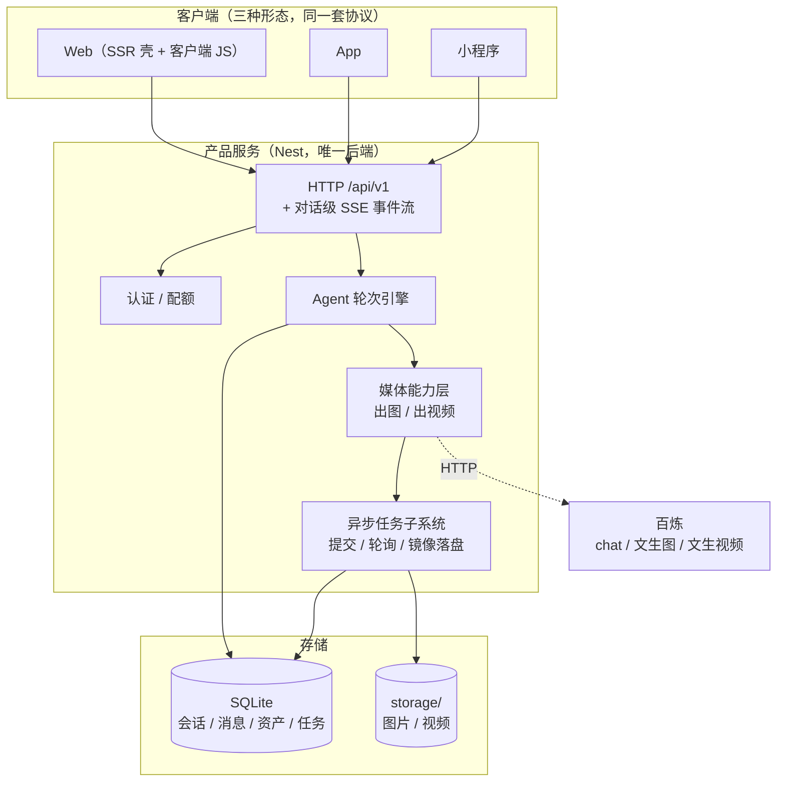

# kestrel-studio 产品扩展规划

> 本文只回答一个问题：**要往哪走**——能力扩展、多端形态、内核选型与分期。
> 与 [architecture.md](./architecture.md) 的分工：那份描述系统**现在是什么**且很少变动；
> 这份描述系统**将变成什么**，会随讨论频繁改写。

## 1. 分期

一期已完成并上线（登录 → 单会话 → 文生图 Agent 循环 → SSE 流式渲染 → 预览下载）。
原定的二期「多会话历史管理、视频工具」中，**多会话历史管理已随一期落地**（历史会话侧栏、
会话列表接口、SSR 历史回放均已验证）；其余被 §2 的产品扩展设计修订，修订后的分期如下。

| 期 | 内容 | 理由 | 现状 |
|---|---|---|---|
| 一 | 上述一期内容 | 已完成 | 端到端已验证（[verification.md](verification.md) §2） |
| 二 | 抽出 `/api/v1` + 对话级 SSE（含断线续传）+ 三模式 | 直接服务多端目标，不依赖内核决策，做完不返工 | **已全部落地**（2026-10-21）：三模式早先完成；`/api/v1` + 提交/订阅分离 + `seq` 续传见 [architecture.md](./architecture.md) §4.2，实测证据见 [verification.md](./verification.md) §8 |
| 三 | 异步任务子系统 + 视频能力 | 独立子系统，与内核决策解耦 | **已落地**，见 `nest/server/src/task/` 与 `rust/server/src/task/`（提交即返回、后台轮询、成功即镜像、追加消息并推送）；端到端**已于 2026-11-06 在新链路上实测**——`视频` 模式在已有 c=11 提交，工具帧回 `Video task 3 submitted`，本轮立即结束，几分钟后 asset 19 无重载落到页面，库侧 `generation_tasks` 第 3 行 `kind=video status=succeeded asset_id=19`，逐条见 [verification.md](./verification.md) §23.3 |
| 四 | **语音会话**（独立入口 + 工具调用） | 与内核决策无关，走 §2.4.1 之外的一条独立通路。设计已迁至 [architecture.md](./architecture.md) §11 | **已落地**，本地与线上端到端实测均通过（[verification.md](verification.md) §4）——那句实测是 **Nest 时代**的。新链路上 2026-11-06 只证到 WS upgrade（`voice session opened conversation=13` → `voice call ended`，两次按下都 `frames=0`，§25.1），**真实麦克风采集待收，它就是 §4.4 P1 剩下的那一条**（§26.5） |
| 五 | 内核选型落地（保持 TS 增强 / 引入 Rust sidecar） | 前面各期完成后，内核的真实收益才有可比基准 | **已重估（2026-11-09，§2.2.1）：维持不引入**，改为按触发条件控制；那七条「经源码核实」的阻塞今天逐条重验，**全部仍然成立**，而三条新事实（本项目已换 Rust 宿主、两套后端长期并存要付同步税、上游 7 周 +12k 行使 fork 跟不上）只增加成本。反向的一条也记了：上游的编排层已经长出来了，所以门槛是**变低了，但还没到** |
| 六 | **语言迁移**：服务端改用 Rust（`rust/server/`） | 与第五期无关的独立变量：先换宿主语言，内核选型才有对照物 | **代码已落地**（2026-10-27），见 [architecture.md](./architecture.md) §13；**已接管交付链并上线**（2026-11-02，§4.4 与 verification.md §13）；离线对拍证据见 verification.md §9 |
| 七 | **Nest/Node 技术栈退役**（**2026-11-07 撤销退役部分**，改为双后端长期并存，见 §4.5）：服务端与 Web 客户端全部改 Rust（客户端走 Rust→WASM） | 六期把服务端迁完了，剩下的 Node 面只剩构建链与客户端；一期一期内核不掺和 | **决策已定**（2026-10-30，§4）→ **2026-11-07 变更**（§4.5）：`nest/` 不再是删除对象，**P4 取消**。已到位的部分不变——P2 已上线（2026-11-02）；P3 两个页面代码到位，模板切换早已不是缺口，`CLIENT_BUNDLE` 开关 11-03 实现（[verification.md](./verification.md) §17），线上档位自 11-03 13:23 起是 `wasm`（§20，11-06 13:58 重拨 §23.1）；P1 部分通过，§13.5 那五条只剩**真实麦克风采集**1 条（§26.5），而它现在只是 wasm 客户端自身的验收，不再是任何删除动作的前置 |

二期至四期无论内核如何选型都不会白做。

## 2. 产品扩展设计（2026-09-22）

一期上线后的扩展方向：从「单一文生图」扩展为**对话 / 生成图片 / 生成视频**三种能力，
并把 Web 从「唯一宿主」降级为**第一个客户端**，为 App / 小程序留出接入位。

### 2.1 已定的产品决策

| 决策项 | 结论 |
|---|---|
| 能力呈现形态 | 模式选择器 + 自动路由：默认可由模型自行判断走哪条路，用户显式选择时收窄工具集强制约束 |
| 会话与模式的关系 | 同一会话内可自由切换；模式是**每一轮的属性**，不是会话的属性 |
| 多端预期 | App / 小程序在明确规划内，按多端消费来设计边界 |

### 2.2 内核选型裁决：kestrel(Rust) 暂不引入

> **本节那七条「经源码核实」的依据已于 2026-11-09 逐条重验，全部仍然成立；评估与触发条件见
> §2.2.1。** 下面的原文按日期留着，是当时的事实与当时的账。

结论：**kestrel 可以作为内核，但当前引入是负收益。** 关键依据（均经源码核实）：

| 项 | 事实 | 影响 |
|---|---|---|
| 无历史灌入入口 | `SessionStore::prompt_items()` 零调用点；`Shared.history` 恒从空开始，只有 `Op::Turn`/`Op::Steer` 两个入口且都会触发采样 | 多轮对话直接做不了，必须改 kestrel 源码 |
| `Tool` 无 `description()` | `ToolRegistry::specs()` 无条件写 `description: String::new()`（`tools/mod.rs:199-208`） | 模型只能看到参数 schema，看不到工具用途，出图质量下降 |
| 事件流单消费者 | `AgentHandle::take_event_rx()` 是 take-once | 多端订阅要自行加广播层 |
| 回合结果不可 await | `op_loop` 丢弃 `run_turn` 的返回值，只能靠 `TurnComplete` 事件侧面推断 | 需自建 oneshot 层 |
| 无服务层 | 全仓库唯一 listener 是 `bus/rpc.rs` 的 `UnixListener`；`kestrel serve` 不是 web server，是拨号连 hub 的 worker，结果只回 `result_ref` **文件路径** | 需自写 800~1500 行 sidecar |
| 无动态工具注册 | `docs/design.md` §1 将「插件/扩展系统」列为**非目标**，工具写死在 `run.rs`/`serve.rs` 的 `vec![]` | 每加一个产品能力都要改 Rust 并重走宿主机 Docker 交叉编译部署 |
| system prompt 不可变 | `shared.system` 固定在 `EngineConfig` | 三模式要换提示词，又一处补丁 |

进一步的模式性错配：

- **主产物没有通道**。`EventMsg` 中没有承载产物的位置，`ToolOutcome.content` 是回灌给模型的内容。
  一期里那个一等公民 `asset` 事件，在 kestrel 里只能塞进 `ToolUpdate` 的字符串走私——而媒体产品的**主产物就是资产**。
- **最值钱的部分用不上**。kestrel 的权限引擎与 Seatbelt 沙箱（约 2.5k 行，其最大工程量）全仓库只服务于
  `bash` 子进程（`tools/bash.rs:88` 是 `Sandbox::wrap` 的唯一调用点），本产品一行都用不到。
  （附带结论：**纯 Rust 原生工具走 `reqwest` 不受网络策略约束**，若真要引入，出图工具无需动沙箱。
  该结论由调用点反推得出，**尚未实机验证**。）

可作为正收益引入的时机：当产品的 Agent 复杂度上升到需要**星型多 Agent 编排**（如策划 Agent + 出图 Agent +
质检 Agent）时——那才是 kestrel 的形状。见 §2.6。

### 2.2.1 2026-11-09 重新评估：裁决维持，理由改写

上面那七条标的是「均经源码核实」，核实日期是 2026-09-22。而 `kestrel` 从那天到现在动了 **55 个提交、
45 个文件、+12,148 行**（现在 17,338 行）。所以这次不是重讲道理，是先回去看那七条还成不成立。

**七条全部仍然成立**，逐条回到当前源码：

| 09-22 的依据 | 11-09 重验 |
|---|---|
| 无历史灌入入口 | 仍成立。`session/store.rs:228` 的 `prompt_items()` **生产调用点仍为 0**（只有本文件 459/491 两处测试）；`core/ops.rs:22` 的 `Op` 现在多了 `Interrupt` 与审批回复等变体，仍没有「灌入历史」这一条 |
| `Tool` 无 `description()` | 仍成立。`tools/mod.rs:300` 仍是 `description: String::new()` |
| 事件流单消费者 | 仍成立。`core/actor.rs:195` 仍是 take-once 的 `Option<UnboundedReceiver<Event>>` |
| 回合结果不可 await | 仍成立。`core/actor.rs:257` 仍是 `run_turn(&sh, &task_token).await;`，结果不接 |
| 无服务层 | 仍成立。全仓库唯一的 bind 还是 `bus/rpc.rs:59` 那个 `UnixListener`，没有 TCP/HTTP |
| 无动态工具注册 | 仍成立。`cli/serve.rs:132` 还是 `tools: vec![...]` 写死 |
| system prompt 不可变 | 仍成立，形态更清楚了：`config/mod.rs:161 system_prompt(base)` 按 role 的 `prompt_file` 解析，是**会话级**配置而非**轮次级**——三模式换提示词仍要改源码 |
| 主产物没有通道 | 仍成立。`core/events.rs:86-140` 里 `ToolEnd.output: Vec<ToolContent>` 是回灌给模型的，没有资产事件；`harness/artifacts/` 是空目录 |

（第九条「沙箱只服务 bash」没重验：它不影响结论，而且真要引入也用不到。）

**三条 09-22 不存在的新事实，全部指向成本上升**：

1. **本项目换了宿主。** 11-02 起线上跑的是 `rust/server`，11-07 起 `nest/` 不退役、两套长期并存。
   「引入内核」当年要替换的东西是 Nest 的循环，**现在要替换的是 `rust/server/src/agent/` 那 1,095 行**
   （Nest 侧 778 行作为契约源也得同步——这一天刚刚为 `owner`/租约/`seq` 付过一次双端同步税）。
   收益没有增加，要动的面反而更明确了：那一千行今天没有一处让我们疼。
2. **fork 跟不上一个正在快速长的上游。** §2.6 的方案是「fork + 打四处补丁」。上游 7 周 +12k 行的
   意思是：fork 那天起补丁就要重新对线，而 §2.2 算的那笔「每加一个能力都要改 Rust 重编部署」的迭代税
   一条都没少。这条税当年便宜（它小、也慢），现在不便宜了。
3. **我们的事件面与它的不是同一个形状。** 我们有 `conversation_events` 持久 journal + 按会话 `seq`
   游标 + 断线续传（今天刚把它改成单语句分配 + UNIQUE 索引）；它是进程内 mpsc、单消费者、无扇出。
   引入 = 把这套 journal 建在别人的事件流上，而它连扇出这一层都还没有。

**一条反向的新事实，值得记下来**：`kestrel` 那侧的编排层**已经长出来了**——
`tools/orchestrator.rs` 332 行（串行 prepare → 并发 execute 带 RwLock gate → 源序收集 → 沙箱拒绝升级环），
`harness/roles/` 有 `qa` / `rd` / `sa` / `writer` / `verifier` 多角色与 policy、evidence 文件，还有
`cli/hub.rs`。也就是说 §2.2 那个「等星型多 Agent 编排出现再引入」的触发条件，**内核侧已经准备好了**，
缺的只是产品侧的需求。这跟 09-22 的状态不一样——所以这次评估的正确说法是
「**门槛变低了，但门槛还没到**」，不是「永远不」。

### 触发条件（把「暂不引入」从表态变成可复核的控制）

以下任一成立，就重开第五期评估，不必重新讨论那七条（它们只会被再验一遍）：

| 信号 | 为什么是它 |
|---|---|
| 产品出现**第二个 Agent 角色**（策划 / 质检 / 修图），且它们之间要互交产物 | §2.2 原定的唯一正收益时机；上游 `roles/` + `orchestrator.rs` 已备 |
| 需要**并行工具调用**（多路同时出图再汇总） | 我们的 `agent/tools.rs` 现在是串行循环；上游 orchestrator 已经解决这件事（RwLock gate + 源序收集）。**这条是本次新识别的** |
| 需要**审批 / 权限引擎**（用户级工具授权、危险操作确认） | 上游有 `ApprovalBoard` + policy json + `ApprovalExpired` 语义；自己写是几百行含并发正确性的代码 |
| 需要**上下文压缩与 token 账本** | 上游有 `Compacted` 事件与 journal/usage 记账，我们这边一条都没有 |

反向信号（出现则更该引入，而不是更该等）：`rust/server/src/agent/` 超过约 **2,000 行**（现在 1,095），
或出现**第三套**客户端。

**若届时要走**：§2.6 那份「最小引入形态」必须按今天的源码**重算**——其中「历史灌入」这一处现在可能比
当年便宜（`prompt_items()` 已经是现成的投影，只差一个入口），而 `serve-rpc` 那一层今天仍要从零写。
第 3 条（单个通用代理工具 `invoke_capability(name, args)` 回调宿主执行）**仍然是该方案成立的前提**，
今天再看更成立：它让媒体代码不出宿主，而 §2.2 那条「无动态工具注册」的迭代税一条没少。

**本次评估的结论**：维持不引入。§1 表里第五期的状态从「未开始」改为「**已重估（11-09）：不引入，
改为按上表触发条件控制**」。wire 层那条事实（kestrel 没有 openai-responses）没重验，但它属于「届时参考」，
不影响今天的判断。

### 2.3 目标架构

决定多端能否复用的**不是内核语言，而是产品 API 边界**。改造前的 SSR 单体没有这条边界：`POST /api/chat`
把整个 agent 轮次挂在一条 HTTP 连接上流式返回，移动端断网、切后台、被系统回收都会让该轮作废。
因此无论内核如何选型，都必须先把「发送」与「订阅」拆开。（本节目标形态已随二期落地，
实装见 [architecture.md](./architecture.md) §4.2。）



Web 只负责首屏骨架，其余全部走同一套 `/api/v1`；App 与小程序将来接的是同一套端点，产品逻辑无需重写。

### 2.4 三个必须做的变更

#### 2.4.1 轮次级 SSE 改为对话级 SSE ——已落地（2026-10-21）

结论与设计已移入 [architecture.md](./architecture.md) §4.2（事件表 §6、日志表 §5）。
实装与本节草案的三处出入，以 architecture 为准：

- `seq` 落在新表 `conversation_events`（会话内自增，每条事件一行）而非
  `messages.seq`：续传游标要盖住增量、工具调用与后台事件，不是只数消息。
- `202` 回的是 `{conversationId, messageId}`，`messageId`（助手占位行）就是
  turn 的身份——不另造只有服务端认识的 `turnId`。
- 额外两条语义：会话已有轮次在跑时提交吃 `409`（防重复计费）；游标低于
  保留窗口时回一帧 `resync`，客户端从落库行重建而不是吃半个回放。

#### 2.4.2 异步任务子系统

视频能力强制需要。已实证的两条硬约束：参考实现（`playground/bailian-media-mcp`）的视频流程是
**最长 240s 的阻塞轮询**（间隔 8s）；且**供应商返回的媒体 URL 是短时效的**，错过成功那一刻就再也取不回。
另有两条产品级缺陷需在自研实现中修正：任务 id 不落任何服务端存储（客户端丢失即永久丢失），
以及**无幂等**（客户端超时重试会重复计费生成）。

流程：

```
generate_video 工具 → 提交 provider 任务 → 立刻返回 task_id（不阻塞本轮）
                    ↓
              落 generation_tasks 表（status=queued）
                    ↓
        后台 worker 退避轮询 → SUCCEEDED → 立刻 fetch 字节镜像到 storage/
                    ↓                              ↓
              写 assets 行 + update task        （provider URL 就此抛弃）
                    ↓
        向该会话的 SSE 流推 task_progress / task_completed
```

要点：

- **Agent 那一轮在提交后立即结束**，不等待渲染。视频完成时由服务端往会话里**追加一条新的 assistant 消息**并推送。
  用户关掉页面再回来，任务照跑，回来能看到结果。
- `status` 用显式枚举落库，不得沿用参考实现把 `task_status` 当裸字符串的做法——它把「仍在跑」与「永久失败」
  都编码成人类可读文本，客户端只能靠字符串匹配区分。
- 媒体字节必须在成功那一刻镜像到 `storage/`，**不可把 provider URL 当持久引用**（一期 `assets.source_url` 保留，
  但仅作审计，明确不再取用）。

#### 2.4.3 模式按轮次而非按会话

`mode ∈ {auto, chat, image, video}`，存在该轮的记录上，历史回放时按轮次渲染。模式决定
**该轮暴露的工具子集** + **系统提示词片段**：

| 模式 | 工具集 |
|---|---|
| `auto` | 全部，由模型自选 |
| `chat` | 零工具 |
| `image` | `generate_image` |
| `video` | `generate_video` / `get_video_task` |

显式模式的作用是让扣费可预期——`auto` 下用户无法预知这一轮会不会生成。这条在 TS 里是每次请求组装
instructions 与 tools 的一行代码，在 kestrel 里则要改 `shared.system` 与工具列表两处写死点，是内核选型的缩影。

### 2.5 数据模型增量

一期 `users / conversations / messages / assets` 基本沿用，增量：

| 表 | 变更 |
|---|---|
| `messages` | 加 `mode`（该轮能力）**已落地**；原规划的 `seq` 改为落在 `conversation_events.seq`（见 §2.4.1 的落地备注） |
| `conversation_events` | 新表（2.4.1 落地时）：`id, conversation_id, seq, message_id, type, payload, created_at` |
| `generation_tasks` | 新表：`id, conversation_id, message_id, user_id, kind, provider_task_id, model, prompt, params(json), status, attempts, error, asset_id, created_at, started_at, finished_at`（落地时字段略有调整，以 schema.ts 为准） |
| `assets` | 加 `task_id` 反查；保留 `source_url` 但仅作审计 |

### 2.6 回归路径：若日后引入 kestrel

若届时要走 Rust 内核，最小可行形态：

1. fork kestrel，打四处小补丁：`Tool::description()`（约 10 行）、历史灌入构造器（约 40 行）、
   事件广播扇出（约 30 行）、回合完成 oneshot（约 30 行）。
2. 新增 `serve-rpc` 子命令：在 UDS/HTTP 上暴露「会话 → `AgentHandle`」映射 + NDJSON 事件流。
3. **产品工具不使用原生 Rust 实现**，改用单个通用代理工具 `invoke_capability(name, args)` 回调宿主执行。
   这样媒体代码不出 Node，新增能力只改 Node，规避「无动态工具注册」的迭代税，资产通道也天然留在 Node 侧。

第 3 条是该方案能成立的前提，否则 §2.2 的账全部成立。

wire 层对接事实（供届时参考）：kestrel 只有 anthropic-messages 与 openai-completions 两条 wire，
**没有 openai-responses**——一期 chat 用的正是 Responses API，迁移后须改走 openai 兼容面。
百炼 Token Plan 主机同时提供 `/compatible-mode`（openai）与 `/apps/anthropic` 两个表面且凭据互通，
openai 面须置 compat 位 `stream_include_usage = true`，否则全程 `usage: null`。

## 3. 当前待办

- **2026-11-09 启动收尾的 owner 规则已在活库上实测关闭**（两次 `docker compose restart`，读数在
  verification.md §33）。局面是三行空占位并存：`owner='nest'` 的新鲜行、`owner IS NULL` 的新鲜行、
  `owner IS NULL` 过期 6 分钟的行，外加一行 `owner='rust'` 的**真在飞轮次**；两次重启都 `abandoned=1`，
  抓的分别是「过期无主行」和「自己的那行」，合成那两行两次都没被动。被杀那一轮的页面在**没有刷新**
  的情况下自己解锁（`turn_error` 靠 `Last-Event-ID` 重放送达）。
  测试数据已清（会话 17 整体是测试产物；超管账号没有删除入口，所以按 id 精确删），
  库回到 16 会话 / 6,827 行事件、空占位 0 行。

- **2026-11-09：三处写的所有权改造已上线 Rust 侧**（`make deploy` 09:49 + 重拨 `wasm`）。活库的迁移
  走的是温和路径：预检查出 **0 对重复 `(conversation_id, seq)`、0 个空占位、0 个非终态任务**，所以只
  补了三列 + 把游标索引换成 `CREATE UNIQUE INDEX`，一行数据都没重编号，启动日志零 ERROR/WARN。
  浏览器那一屏（会话 17 一句话）回来之后，库侧证据是：新两行 `owner='rust'`、该会话 journal 21 行
  `seq` 1..21 不重不漏、终态帧是 `turn_done`、控制台 0 条。逐条读数在 verification.md §32。
  ~~**仍未闭合的是并行本身**（下面那条）~~ 同日已闭合，见 verification.md §34。

- **2026-11-08「点新会话后刷新又把上一条会话画回来」已修并已上线复跑**。不是缓存：`GET /` 在
  `?c=` 缺失时回落到「最近更新的那条」，而 §22.3 那次修复把地址栏改成裸 pathname——删掉 query 表达
  不了「空舞台」，它表达的正是「我最近那条」。现在两端都认 `?new=1`（architecture.md §4.1），两个
  客户端把地址栏写成 `pathname?new=1`（根因与判据 implementation-notes.md §23，质量门读数
  verification.md §29）。17:58 那次 `make deploy` + 重拨 `wasm` 之后照 §29.2 那两步在同一条浏览器
  路径复跑过了：刷新停在 `/?new=1`，空舞台发一句话改写成 `/?c=15` 并回放，控制台零条。它不在
  §13.5 那五条 P1 判据里，也不是任何删除动作的前置（P4 已取消）。
- **2026-11-07 策略变更：不退役 Nest，双后端长期并存**（§4.5）。P4 取消，`nest/` 一行不删也不再是
  待删对象。三个待定项同日都定了：入口形态 = ~~**按子域反代、各占一个宿主端口**~~（不是按路径分，原因
  写在 §4.5 与 deployment.md §1.1；**该形态已于 11-09 撒销——没有第二个子域，第二套不对外**）；
  Nest 侧**访问日志已补并在宿主机跑通**（`common/access-log.ts` +
  `ACCESS_LOG=1`，deployment.md §2.3、verification.md §28.3）；双进程共用同一个 SQLite 的那次实测
  **做了一半**——镜像与单容器已在宿主机验证（§28），并行没测，而且已经测出一处 Critical
  （**并行那一半已于 11-09 补上，Critical 已修并实测，见 §34**）。
- **~~第二后端现在不能接活库~~ 已解除（2026-11-09 并行实测通过，verification.md §34）**。这条原本是
  §4.5 落地过程中查出来的，逐条证据在 [architecture.md](./architecture.md) §13.2「四处没有进程所有权的
  写」。给那三件事加上所有权之后，两套在宿主机上**同时跑同一份 SQLite 文件**已在库副本上实测：
  第二次启动的迁移幂等、两个进程并发写下每个会话的 `seq` 仍连续且全库零重复、对方真实在飞的轮次不被
  收尾、新鲜外来租约跳过 / 过期租约接管。**活库上同时挂两套仍然没发生过，但挡着的已经不是判据而是
  入口**：下面那条 openresty 第二个 server 块 + 每套自己的 `PUBLIC_BASE_URL`。逐条改造：
  1. ~~**启动收尾**要认 owner~~ **已修（2026-11-09）**：`messages.owner`，三条插入路径写本套身份
     （`rust` / `nest`，每套后端一个值），收尾谓词「自己的无条件、对方的不碰、无主的等 5 分钟」。
     原方案那句「且 `created_at` 早于 N 分钟前」收窄到了无主行上——对自己的行加时间下界会毁掉
     verification.md §26 那条已上线实测的恢复（提交一轮 → 中途重启 → 页面自己解锁）。
  2. ~~**任务 worker** 要 claim~~ **已修（2026-11-09）**：`claimed_by` / `claimed_at` 租约，worker 在任何
     provider 调用之前用一条条件 UPDATE 认领，`changes()` 不为 1 就跳过。**没采纳**原写法的两处：
     不加 `status='claimed'`（要牵动 `active()`、线类型 `TaskStatus`、页面标签表，且崩溃时正持有的行会
     掉出队列），不在 claim 里递增 `attempts`（它计供应商失败、驱动 `MAX_MIRROR_ATTEMPTS`，而租约每 8s
     续一次）。理由见 implementation-notes.md §24。
  3. ~~**journal 要单一写入者**~~ **已修（2026-11-09）**：`seq` 算在写语句自己身上
     （`INSERT … SELECT COALESCE(MAX(seq),0)+1 … RETURNING seq`，单条写语句先取写锁再执行），
     `idx_events_conversation` 由启动迁移改成 UNIQUE，迁移先把重复行挪到该会话编号末尾（那些行本来
     就被 `seq >` 挡着、对任何读者都不存在）再 drop/create，失败打 `ERROR` 但不拒绝启动；DDL 里刻意
     留普通索引。publish 带 3 次冲突重试覆盖发布窗口。
  - 第四处（每会话单轮的锁只在进程内存）由**入口按子域固定**这条决策来挡，不需要改代码；但它是
    固定入口真正的理由，不是偏好。
  - **三处改造只是把「已知会坏数据」变成「待实测」**。两侧仍从没同时对着同一个文件跑过：下一步是
    在宿主机拿 `.backup` 的库副本把两套并行起来验（§28 那次只做了一半），过了才谈得上 `make nest-up`
    接活库。质量门读数在 verification.md §31。
    **已做（同日，verification.md §34）**：`make deploy-nest` 重建带本次改动的 Nest 镜像，两个一次性
    容器（`127.0.0.1:8850` / `:8851`）共享同一份 `.backup` 副本与同一份 `storage/` 副本，四组断言全过，
    拆场后生产库读数与 §33.4 逐个相同。**剩下的待办因此只剩入口那两件**（下面那条 openresty 与
    `PUBLIC_BASE_URL`）。
  - **顺带把 §13.2 第 4 条的后果也测了**：同一会话让两套各提一轮，两个 POST 都是 202，而 journal 不坏
    （`seq` 连续、两个 `turn_done`、零 collided/busy/UNIQUE 痕迹）——这条暴露的只有钱，不改代码的决定
    不变。
- ~~openresty 那个新 server 块与第二个子域的 DNS 记录仍是待做的运维动作（deployment.md §1.1 那两件
  配置项）。子域名叫什么、走 `*.try.*` 还是新记一条 A 记录，要你定。~~
  **已定（2026-11-09）：不需要第二个子域，也没有第二个子域。** 这直接撒掉了 §4.5「同日定下的三件」里的
  第 1 件（对外形态 = 按子域反代），以及 deployment.md §1.1 那两件配置项。**后果不是「双后端不能上线」
  而是「双后端只有一套对外」**：cookie 的归属不看端口（RFC 6265），路径分又会互盖签名（verification.md
  §27.1），所以除了另一个 host 没有隔离手段，而没有它——`make nest-up` 从此只是宿主机内部动作，
  **不接真实用户流量**。§13.2 第 4 条的护栏因此从「路由固定」变成「第二套不对外」，反而更强。
  要复现两套并跑照 verification.md §34（库副本 + 两个 127.0.0.1 端口），不必也不应挂 `./data`。
- ~~红隼 logo 目前是占位 SVG（`nest/client/public/logo.svg`），待替换为正式图片。~~
  **已换并已上线（2026-11-09 12:43 那次 `make deploy`，读数在 verification.md §39）**：
  侧影隼头，几何构造（正圆的头 + 楔形喙 + 底色挖空的眼与颊纹），
  沿用品牌两色，一个 viewBox 服务 favicon / 顶栏 32 / 登录页 56 三处。判据是**把真实文件挂到本地页面
  在 Chrome 里看**（四档尺寸 × 白 / 深 / 米三种背景），不是看代码——前四轮就是栽在只看代码上。
  为什么最终选几何构造而不是自由曲线、以及那四轮各长出了什么，记在 implementation-notes.md §29。
  文件 1118 字节（占位版 294），理由挪进了台账、文件里只留指针。**这是手写标记，不是设计产出**：
  它满足「认得出红隼、16 px 不糊」，品牌层面的判断仍该由人做。
- 对话页有 1 条 Chrome *issue*：`Lazy-loaded images should have explicit dimensions`，来自 SSR 回放
  那一段 `loading="lazy"` 的资产 ``——线上出自 `rust/server/src/view/templates.rs:209`
  （`turn()`，由 `view/tests.rs:209` 钉住），`nest/server/src/view/views/partials/turn.hbs:39` 是它的
  契约源，两条同形。2026-11-06 按源码补一条边界：**只有回放路径会命中**——两个客户端拼流式 DOM 时
  都不带 `loading` 属性（`nest/client/scripts/main.ts` 全文无 `loading`，`rust/client` 的
  `append_asset` 也不设），所以它只在刷新回已有会话那一屏出现。不是错误也不是警告，属既有代码。
  ~~要修得先知道图片尺寸，而尺寸由模型选，暂无好办法，先记着。~~
  **那句"暂无好办法"是没去量过的推断，已推翻（2026-11-09）**：尺寸一直在落盘字节的头部里。
  现在 `assets.width/height` 两列由两侧探针（`media/dims.rs`、`media/image-dims.ts`）在 `store()`
  时读一次，`AssetView` 带上线，模板与两个客户端**成对才输出**属性。
  为什么不能用请求里的 `size`：生产 19 张图逐张对撞过，一张请求 `1024*448`、供应商返回
  `1536×640`（它会吸附尺寸），照请求值写就是错宽高比的盒子，比要修的跳动更糟。
  测量、判据与门读数在 verification.md §40，坑在 implementation-notes.md §30。
  **已上线（13:51 那次 `make deploy`，§42）**：`assets` 两列补上，启动回填把既有 **19/19 张图**
  全部填出尺寸（分布与 §40 那次独立测量逐档相同），旧行的 `` 现在也带盒子。
  旧行也不会一直留着 NULL：**启动时有一趟有界回填**（两侧各 500 行/趟、只选
  `width IS NULL`、读不出继续留 NULL），设计、被测试纠正过的那处理解（unreadable 每趟会重试）
  与门读数在 verification.md §41。这次上线它确实跑了，但那条 `backfilled pixel dimensions …`
  日志没留下来（`make deploy` 起一次、重拨档位又起一次，`docker logs` 只剩当前容器），
  证据取的是库里的 `filled=19`——要复现日志行得单独重启一次容器。
  **但这条待办不能算"issue 消失了"**：DevTools 那条计数仍报 count=2，而实测布局偏移是 **0**
  （未下载完的图已经占着 758×758 的盒子）。判据换成 `layout-shift`，别再拿这条 issue 当这个缺陷的
  度量。为什么属性到位了它还在报：**不知道**——我先前那个「CSS 覆盖让启发式不给分」的解释
  已被实验推翻（撤掉覆盖、让属性真正决定尺寸，count 仍是 11），实验与两条硬观测写在 §42.3。
  `/admin` 那一屏也补上了：11 张懒加载图全部带尺寸、滚动到底布局偏移 0（§42.5）。
  2026-11-06 下午在新链路上量到了实际条数：产品页 c=11 是 **count=2**，只读回放页
  `/admin/conversations/3`（11 个资产）是 **count=11**——与"只有回放命中"的判断一致（verification.md §23.5）。
- 语音的遗留项（设计与已落地的部分见 [architecture.md](./architecture.md) §11）：
  - **WS upgrade 已经在新链路上跑通**（2026-11-06 17:07，操作者亲按；verification.md §25.1）：
    `voice session opened conversation=13` → 两次 `voice turn committed` → `voice call ended`。
    **但两次都是 `frames=0`**，上游回 `buffer too small, or have no audio`——`capture.js` 是 43 ms
    一帧，正常按住 1.2 秒该有约 27 帧，所以音频一字节都没到服务端。最可信的解释是首按正好撞上
    权限框（`getUserMedia` 在提示期间不产出）；现在权限已 `granted`，**再按一次**就该看到 `frames>0`。
    所以这条遗留项**仍未关闭**，而且只剩"人再按一次"这一件事——合成 `pointerdown` 会在权限已授的
    前提下悄悄开麦把环境声送进外部 ASR，那不该由 Agent 代做。
  - **一条相关缺口已修并已上线（2026-11-09 11:37 那次 `make deploy`，§37）**：`voice_core::release()` 原先不知道"这一按有没有
    产出过帧"，静默按住也会 commit，由上游拒绝。现在两端核心各记一个每次按住归零的帧计数，
    计数为 0 时 `release` 与 25 秒上限两条路都**不提交**，改为闭合这一按并给用户一句说明
    （两套同一句话）。`abort()` 那条路不变。断言：rust client 42 passed、nest client 52 passed、
    wasm32 check 干净——逐条见 verification.md §35。改它不需要域名也不需要人按键，但**要上线得等
    下一次 `make deploy`**（本轮没构建 wasm、没部署、没在浏览器里真按过）。
    **那次部署已发生**：11:37 上线后从线上取回 `/wasm/kestrel_client_bg.wasm` 与 `/assets/voice.js`，
    两个包都命中新那句提示（§37.1）。**但守卫那条路径本身仍未在浏览器里走过**——那要真实按住，
    归在上面那条"人再按一次"里，不由 Agent 代做。
  - **~~待决定的一条~~ 已修并已上线（2026-11-09 12:43，§38 改动、§39 上线）**：
    两套渲染器对**原始 HTML** 的策略不同——
    `marked` 默认把助手文本里的 `<div>` 之类原样放进 DOM，`kestrel-md` 一律转义。助手文本由模型
    产出，模型可被提示注入，所以那是两套在线后端之间的一处 **HTML 注入面差异**，不是样式差异。
    现在 Nest 那套的 markdown 出口收进 `nest/server/src/common/markdown.ts` 与
    `nest/client/scripts/markdown.ts`（两份手抄同步，中间那根线是逐字断言，见 verification.md §38.2），
    三个 `marked.parse` 调用点全走它。门：nest server 487 条、nest client 56 条、tsc ×3 全过；
    逐构造复测从「一致 9 / 分歧 9」变成「**一致 11 / 分歧 8**」，关掉的两条正是行内与独立成段的
    原始 HTML（§38.3）。
    **当初写的修法（覆盖 `tokenizer.html`）是错的**，实测不成立——marked 18 里返回 `false` 的含义是
    回落到默认实现；生效的是 `renderer.html`。纠正与理由在 verification.md §38.1 与
    implementation-notes.md §28。
    剩下那 8 类是「子集不支持 vs marked 照渲染」的**产品口径**差异（§4.1.1 定的取舍），不是注入面，
    要关得逐构造再谈一次口径。
  - **打断（barge-in）已落地（2026-11-09），但未在浏览器里走过**：上一句还在播时再按住，
    页面立刻静音 + 发 `cancel`，中继转成上游的 `response.cancel` 并当场收尾那一轮。
    判据、三方职责与那条「无推理可取消时上游回错误」的出处在
    [architecture.md](./architecture.md) §11.6；门读数与**它没验到的部分**在
    [verification.md](./verification.md) §43。它和那条「人再按一次」是同一件事：一次真实按住
    同时收两条——守卫那条路（§35/§37）与打断这条路。
    **14:45 已随 `make deploy` + 重拨 `wasm` 上线**（§43.5）：那份包被真实浏览器下载并初始化了
    （`/voice` 只加载 wasm，控制台 0 条），但「按下即静下来」仍只有单元读数——它等的是同一按。
  - **一条被打断放大的旧洞已修并上线（2026-11-09 14:55 修好，15:04 上线）**：中继收尾在
    「那一轮没有占位行可写」时是**早退**的，连 `done` 都不发。原先的后果只是「按钮整通电话禁用」，
    而打断引入的延后 commit 让同一洞变成「用户那句盖上去的话永不提交、页面静音窗口永不解除」。
    修法是一条谓词 `closing = busy`：只有确实有一轮在跑，才有权宣布它结束——与「一轮的连续失败
    只发一行错误」同形。因果链、为什么改的是那条既有断言、红绿读数都在
    [implementation-notes.md](./implementation-notes.md) §33 与 [verification.md](./verification.md) §44。
    **同一个洞的邻支一并关了**：`dispatch_pending` 在没有行可归档时也是「丢掉调用 + 不结轮次」，
    两套同改；那条断言是先修后测的，所以红灯靠临时撤掉修复取了一次（§33 里写明了顺序）。
    **纯服务端**：两套客户端一行未动，15:02 那次 `make deploy` 照旧重跑了 `build-wasm`，
    产出的包与 §43.5 那份**逐字节相同**（md5 `cf246955e7aa…`）——上线读数在 §44.4。
    14:45→15:04 那段窗口里线上不带这个修复，但同期 `voice session opened` 0 条，没有实际暴露。
  - **顺带量到的一条既有行为（读码，非运行）**：第一次按住之后麦克风并不关。松手提交后，
    worklet 的每一帧仍照发 `{"type":"audio"}`，中继也照 append 进上游的输入缓冲——直到上游
    拒绝（`blocked` / `refused`）为止。两套同形（`voice_core::audio_chunk` 只看 `blocked`
    不看 `holding`；`nest/client/scripts/voice.ts` 的 `onmessage` 只看 `blocked` 与 `ready`）。
    于是两轮之间的环境声会进了下一次提交。这条**没改**：一是它不在本次范围内，二是它正好是
    打断能盖话的原因（按下之前那句话已经在缓冲里了）。要不要在松手时收麦，是个产品口径，
    要你定。理由与逐条定位在 [implementation-notes.md](./implementation-notes.md) §32。
  - **空闲保活未做**：上游 180 秒无响应即关闭会话（close code `1007`），现由客户端提示
    "再按一次继续"并重新取票重连——重连后上游上下文重置。
  - **并发通话数已评估（2026-11-09，读数在 [verification.md](./verification.md) §45）：第一个约束不是带宽**。
    每通话双向各 ~64 KB/s（base64 后的 PCM16 单声道 24 kHz；§4.1 线上实拨 48 KB/s 推流
    `bufferedAmount` 峰值仅 1305 字节，无积压），而宿主机**服务出网**今天实测冷连接单流
    **1.9 MB/s**、浏览器 h2 四路并行**聚合 ~5.9 MB/s**——按这两个数除，先撞的不是链路。
    剩下三个候选，只有第三个是我们能改的：
    1. **上游那个账号的 realtime 并发配额**——未知，不压测就不知道（这也是这条待办真正没关掉的部分）；
    2. 宿主 **2 vCPU / 3.6 GB**，同机还跑着另外四个生产容器与 1Panel，而 `docker-compose.yml`
       **没给容器设 `cpus` / `mem_limit`**（今天空闲：load 0.00、容器 RSS 2.7 MiB）；
    3. **中继里有一条无界队列**：到浏览器的出站队列只有 64 帧，满了之后 `send().await` 卡住会话任务，
       而上游事件通道是 `unbounded_channel`（`upstream.rs`）——于是一个卡住或极慢的浏览器会把
       **每通话的内存往上顶**（按 64 KB/s 约 3.8 MB/分钟，一轮回答多长就顶多长）。
       要不要收窄、封顶多少帧、溢出时是丢音频还是收掉通话，是设计决定，**等你定**。
    评估过程顺带纠正了一条被引用错方向的老读数（原「出站 65 KB/s」实为「服务器自己去公网下载」），
    教训与那两条相差 10 倍的同文件读数都记在 [implementation-notes.md](./implementation-notes.md) §34。
- **多账号与超管**：代码完成、本地实测、**线上已上线**（[verification.md](verification.md) §5、
  [deployment.md](deployment.md) §8）。`role` 补列与超管账号的创建都发生在**进程启动时**，
  所以本机那个常驻的 pm2 实例要等重启才会出现 `/admin` 与超管账号。
- 后端链路与前端控制台均已实测，本地与线上均通过，详见 [verification.md](verification.md)。
  注意这条说的是**功能面**（Nest 时代验的）；服务端的宿主语言此后换过一次，见下两条。
- **线上已是 Rust 服务端**（2026-11-02 13:24 接管，当天共三次部署）；**盘上在跑的是 11-03 13:21
  那版**——客户端修复版，机器证据见 [verification.md](verification.md) §20。2026-11-06 复核：容器
  仍是那一次 `up -d`，三天没有新部署。镜像 10.2 MB 的 `scratch`，`make deploy` 先跑 `build-linux`
  再跑 `build-wasm`。
  已过与未过的判据逐条列在
  [verification.md](verification.md) §13.5：**出图 / 视频任务 / 语音 / `/admin` 内容 /
  SSE 断线续传 / 浏览器控制台零噪音仍未在新链路上实测**。
  **2026-11-02 决定：这轮不补这些走查**（要登录态、要真人，不在当前排期里）。它们因此是
  「已知且接受的未验证」，不是待补的遗漏；要补的时候照 verification.md §13.6 末那份清单执行，
  取证工具（DEBUG 访问日志）已经在线上。
  **2026-11-06 这批已补完（除一条）**：出图、视频异步任务、`/admin` 内容与只读回放、SSE 断线续传
  （含断开期间的缺口回放）、控制台零噪音，全部在新链路上实测通过——证据见 verification.md §23、§25.1、§26。
  **只剩"真实麦克风采集"一条**，因为它要人亲自按一下。
- 切换的代价按预测发生了一次：**cookie 的签名口径不同（同 HMAC-SHA256，被签的字符串一个含 `s:`
  前缀一个不含），切流当天全员被登出**——细节与线上表现见 [verification.md](verification.md) §13.4。
  只要这条口径再变一次，代价就会重现，所以切流前必须告知使用者，别让它再变成意外。
  方向还不对称：Nest 读不懂 Rust 写的 sess 行，所以**回滚也要登出一次**（§4.3 的 P2 行）。
- **P3 的切换开关已就位，且现在拨在 `wasm` 灰度档**（2026-11-03 10:57 首次拨档、13:23 带修复再拨；
  `nest` 仍是代码默认与 `make deploy` 的默认，两次的机器证据见 verification.md §18 与 §20）：`CLIENT_BUNDLE=wasm` 让 `/` 与 `/voice` 改加载
  `public/wasm/` 那份客户端，`nest` 是原样。开关是**部署配置**，所以一次 `docker compose up -d`
  就能切、去掉变量就回滚，不用重新构建或部署；机制与四条性质见 deployment.md §2.2，实现与未验证
  项见 verification.md §17。灰度已跑过一轮：一整轮对话在真实浏览器里走通（§18），报回的「新会话」与
  Enter 两条回归已修并随 13:21 那次部署上线（§19）。**2026-11-06 只读复核**：档位仍是 `wasm`，
  修复版包被真实浏览器全新下载并执行过，但拨档到复核时 `POST /api/v1/...` 与 `stream` 各 0 条——
  「Enter 发送」从没被按下过（逐条时间轴见 verification.md §21）。
  **同日已经跑完这一轮**：用 chrome-devtools MCP 在真人登录态的浏览器里走完十项清单（证据与
  逐条返回值见 verification.md §22）。**通过**：控制台零噪音（5 次导航全零条）、Enter 发送、
  Shift+Enter 换行、历史抽屉刷新、`/voice` 的 `initVoice` 首次执行到底。**不通过**：客户端把
  `dataset()` 的键写成属性的 kebab 拼法，六处恒为 None，导致「已有会话里提交会新建会话」与
  「已有会话首屏根本不订流」两条坏功能；「新会话」按钮也仍没给出空舞台（服务端把无 `?c=` 的请求
  回落到最近一会话）。三个修复提交已在本地（`9a5d7d3` / `f40f132` / `e33a017`，含一条静态护栏），
  质量门 `cargo test` 39 passed、`cargo check --target wasm32` 零 warning，**但尚未 build-wasm、
  尚未部署**——线上仍是坏的那份。
  **13:58 已部署并重跑**：三条修复在真实浏览器里全部复验通过，P1 又过了四条（出图、视频异步任务、
  `/admin` 页面内容、断线重连的**游标回放**那一半），下载弹窗的 canvas 重编码也首次上浏览器验过。
  现在只剩**语音真拨号**与 **`Last-Event-ID` 自动重连**两条。逐条证据见 verification.md §23。
  16:44 又补了一刀（§24）：`logging` 上限已加；浏览器自动重连确实带 `last-event-id`（16:44:24 那条
  请求头是 1181，服务端 `chat.rs:213-216` 优先读它、忽略同 URL 上的 `?from=0`）。**断开期间的缺口
  回放仍未测**——第二次尝试里那一轮跟着进程一起死了，于是顺带挖出下面那条新缺陷。
- **灰度取证的盲区已补并上线**（2026-11-02 16:18）：`router.rs` 挂了 `tower_http::trace::TraceLayer`，
  每请求一行 method + uri + status + latency，**级别 DEBUG**，所以默认的 `info` 过滤下一行都不打、
  生产日志量不变（线上实测：打了若干请求之后去色计数仍为 0）；开关是 compose 里的
  `RUST_LOG=${RUST_LOG:-info}`，用法与四条限制见 deployment.md §2.1，实现与测试见
  verification.md §13.7，ANSI 那个 grep 陷阱见 §13.8。开关已在宿主机拨档验过（`client=` 字段两个方向都对，见 verification.md §17），但走查本身
  当天决定不跑（见上一条与 §4.4 的 P1 行），所以它现在是排障手段，不是待办。
  注意 `/api/voice` 刻意排除在外（它是唯一劫持连接的路径，接管未上机验过之前不在它前面放碰
  response body 的件），这条排除有测试钉住。
- **取证档位忘了收回**（2026-11-06 核对）：线上 `RUST_LOG=debug` 还挂着，是 11-03 13:23 那次拨档
  带进去的。日志文件 16 MB / 2.8 天，json-file 驱动且没有轮转配置，31,840 行里 30,903 行（97%）
  是 sqlx 的 DEBUG 语句而不是访问日志。宿主机 `/` 还有 50 G 可用，不急，但它没有上限——deployment.md
  §2.1 第 4 条那句「只在走查的那几分钟开着，走完关掉」这次没被执行。收回且保留灰度 =
  `CLIENT_BUNDLE=wasm docker compose up -d`（重建容器、不登出任何人）。**未执行，等确认。**
  数字与顺带测出的扫描面见 verification.md §21。
  **2026-11-06 13:58 已关闭**：那次重拨灰度时故意不带 `RUST_LOG`，档位回到 `info`——新容器日志
  4.0 KB、五分钟窗口内 DEBUG 行计数 0（verification.md §23.1）。**但根因没除**：json-file 仍然没有
  `max-size` / `max-file`，下一次取证再忘收回，还是会一直长。要不要给它加轮转上限，是个独立的运维
  决定，写在 deployment.md §2.1。
  **同日 16:44 根因也关了**：`docker-compose.yml` 的 `logging` 段加了 `max-size: 10m` / `max-file: 5`，
  宿主机重建后核对 `HostConfig.LogConfig` 已带上这两个键（§24.1 与 deployment.md §2.1）。

- **服务端在轮次进行中被重启 → 页面永久停在「正在生成…」**（2026-11-06 实测，verification.md §24.4）：
  那一轮不会有终态事件（`conversation_events` 末尾停在 `reasoning`，没有 `turn_done` / `turn_error`），
  启动收尾虽然把空占位行写成「本轮处理失败：服务在轮次完成前中断。」，**但这条收尾不产生事件**，
  活着的连接收不到，只有重载页面才恢复。**两个客户端同形**（`main.ts` 的 `streamTurnRunning` 与
  `chat_page.rs` 的 `turn_running` 都只在 `turn_done` / `turn_error` 复位，没有看门狗），所以这不是
  wasm 回归而是既有缺口。倾向的修法：启动收尾时往 `conversation_events` 补一帧 `turn_error`——一次
  改动、两个服务端同步、且天然被重放路径带上；另一条是客户端加无终态超时后自动重载。**未开工，等定**
  （它不在本次批准的范围内，而且要两端同改）。
  **同日已按第一个方向修完（verification.md §25.2）**：`abandon_stale_placeholders` 改为返回被收尾的
  `(conversation_id, message_id)`，启动时对每一对 publish 一帧 `turn_error`——`rust/server`（`repo.rs`
  + `main.rs`）与 `nest/server`（`conversation.service.ts` + `turn-runner.service.ts`）两侧同改，
  测试同步（rust 侧断言日志末尾真的落下那一帧）。质量门全绿。**尚未部署**，验法就是重玩一次
  "提交一轮 → 中途重启"，预期这次 composer 自己解锁。
  **同日 17:26 已部署并实测关闭**：启动时 `finalized … abandoned=1`，日志落下 `1426|turn_error`，
  页面在**没有重载**的情况下自己解锁并显示出"服务在轮次完成前中断。"（verification.md §26）。
  这一测还顺带证明了缺口回放：那帧事件发布在服务端开始 accept 之前，客户端能收到它只能是
  重连时带 `Last-Event-ID` 被按游标重放的结果。

## 4. Nest 退役与 WASM 客户端（2026-10-30 决策；**退役部分已于 2026-11-07 撤销，见 §4.5**）

### 4.1 决策

目标：**仓库里不再出现 Nest / Node / npm 技术栈**。**这条目标已于 2026-11-07 撤销**（§4.5：双后端
长期并存，P4 取消）；本节以下按原样留着，是当时的决策与当时的证据。服务端由 `rust/server/` 接管（第六期），
Web 客户端由 TypeScript + Vite 改为 **Rust→WASM**（选型 B），markdown 改由
`pulldown-cmark` 承担。**2026-11-06 更正这行的最后一项**：`pulldown-cmark` 只是当时的原案，实测后
被换掉了——服务端 SSR 与浏览器现在编的是同一个共享子集 `kestrel-md`（`crates/md/`），体积账与理由见
§4.1.1 及 [verification.md](verification.md) §14；代码里两侧都依赖它，`rust/client/Cargo.toml` 的注释
明确写着不选 `pulldown-cmark`（多付 74 KB gz 换助手根本不写的语法）。

选 B 接受的代价，其中第一条在实测后被**推翻**（数字见 [verification.md](verification.md) §11.5）：

| 代价 | 结论 | 说明 |
|---|---|---|
| ~~首屏载荷涨 10 倍~~ | ~~不成立，实测持平~~ **现在约 6 倍** | 这行的「持平」在 2026-10-30 就被更正过一次（§12：真实语音页把模块推到约 85 KB gz），2026-11-02 对话页两项补完后复测为 **131.6 KB gz**（wasm 本体 + glue 约 142 KB gz），而现客户端是 `main.js` 18.2 + `main.css` 3.5 ≈ **21.7 KB gz**。历史数字 303 KB / 95 KB / 74 KB 仍不作数（wasm-opt 前的中间产物、`pulldown-cmark` 方案）。按用户判断体积不作为这个迁移的决策输入，但「持平」这个数字已经从近似真实变成彻底的假，别再引用它——总量见 verification.md §13.9，逐项归因见 §14 |
| JS 地板 | 约 20 行，**删不掉** | `AudioWorkletProcessor` 子类必须在 worklet 全局作用域 `registerProcessor`，那里跑不了 wasm 宿主。语音采集那小段 JS 只能作为静态资源入库（`public/capture.js`） |

真实代价改记为两条：一是**客户端从此没有类型检查与 jsdom 测试之外的运行时护栏**，
`cargo test` 只能覆盖与 DOM 无关的逻辑（这正是 `voice_core` 被拆成纯状态机的原因）；
第一条已在 2026-11-06 以它预言的方式兑现一次：六处 `dataset()` 键拼错，宿主测试与模板契约测试
都拦不住，只能靠真浏览器发现——细节与结构性护栏见 implementation-notes.md §19。
二是 markdown 换成共享子集后**语法面曾收窄**（缺 GFM 表格与删除线），2026-11-03 已补齐，见 §4.1.1。

### 4.1.1 两个开放项（均已关闭：一个用实测回答，一个已实现）

| 项 | 现状 | 决策点 |
|---|---|---|
| ~~GFM 表格与删除线~~ **已补并已上线（2026-11-03 10:18）** | 子集此前不含两者，而线上跑的是子集这一侧，所以助手一旦写表格就会显示裸竖线——差异已生效、未被触发（49 条消息 0 命中，§15）。现在补齐：`crates/md` +153 行（含注释）、断言在 `rust/server/src/view/tests.rs`、客户端包 **+2.1 KB gz**（131.6 → 133.7，§16） | **已关闭**。四条刻意与 `marked` 不同的边界写在 helper 注释里并由测试钉住：单列表格必须两侧围栏、`\|` 是单元格内竖线的唯一写法、未转义的竖线即使在代码串里也照样分格（参考实现同此）、多出的单元格丢弃而非凭空造列。不再有"两侧同改"这回事——SSR 与浏览器编的是同一个 crate。**哨兵已经挂成命令**：`make census`（本地库）/ `make census-prod`（线上，SQL 走
stdin、对端不落文件），脚本是 `scripts/markdown-census.sql`，口径与解释见 verification.md §15
| DOM 层的真实体积 | **已测**（2026-11-03，verification.md §14）：两个页面的 DOM 层合计 **110.5 KB gz**，占整包 131.7 KB gz 的 84%；共享底（markdown + 解析层 + 地板）只占 16% | **已按当时写下的方式处理：先看数字再谈退路**。数字是整包对现客户端整站 24.8 KB gz 的 **5.3 倍**。当初设想的退路"服务端吐 HTML、客户端不做 markdown"经实测**不成立**——省掉 markdown 只有 5.6 KB，还剩 126 KB；真要降体积，抓手在那两个各约 55 KB 的 DOM/音频层，不在渲染器上。按用户判断体积不作为这个迁移的决策输入，因此此项**关闭但不排降体积的工作**——数字留在那里，日后要反悔不必重新量 |

顺带修掉的一个长期风险：markdown 原本有**三处**渲染口径——Nest 服务端 SSR
（`nest/server/src/view/render.ts` 用 `marked`）、Nest 客户端（`nest/client/scripts/main.ts` 同一个
`marked`，这两处天然一致）、以及 Rust 服务端的**手写子集**。历史上这个边界出过一次问题（用户轮次
不该按 markdown 解析，提交 `e7b2911`）。

**2026-11-03 更正最后两句**：WASM 客户端接的是 `kestrel-md`（`crates/md/`），**不是
`pulldown-cmark`**——实测多付 74 KB gz 换助手根本不写的语法（§11.5 与它下面那条注解）。所以
"实时渲染与重载回放不一致"这一类缺陷在 Rust 这一侧已经结构上不可能（SSR 与浏览器编同一个
crate）；全站还剩 `marked` 那一套，等 P4 删掉 `nest/` 就归一。口径数从三降到**二**，不是降到一。
**2026-11-07 更正这行的后半句**：P4 已取消（§4.5），「等删掉 `nest/` 就归一」这条归一路径不存在了——
`marked` 那套是常驻的第二口径，两侧渲染不一致此后要长期按缺陷对待。

### 4.2 前置事实更正

`architecture.md` §13.1 的"开发机无出站网络"不成立（实测见 verification.md §10.1），
crate 可按需下载。所以本期的成本中心**不是依赖供给**，而是下面三件事：
Rust 服务端从未真跑、客户端要重写、部署镜像要换形态。

### 4.3 分期（判据不过不进下一期，P4 之前不删任何 Node 文件；**2026-11-07：P4 已取消，见 §4.5**）

| 期 | 内容 | 完成判据 |
|---|---|---|
| P1 | Rust 服务端第一次**真运行**（不在本机） | 本机禁止启动 Docker、禁止为本机起服务做测试，且仓库不保留 CI 配置（CLAUDE.md），所以判据只剩一个去处：**目标主机上的灰度实例**——与现有 Nest 容器并存、占另一个端口，跑通 `/login` 200、静态资源、SSE 续传、出图 / 视频任务 / 语音 / `/admin` 只读回放 + 控制台零噪音。需用户授权并人工执行。**取证边界（11-02 复核补，同日补访问日志后修订）**：写路径一直可正证——出图 / 视频看 `messages`+`assets`（视频另有 `generation_tasks`）的新行，语音看 `voice session opened` 日志与「语音会话」行；`/admin` 回放与 SSE 重放在 13:47 那版上**取不到**（服务端没有请求日志），现在可以看每请求一行的 DEBUG 访问日志（`RUST_LOG=debug`，见 verification.md §13.7 与 deployment.md §2.1；**16:18 已上线**，日志带 ANSI，grep 前先去色，见 §13.8）；控制台噪音任何时候都只在浏览器里，只能由操作者报告并单独标注。另：实际执行与本行设想不同——不是并存占另一端口，而是 compose 直接换掉镜像、Nest 容器被移除（回滚见 deployment.md §1.1） |
| P2 | 交付链换 Rust | 开发机构建静态 musl 二进制 → `FROM scratch` 运行镜像（服务器零下载，TLS 根证书已有 `webpki-roots`）；先确认宿主机架构；灰度前备份 SQLite 库；已知副作用：**cookie 的签名口径不同，切流时全员重新登录一次**——而且这个方向是不对称的（Nest 读不懂 Rust 写在顶层 `user` 的 sess 行），所以**回滚同样会登出一次**，见 verification.md §13.4 与 deployment.md §1.1 |
| P3 | 客户端 Rust→WASM | 装 `wasm-pack`（不能用 brew 的 wasm-bindgen CLI，版本 0.2.111 vs crate 0.2.129）；按页拆 `main` / `voice` 两个 wasm 模块；**语音帧序列逻辑与 DOM 分离**，使 `start`/`commit`/排队补发那组断言能在 `cargo test` 里跑（jsdom 测试要退役，而它正是抓住线上"永远停在正在连接…"的那个测试）；`AudioWorklet` 的 JS 留在静态资源里 |
| P4 | ~~删除 Node 栈~~ **已取消（2026-11-07，§4.5）**——原计划留在此处备查（`CLIENT_BUNDLE=wasm` 的灰度属于 P3，P4 仍要等 P1 整体通过） | 原清单：`nest/server/`（整棵树，含自己的 `package.json` 与 `vitest.config.mts`）、`nest/client/` 的 TS 面（`scripts/`、`styles/`、`__tests__/`、`package.json`、`tsconfig.json`、`vite.config.mts`、`vitest.config.mts`，**留下 `rust/client/`**）、根的 `package.json` + `pnpm-lock.yaml` + `pnpm-workspace.yaml`、Makefile 的 Node targets、Dockerfile 的 node 阶段。**这些现在全部保留**，删除动作没有任何排期 |

P3 的 DOM 契约测试要同步改：现有 Rust 测试从 `nest/client/scripts/main.ts` 解析
`requireElement` 得到 17 个 id 来反向钉模板；客户端变成 Rust 后，这份清单应从
Rust 客户端源码本身取得，跨语言解析那层可以去掉。

### 4.4 进度（2026-10-30 定档，P1/P2 于 2026-11-02 更新）

| 期 | 状态 |
|---|---|
| P2 | **已实装并上线**。交叉编译：`make build-linux` 产出 9.2 MB 的 `x86_64-unknown-linux-musl` 静态 ELF；`Dockerfile` 换成 `FROM scratch`、compose 加 `tmpfs /tmp`、`deploy.sh` 不再上传 node_modules（约 300 MB → 几 MB）、`bootstrap-host.sh` 不再需要缓存基础镜像。目标机实测为 x86_64 / CentOS 7.9 / Docker 26.1.4。**2026-11-02 当天三次 `make deploy`（13:24 / 13:45 / 13:47）后，线上就是这个形态**：镜像 10.2 MB、静态 ELF 在 glibc 2.17 上直接跑、RSS 1.2 MiB、旧 cookie 按预测被拒绝。证据见 [verification.md](verification.md) §11.1-§11.2 与 §13.1 |
| P3 | **两个页面的代码基本到位**。语音页：`rust/client/src/{wire,audio,voice_page}.rs` + `rust/client/public/capture.js`（`40181fd`）。对话页：判定层 `chat_core.rs`（31 条宿主测试，`a2019a8`）+ 渲染层 `chat_page.rs`（订阅、绘制、模式选择、提交、图片预览、删除确认 `a9074d5`、轮次索引）。类型单一来源扩到事件流：`crates/proto/src/event.rs` 收了 `ConversationEvent` / `MessageView` / `AssetView` / `ToolCallRecord` / `Mode` / `TaskStatus`（`b59e8ed`），服务端的提示词与工具表用 `ModePrompt` trait 留在原处。契约测试补到两条：`/voice` 骨架与对话骨架分别按 `voice_page.rs`、`chat_page.rs` 源码里读出的 id 校验（rust 侧 161 条通过）。**跑过一次，报回两条回归**（2026-11-03 灰度，取证与修复见 verification.md §19）：`initChat` 在真实浏览器里走完了一整轮（建会话 201 → 提交 202 → `?from=0` 订阅 → 179 个事件连续到 `turn_done` → 历史刷新5 次），但「新会话」与 Enter 两条坏了，都已修，修复版随 11-03 13:21 那次部署上线、13:23 重新拨到 `wasm`（机器证据 verification.md §20），**修复后的浏览器复验仍未做**；`initVoice` 至今零请求，仍然一次都没跑过。2026-11-03 已把调用它们的路修通（`CLIENT_BUNDLE`，见 deployment.md §2.2），但**默认仍是 `nest`**，因为切换的前提正是下面这条未验证。**对话页那两项已补**（2026-11-02，当天用 `make build-wasm` 重新打过包，产物体积见 verification.md §13.9）：下载对话框接上了 canvas 重编码——`render_data_url` 用 `toDataURL` 而不是 `main.ts` 的 Blob + objectURL，因为同步一条路就够、不需要回调也没有要 revoke 的对象，而预计大小直接读 base64 长度（`chat_core::decoded_bytes`），估算与成品是同一次编码；历史下拉改为**重新向 `/api/v1/conversations` 取**（`refresh_history` + `paint_history`），新建会话、删除别行、打开抽屉都走它，不再手工增删行。两项都只在编译与宿主测试层验过：`cargo test`（client）36 passed、`cargo check --target wasm32-unknown-unknown` 无 warning、shell/wasm 的 id 契约测试通过——**浏览器里一次都没跑过**。两处走法记在此处以免后人重推：删除确认用 `[data-delete-conversation]` 与 `[data-delete-choice]` 的 document 级委托，删的是当前会话就回空舞台、删别的行就重新取一次列表（原来是手工摘行，2026-11-02 起改走 `refresh_history`，行的形状因此只有 `paint_history` 一处定义），并在 `close` 事件里清掉待删 id（Esc 不是确认）；轮次索引按 `.turn-index-link[data-target]` 绑骨架已有行、`user_message` 落地时补新行，高亮跟随阅读位置而非最后一次点击（`request_animation_frame` 合帧，阈值取滚动容器顶 +24 px——必须高于 `.turn` 的 12 px `scroll-margin-top`，否则刚滚到的那一轮仍亮着上一条）。**2026-11-02 起这些文件在 `rust/client/` 下**，crate 本身未变 |
| P1 | **部分通过（2026-11-02，用户在 lavo-test 上人工执行）**。已过的判据：`/login` 200、静态资源（`main.css` 与开发机构建产物 md5 相同，`capture.js` 与 wasm 也在）、公网 HTTPS 经 openresty、`/admin` 与 `/` 的鉴权跳转、`/api/voice/ticket` 路由挂载、**一轮真模型流式对话**事件 37 行连续到 `turn_done`。**未过**：出图 / 视频任务、语音 upgrade 与真拨号、`/admin` 页面内容、SSE 断线续传、浏览器控制台零噪音——逐条见 [verification.md](verification.md) §13.5，全部需要登录态，只能人在浏览器里走。本机不跑服务、不起 Docker（硬规则）不变，运行时证据的来源也只有目标主机这一条。可逆性：Nest 管线一行未删（P4 未开工），回滚写在 deployment.md §1.1，但盘上那份 node_modules 是 9-27 的残留，回滚要重新上传，见该节 |

同日复核：**13:47 那次部署之后线上写入为 0**——按时间戳查 `messages` / `assets` /
`conversation_events` / `generation_tasks` 全是 0 行，日志只有启动 3 行。所以上面那五条「未过」
里的出图 / 视频 / 语音是**正证未跑过**，不是"跑过但没记"；另外两条（`/admin` 内容、SSE 续传）加
控制台噪音，服务器侧无痕，操作者报告的"已在浏览器中验证过"拿不到机器证据佐证，因此
**P1 仍记为部分通过**。复核命令与分类见 verification.md §13.6。
同日把盲区补了一半：DEBUG 访问日志已实现并通过本机 `oneshot` 测试（`cargo test` 164 passed，
见 verification.md §13.7），并于当天 16:18 部署上线（§13.7 末尾那张线上实测表：默认级别零输出、
打开后 `uri=` 保留查询串、`/api/voice` 仍零输出、连续三次重建容器没有登出任何人）。因此上面这
三次走查**仍然无法追认**（当时日志还没上线），P1 的判断不变。**同日决定：这轮走查跳过**，P1 因此
停在「部分通过」，不再有「下一步就是走一遍」这个排队项。直接后果：**P4（删 Node 栈）继续禁止**，
`nest/server/` 与 `nest/client/` 的 TS 面一行不删——P1 没整体通过，那两棵树是目前唯一的回滚底牌。
访问日志留在原地当排障手段，真供应商链路出问题时按 §13.6 末的清单取证。

顺序偏离原计划两处，都记下来。一是 **P2/P3 先于 P1 动了**；二是**11-02 在 P1 只部分通过的
情况下就把交付链切了**——本节原先那句「P1 未通过之前交付链不得实际切换」被实际执行推翻。
当时判断可以切的理由只有一个：`/login`、静态资源、鉴权、公网反代、一轮真实流式对话这些
**主干已经在线上跑通**，而未过的五条（出图 / 视频 / 语音 / 管理页内容 / 续传）在 Nest 时代
验过、切流不会让它们凭空变得更坏。代价也已经量化：切流当天全员被登出一次。
剩下的硬闸现在只对 **P4（删除 Node 栈）** 生效：P1 整体通过之前，`nest/server/` 整棵树与
`nest/client/` 的 TS 面一行都不删——它们是目前唯一的回滚底牌，删掉就没有底牌了。

**2026-11-02 目录前置**：仓库先拆成 monorepo 形态——`server/`（Nest 后端 + 它的
tsconfig / nest-cli / drizzle 配置）、`web/`（前端代码 + vite / tsconfig + WASM 客户端
`web/client/`）、`rust/`（Rust 服务端）、`crates/`（`proto/`、`md/` 两个共享库），
完整映射见 [architecture.md](./architecture.md) §9。**只挪目录与改引用，未动任何代码语义**；
P4 的删除清单因此收敛成「删两棵树」，见上表。质量门当天全跑过：`tsc --noEmit` 三份、
`vitest run` 30 files / 510 passed、`cargo test`（rust）161 passed、
`cargo check --target wasm32-unknown-unknown`（web/client）、`make clean && make build`
（产物落位 `server/dist` 与仓库根 `public/`）——过程与踩到的三处 cwd 暗坑记在
implementation-notes.md §17。当天 13:24 起 `make deploy` 跑了三次，线上换为 Rust 镜像
（本节 P1/P2 两行与 verification.md §13）——原先写在这里的「`make deploy` 仍未跑」是
13:24 之前的事实。

同日第二步：Node 侧改成**真 pnpm workspace**——依赖从根 `package.json` 下沉到
`server/package.json` 与 `web/package.json`（根不声明依赖，只留 `pnpm -r` 聚合脚本），
`vitest.config.mts` 也跟着拆成两份 app 内配置，根不再留测试编排文件。代价按约定经授权重写
了 `pnpm-lock.yaml`（一次 `pnpm install`）。**Rust 侧不合并 Cargo workspace**：四份
`Cargo.lock` 合成一份的收益只是少一个 `target/`。质量门复跑：typecheck 两个 app 通过、
vitest **server 461 + web 49 = 510**（与拆分前单 runner 同数，一条没丢）、`make build` 产物落位不变。

同日第三步：取消独立前端 app，按**后端技术栈**拆包——`server/` → `nest/server/`、
`web/` → `nest/client/`、`rust/` → `rust/server/`、`web/client/` → `rust/client/`；
根 `public/` 仍是两个服务端共用的产物，`capture.js` 随 Rust 客户端迁到
`rust/client/public/`。完整形态见 [architecture.md](./architecture.md) §9 与 `make help`。

本表原先把 P1 写成"本机起服务跑通"，那与项目既有规则冲突，2026-10-30 已改正。
**本机可验证的上限**（不动 Docker、不起服务，因此始终可做）：编译、单元测试、
`cargo check --target wasm32-unknown-unknown`、`wasm-pack build` 的静态产物与体积。
真相在运行时的部分，只能来自目标主机——那份 CI 配置已按要求删除，且不得重建。

P1 的载体只剩目标主机。同日曾写过一份 `.github/workflows/ci.yml`（远端 runner 起容器
烟测 + 汇报 wasm 体积 + 过渡期跑 Nest 的 typecheck/vitest），**按用户要求已删除，
不要重建**；它删除前也从未运行过，所以其中任何步骤都未经证实。因此 P1 目前没有自动化，
只有"用户在服务器上人工灰度"这一条路，真供应商那一段（出图 / 视频 / 语音 / `/admin`）
本来也只能在这条路上做。

**2026-11-02 这条路真的走了一次**：当天 13:24 / 13:45 / 13:47 三次 `make deploy`，线上换为
Rust 容器，`/login`、静态资源、鉴权跳转、公网 HTTPS、一轮真模型流式对话（37 个事件连续落库到
`turn_done`）都已确认——P1 因此是**部分通过**，逐条证据与剩下未覆盖的五项见
[verification.md](verification.md) §13。剩余五项里出图 / 视频 / 语音 / `/admin` 内容都需要登录态，
必须由人在浏览器里操作，探测脚本代替不了。

**2026-11-06 宿主机只读复核**（证据见 [verification.md](verification.md) §21）：档位仍是
`client="wasm"`，三天没有新部署，而拨档之后零轮次提交、零 `stream`、零语音会话——时间轴与零计数见
§21。当时据此写下"这一步只能由人做"，**同日这句话就被推翻了**：chrome-devtools MCP 在本机可用，
Agent 直接在真人登录态的浏览器里把十项清单跑完，逐条返回值见 §22。

**P1 的结果是部分通过、且比原先记的更坏**：控制台零噪音（P1 五条之外的一条判据）**首次通过**，
但走查挖出一条阻塞级缺陷——`dataset()` 键拼法错到 kebab，六处恒 None，于是「在已有会话里提交会
新建会话」与「已有会话首屏不订流」两条坏功能一直在线跑。也就是说 §21 那些"零计数"不是巧合：
订流路径从来没被打开过。断线续传这一条在修复前是**结构性不成立**，不是"未测"。

三个修复提交已在本地（键、静态护栏、客户端清场），质量门通过。**同日 13:58 部署上线并重拨灰度**
（`make deploy` 后 `CLIENT_BUNDLE=wasm docker compose up -d`，顺手把遗留三天的 `RUST_LOG=debug`
收回 `info`），§22 那张表在同一个浏览器里重跑一遍：**三条修复全部复验通过**，P1 再过四条——
出图（asset 18）、视频异步任务（`generation_tasks` 第 3 行 succeeded、asset 19 自动落到页面）、
`/admin` 页面内容与只读回放、以及断线重连的**游标回放**那一半（轮次进行中重载，客户端从
`data-start-seq=269` 续订并把那一轮画完，用户气泡只出现 1 次，`messageId` 去重第一次在浏览器里生效）。
下载弹窗的尺寸档也复算对了（1024 档 186.6 KB，独立 canvas 复算 191 KB）。逐条见 §23。

**P1 至此只剩两条**：语音的真拨号（要权限框与人耳）、`Last-Event-ID` 的自动重连（CDP 的 Offline
撕不开已经建立的流，所以不算证据）。**P4 的闸门仍然关着**——除这两条之外，`nest/` 一行不删。

**同日 17:07 之后收窄成一条半**（verification.md §25）：语音的 **WS upgrade 已经真跑通**
（`voice session opened conversation=13` → `voice call ended`），剩下的是**真实音频**——两次按下都是
`frames=0`，几乎确定是首按撞上权限框；权限现在已 `granted`，人再按一次就能收口。

**17:26 之后只剩那一条**：启动收尾缺陷已上线实测（§26），而那次实测把"断开期间的缺口回放"也一并
证掉了——客户端收到的正是发布在它断线期间、且早于服务端重新 accept 的那帧终态事件。P1 现在 =
**真实麦克风采集 1 条**；P4 的闸门等这一条收口后再谈。

### 4.5 2026-11-07 决策变更：不退役，双后端长期并存

**变更内容**：撤销 §4.1 那个目标（「仓库里不再出现 Nest / Node / npm 技术栈」）。`nest/server/`
与 `nest/client/` 的 TS 面**作为长期在线的第二后端保留**，P4 取消，删除清单作废，不留任何排期。
本节以上关于 P1/P2/P3 的事实记录与 §4.3 的判据原文都按原样留着——它们是当时的决定与当时的证据。

**不变的部分**：Rust 仍是主交付链（`make deploy` → `scratch` 镜像，§4.4 P2）；`rust/client` 的
WASM 客户端与 `CLIENT_BUNDLE` 开关继续做完。开关的**含义变了**：从「退役前的过渡手段」变成
「两套客户端长期并存时的路由档位」，它现在是一个常态配置项，不是一个会随 P4 消失的临时件。
P1 的判据一条不减（仍是真实麦克风采集 1 条），但它的**后果变了**——以前不过就不能删 `nest/`，
现在 `nest/` 根本不删，所以这一条只代表 wasm 客户端自身的验收状态。

**三条原本是「反正要删」才成立的决定，现在失去理由**（第一条已于同日闭合）：

1. **Nest 侧没有访问日志**。architecture.md §13.3 那条「刻意不同步」的理由就是「第七期要删掉那棵树」。
   **已于 2026-11-07 闭合**：`nest/server/src/common/access-log.ts`，开关 `ACCESS_LOG=1`
   （deployment.md §2.3），每请求一行的形状与 Rust 侧对齐，两处口径差异（升级路径、`latency`）写在
   architecture.md §13.3。**尚未部署**——compose 里现在只有 Rust 一个 service，所以那一节是实现的
   记录而不是取证的记录；单元层的输出形状见 verification.md §27。
2. **新功能不许往 `nest/` 搬**（CLAUDE.md 的同名规则）也是同一个理由推出来的。现在两套都长期
   对外，同一个能力要不要两端同改，是一个新的排期决定——不同步的代价从「延长退役成本」变成
   「两套在线实现的行为漂移」。
   **2026-11-09 定了第一例**：§13.2 那三处并行安全的改动**必须**双端同改——一张表、一套写协议，
   只改一侧等于没改（Nest 不认识 Rust 写的 `owner`，两套各自的 `MAX(seq)` 照样撞）。所以这条排期
   决定按对象的性质分两类：**共享数据面的写协议双端同改，产品功能仍按排期单独决定**。CLAUDE.md 的
   同名规则已按这个口径改写。
3. **markdown 两套口径**（`kestrel-md` 与 `marked`，§4.1.1 末段）从过渡态变成常驻态。
   原先「等 P4 删掉 `nest/` 就归一」这条归一路径没了，两侧渲染不一致要长期按缺陷对待。
   **2026-11-09 有了读数**（verification.md §36）：生产 40 条助手消息**逐条结构一致**——今天没有
   一条内容让两套渲染得不同；但逐构造双跑 18 类里有 **9 类分歧**，其中**原始 HTML** 那一类是
   注入面差异（`marked` 原样进 DOM，`kestrel-md` 转义），不是样式差异。所以这条从「按缺陷对待」
   落成「一条具体的、目前没被生产内容触发的缺陷」，修法与判断写在 §3。顺带修掉了哨兵的盲区
   （`scripts/markdown-census.sql` 原来一条都没数过引用块 / 分隔线 / 嵌套列表 / 有序列表 / ATX 标题）。

**双后端同时对外服务挡着一个实测过的事实**：两套的 cookie 签名口径不同（同 HMAC-SHA256，
被签的字符串一个含 `s:` 前缀一个不含），且 `sess` 行只有 **Nest → Rust 单向**可读
（[verification.md](verification.md) §13.4、architecture.md §13.2）。所以**任何一个方向的切换都会把
当时在登录态的人登出一次**，按请求轮询分流不可行；可行的形态只有「按入口固定」——两套各占一个
端口或子域，一个人只会被路由到其中一套。

**同日定下的三件**（用户裁决，按上面那条编号对应）：

- ~~**对外形态 = 反代按子域分**，两个子域各起一个 openresty server 块、各反代到一个宿主端口（Rust 占
  8848，Nest 另取一个）。~~ **已于 2026-11-09 撒销：不需要第二个子域，也没有第二个子域。**
  下面那段隔离推理按原样留着，因为它是下次有人想换种方式对外时的依据，而且它多了一条：**端口也隔不开**
  ——cookie 的归属只看 host 与 path，不看端口（RFC 6265），所以 `:8848` 与 `:8849` 共用同一个槽位；
  于是除了另一个 host 没有隔离手段，而没有它，**第二套只能不对外**（deployment.md §1.1、
  verification.md §37.3）。**不是按路径分**：两套写的 cookie 同名同作用域（都叫 `connect.sid`、都是
  `Path=/`——`rust/server/src/auth/session.rs:12,58` 与 `nest/server/src/main.ts`），同一 origin 下
  按路径分流会互相覆盖 cookie，再叠上签名口径不同，等于每次跨路径浏览都登出一次。细节与两条随之而来
  的配置项（新增 server 块、每套自己的 `PUBLIC_BASE_URL`）写在 deployment.md §1.1 与 §3
  ——**两件都随之作废**。
- **补日志**：见上面第 1 条，已实现。
- **双进程共用同一个 SQLite 文件**列为一次**待做的宿主机实测**（两侧建表 / 补列 / seed 都在进程启动
  时做，这个组合从没同时跑过）。它排在 Nest 那套真正重新上线之后——在那之前这个组合无法构造。
  **已于 2026-11-09 做完**：用库副本把两套并起来跑，四组断言全过（verification.md §31 单元、§34 并行）。
  当时用的构造手段（`sqlite3 .backup` + 两个一次性容器）也留下了，不必等第二套对外。

**同日落地的部分**（deployment.md §1.1 的命令与读数，证据在 verification.md §28）：

- `Dockerfile.nest`（单阶段，534 MB）+ compose 里 profile 之后的 `nest` service（默认端口 8849）
  + `scripts/deploy-nest.sh` + `make deploy-nest / nest-up / nest-down / nest-logs`。已在宿主机
  建好镜像，并在**库副本**上跑通一次性容器：`/login` 200、`ACCESS_LOG=1` 每请求一行。
- 因为 `nest` service 挂在 `profiles: ["nest"]` 上，普通 `make deploy` 与 `docker compose up -d`
  的行为**一个字都没变**，第二后端不会被一次寻常部署顺带拉起来。

**仍未落地的一件，加一道闸**（下面两条已于 2026-11-09 一同了结，一条撤了，一条拆了）：

- ~~openresty 的新 server 块与第二个子域（要先定域名）。改完 `nginx -t` 再 reload，三个关键点见
  deployment.md §3。~~ **不做了（2026-11-09 用户决定：不需要第二个子域，也没有第二个子域）**。
  这一条从「待定的运维动作」变成「已撤销的形态」，连带 §4.5 第 1 件与 deployment.md §1.1 那两件配置项
  一起作废；**第二套不对外**，理由与那条容易想错的事实（端口隔不开 cookie）写在 deployment.md §1.1
  与 verification.md §37.3。
- ~~**闸**：在 §3 那三处所有权改造完成之前，`make nest-up` 对着活库跑是已知会坏数据的操作
  （architecture.md §13.2 第 1、2 条）。这不是「风险」而是已经实测过一次的行为。~~
  **这道闸已于 2026-11-09 拆掉**：三处所有权改造两侧到位（§3 与 verification.md §31），并且两套同时跑
  同一份 SQLite 文件已在库副本上实测通过（verification.md §34，含「对方真实在飞的轮次不被收尾」这一枪）。
  现在挡在 `make nest-up` 前面的只剩上面那条**入口**——两个子域各绑一套、每套自己的 `PUBLIC_BASE_URL`；
  入口没定之前第二后端接了也没有流量，不必让它空挂在 `./data` 上。
