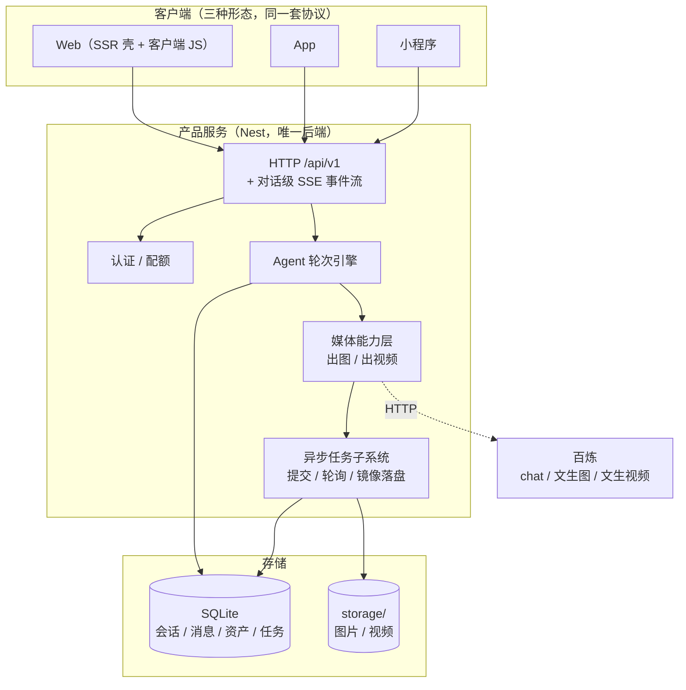

# kestrel-studio 产品扩展规划

> 本文只回答一个问题：**要往哪走**——能力扩展、多端形态、内核选型与分期。
> 与 [architecture.md](./architecture.md) 的分工：那份描述系统**现在是什么**且很少变动；
> 这份描述系统**将变成什么**，会随讨论频繁改写。

## 1. 分期

一期已完成并上线（登录 → 单会话 → 文生图 Agent 循环 → SSE 流式渲染 → 预览下载）。
原定的二期「多会话历史管理、视频工具」中，**多会话历史管理已随一期落地**（历史会话侧栏、
会话列表接口、SSR 历史回放均已验证）；其余被 §2 的产品扩展设计修订，修订后的分期如下。

| 期 | 内容 | 理由 | 现状 |
|---|---|---|---|
| 一 | 上述一期内容 | 已完成 | 端到端已验证（[verification.md](verification.md) §2） |
| 二 | 抽出 `/api/v1` + 对话级 SSE（含断线续传）+ 三模式 | 直接服务多端目标，不依赖内核决策，做完不返工 | **已全部落地**（2026-10-21）：三模式早先完成；`/api/v1` + 提交/订阅分离 + `seq` 续传见 [architecture.md](./architecture.md) §4.2，实测证据见 [verification.md](./verification.md) §8 |
| 三 | 异步任务子系统 + 视频能力 | 独立子系统，与内核决策解耦 | **已落地**，见 `src/task/`（提交即返回、后台轮询、成功即镜像、追加消息并推送）；端到端未记录 |
| 四 | **语音会话**（独立入口 + 工具调用） | 与内核决策无关，走 §2.4.1 之外的一条独立通路。设计已迁至 [architecture.md](./architecture.md) §11 | **已落地**，本地与线上端到端实测均通过（[verification.md](verification.md) §4） |
| 五 | 内核选型落地（保持 TS 增强 / 引入 Rust sidecar） | 前面各期完成后，内核的真实收益才有可比基准 | 未开始 |
| 六 | **语言迁移**：服务端改用 Rust（`rust/`） | 与第五期无关的独立变量：先换宿主语言，内核选型才有对照物 | **代码已落地**（2026-10-27），见 [architecture.md](./architecture.md) §13；**未接管构建与部署、未端到端实测**（verification.md §9） |
| 七 | **Nest/Node 技术栈退役**：服务端与 Web 客户端全部改 Rust（客户端走 Rust→WASM） | 六期把服务端迁完了，剩下的 Node 面只剩构建链与客户端；一期一期内核不掺和 | **决策已定**（2026-10-30，§4）。分期见 §4.3，**未开工** |

二期至四期无论内核如何选型都不会白做。

## 2. 产品扩展设计（2026-09-22）

一期上线后的扩展方向：从「单一文生图」扩展为**对话 / 生成图片 / 生成视频**三种能力，
并把 Web 从「唯一宿主」降级为**第一个客户端**，为 App / 小程序留出接入位。

### 2.1 已定的产品决策

| 决策项 | 结论 |
|---|---|
| 能力呈现形态 | 模式选择器 + 自动路由：默认可由模型自行判断走哪条路，用户显式选择时收窄工具集强制约束 |
| 会话与模式的关系 | 同一会话内可自由切换；模式是**每一轮的属性**，不是会话的属性 |
| 多端预期 | App / 小程序在明确规划内，按多端消费来设计边界 |

### 2.2 内核选型裁决：kestrel(Rust) 暂不引入

结论：**kestrel 可以作为内核，但当前引入是负收益。** 关键依据（均经源码核实）：

| 项 | 事实 | 影响 |
|---|---|---|
| 无历史灌入入口 | `SessionStore::prompt_items()` 零调用点；`Shared.history` 恒从空开始，只有 `Op::Turn`/`Op::Steer` 两个入口且都会触发采样 | 多轮对话直接做不了，必须改 kestrel 源码 |
| `Tool` 无 `description()` | `ToolRegistry::specs()` 无条件写 `description: String::new()`（`tools/mod.rs:199-208`） | 模型只能看到参数 schema，看不到工具用途，出图质量下降 |
| 事件流单消费者 | `AgentHandle::take_event_rx()` 是 take-once | 多端订阅要自行加广播层 |
| 回合结果不可 await | `op_loop` 丢弃 `run_turn` 的返回值，只能靠 `TurnComplete` 事件侧面推断 | 需自建 oneshot 层 |
| 无服务层 | 全仓库唯一 listener 是 `bus/rpc.rs` 的 `UnixListener`；`kestrel serve` 不是 web server，是拨号连 hub 的 worker，结果只回 `result_ref` **文件路径** | 需自写 800~1500 行 sidecar |
| 无动态工具注册 | `docs/design.md` §1 将「插件/扩展系统」列为**非目标**，工具写死在 `run.rs`/`serve.rs` 的 `vec![]` | 每加一个产品能力都要改 Rust 并重走宿主机 Docker 交叉编译部署 |
| system prompt 不可变 | `shared.system` 固定在 `EngineConfig` | 三模式要换提示词，又一处补丁 |

进一步的模式性错配：

- **主产物没有通道**。`EventMsg` 中没有承载产物的位置，`ToolOutcome.content` 是回灌给模型的内容。
  一期里那个一等公民 `asset` 事件，在 kestrel 里只能塞进 `ToolUpdate` 的字符串走私——而媒体产品的**主产物就是资产**。
- **最值钱的部分用不上**。kestrel 的权限引擎与 Seatbelt 沙箱（约 2.5k 行，其最大工程量）全仓库只服务于
  `bash` 子进程（`tools/bash.rs:88` 是 `Sandbox::wrap` 的唯一调用点），本产品一行都用不到。
  （附带结论：**纯 Rust 原生工具走 `reqwest` 不受网络策略约束**，若真要引入，出图工具无需动沙箱。
  该结论由调用点反推得出，**尚未实机验证**。）

可作为正收益引入的时机：当产品的 Agent 复杂度上升到需要**星型多 Agent 编排**（如策划 Agent + 出图 Agent +
质检 Agent）时——那才是 kestrel 的形状。见 §2.6。

### 2.3 目标架构

决定多端能否复用的**不是内核语言，而是产品 API 边界**。改造前的 SSR 单体没有这条边界：`POST /api/chat`
把整个 agent 轮次挂在一条 HTTP 连接上流式返回，移动端断网、切后台、被系统回收都会让该轮作废。
因此无论内核如何选型，都必须先把「发送」与「订阅」拆开。（本节目标形态已随二期落地，
实装见 [architecture.md](./architecture.md) §4.2。）



Web 只负责首屏骨架，其余全部走同一套 `/api/v1`；App 与小程序将来接的是同一套端点，产品逻辑无需重写。

### 2.4 三个必须做的变更

#### 2.4.1 轮次级 SSE 改为对话级 SSE ——已落地（2026-10-21）

结论与设计已移入 [architecture.md](./architecture.md) §4.2（事件表 §6、日志表 §5）。
实装与本节草案的三处出入，以 architecture 为准：

- `seq` 落在新表 `conversation_events`（会话内自增，每条事件一行）而非
  `messages.seq`：续传游标要盖住增量、工具调用与后台事件，不是只数消息。
- `202` 回的是 `{conversationId, messageId}`，`messageId`（助手占位行）就是
  turn 的身份——不另造只有服务端认识的 `turnId`。
- 额外两条语义：会话已有轮次在跑时提交吃 `409`（防重复计费）；游标低于
  保留窗口时回一帧 `resync`，客户端从落库行重建而不是吃半个回放。

#### 2.4.2 异步任务子系统

视频能力强制需要。已实证的两条硬约束：参考实现（`playground/bailian-media-mcp`）的视频流程是
**最长 240s 的阻塞轮询**（间隔 8s）；且**供应商返回的媒体 URL 是短时效的**，错过成功那一刻就再也取不回。
另有两条产品级缺陷需在自研实现中修正：任务 id 不落任何服务端存储（客户端丢失即永久丢失），
以及**无幂等**（客户端超时重试会重复计费生成）。

流程：

```
generate_video 工具 → 提交 provider 任务 → 立刻返回 task_id（不阻塞本轮）
                    ↓
              落 generation_tasks 表（status=queued）
                    ↓
        后台 worker 退避轮询 → SUCCEEDED → 立刻 fetch 字节镜像到 storage/
                    ↓                              ↓
              写 assets 行 + update task        （provider URL 就此抛弃）
                    ↓
        向该会话的 SSE 流推 task_progress / task_completed
```

要点：

- **Agent 那一轮在提交后立即结束**，不等待渲染。视频完成时由服务端往会话里**追加一条新的 assistant 消息**并推送。
  用户关掉页面再回来，任务照跑，回来能看到结果。
- `status` 用显式枚举落库，不得沿用参考实现把 `task_status` 当裸字符串的做法——它把「仍在跑」与「永久失败」
  都编码成人类可读文本，客户端只能靠字符串匹配区分。
- 媒体字节必须在成功那一刻镜像到 `storage/`，**不可把 provider URL 当持久引用**（一期 `assets.source_url` 保留，
  但仅作审计，明确不再取用）。

#### 2.4.3 模式按轮次而非按会话

`mode ∈ {auto, chat, image, video}`，存在该轮的记录上，历史回放时按轮次渲染。模式决定
**该轮暴露的工具子集** + **系统提示词片段**：

| 模式 | 工具集 |
|---|---|
| `auto` | 全部，由模型自选 |
| `chat` | 零工具 |
| `image` | `generate_image` |
| `video` | `generate_video` / `get_video_task` |

显式模式的作用是让扣费可预期——`auto` 下用户无法预知这一轮会不会生成。这条在 TS 里是每次请求组装
instructions 与 tools 的一行代码，在 kestrel 里则要改 `shared.system` 与工具列表两处写死点，是内核选型的缩影。

### 2.5 数据模型增量

一期 `users / conversations / messages / assets` 基本沿用，增量：

| 表 | 变更 |
|---|---|
| `messages` | 加 `mode`（该轮能力）**已落地**；原规划的 `seq` 改为落在 `conversation_events.seq`（见 §2.4.1 的落地备注） |
| `conversation_events` | 新表（2.4.1 落地时）：`id, conversation_id, seq, message_id, type, payload, created_at` |
| `generation_tasks` | 新表：`id, conversation_id, message_id, user_id, kind, provider_task_id, model, prompt, params(json), status, attempts, error, asset_id, created_at, started_at, finished_at`（落地时字段略有调整，以 schema.ts 为准） |
| `assets` | 加 `task_id` 反查；保留 `source_url` 但仅作审计 |

### 2.6 回归路径：若日后引入 kestrel

若届时要走 Rust 内核，最小可行形态：

1. fork kestrel，打四处小补丁：`Tool::description()`（约 10 行）、历史灌入构造器（约 40 行）、
   事件广播扇出（约 30 行）、回合完成 oneshot（约 30 行）。
2. 新增 `serve-rpc` 子命令：在 UDS/HTTP 上暴露「会话 → `AgentHandle`」映射 + NDJSON 事件流。
3. **产品工具不使用原生 Rust 实现**，改用单个通用代理工具 `invoke_capability(name, args)` 回调宿主执行。
   这样媒体代码不出 Node，新增能力只改 Node，规避「无动态工具注册」的迭代税，资产通道也天然留在 Node 侧。

第 3 条是该方案能成立的前提，否则 §2.2 的账全部成立。

wire 层对接事实（供届时参考）：kestrel 只有 anthropic-messages 与 openai-completions 两条 wire，
**没有 openai-responses**——一期 chat 用的正是 Responses API，迁移后须改走 openai 兼容面。
百炼 Token Plan 主机同时提供 `/compatible-mode`（openai）与 `/apps/anthropic` 两个表面且凭据互通，
openai 面须置 compat 位 `stream_include_usage = true`，否则全程 `usage: null`。

## 3. 当前待办

- 红隼 logo 目前是占位 SVG（`web/public/logo.svg`），待替换为正式图片。
- 对话页有 1 条 Chrome *issue*：`Lazy-loaded images should have explicit dimensions`，来自
  `partials/turn.hbs` 里 `loading="lazy"` 的资产 ``。不是错误也不是警告，属既有代码；要修
  得先知道图片尺寸，而尺寸由模型选，暂无好办法，先记着。
- 语音的遗留项（设计与已落地的部分见 [architecture.md](./architecture.md) §11）：
  - **真实麦克风采集尚未验证**。客户端到服务端的帧序列已有测试与实测覆盖
    （`web/scripts/voice.test.ts`、[verification.md](verification.md) §7），剩下的是
    `getUserMedia` 那一步——它要弹权限框，需由人在 `/voice` 页按住按钮走一遍。
  - **打断（barge-in）未做**：上一句还在播时按住说话不会中断它。
  - **空闲保活未做**：上游 180 秒无响应即关闭会话（close code `1007`），现由客户端提示
    "再按一次继续"并重新取票重连——重连后上游上下文重置。
  - **并发通话数未评估**：每个通话占一条到浏览器的 WS + 一条到上游。
- **多账号与超管**：代码完成、本地实测、**线上已上线**（[verification.md](verification.md) §5、
  [deployment.md](deployment.md) §8）。`role` 补列与超管账号的创建都发生在**进程启动时**，
  所以本机那个常驻的 pm2 实例要等重启才会出现 `/admin` 与超管账号。
- 后端链路与前端控制台均已实测，本地与线上均通过，详见 [verification.md](verification.md)。
- **Rust 实现（`rust/`）未接管任何交付路径**：线上仍是 Nest 容器；`make rust-*`
  只做本地 check/test/build，`Dockerfile` 未加 Rust 阶段——离线 registry 缺件要在
  服务器上重现，先把 crate 缓存问题解掉再说。
- **Rust 侧没有端到端**：开发环境禁止启动服务，因此 §13.3 列的三处（真拨号、101
  接管、浏览器控制台零噪音）仍是未知；一次真机运行即可消掉。

## 4. Nest 退役与 WASM 客户端（2026-10-30 决策）

### 4.1 决策

目标：**仓库里不再出现 Nest / Node / npm 技术栈**。服务端由 `rust/` 接管（第六期），
Web 客户端由 TypeScript + Vite 改为 **Rust→WASM**（选型 B），markdown 改由
`pulldown-cmark` 承担。

选 B 接受的代价，其中第一条在实测后被**推翻**（数字见 [verification.md](verification.md) §11.5）：

| 代价 | 结论 | 说明 |
|---|---|---|
| ~~首屏载荷涨 10 倍~~ | **不成立，实测持平** | wasm-opt 后当前范围是 **24.4 KB gz**，现客户端是 **21.0 KB gz**。此前的 303 KB / 95 KB 两个数字都不作数：前者是 wasm-opt 之前的中间产物，后者 74 KB 来自 `pulldown-cmark`，已改为共享服务端的手写子集（`md/`）|
| JS 地板 | 约 20 行，**删不掉** | `AudioWorkletProcessor` 子类必须在 worklet 全局作用域 `registerProcessor`，那里跑不了 wasm 宿主。语音采集那小段 JS 只能作为静态资源入库（`public/capture.js`） |

真实代价改记为两条：一是**客户端从此没有类型检查与 jsdom 测试之外的运行时护栏**，
`cargo test` 只能覆盖与 DOM 无关的逻辑（这正是 `voice_core` 被拆成纯状态机的原因）；
二是 markdown 换成共享子集后**语法面收窄了**，见下面的开放项。

### 4.1.1 两个开放项（需要决策，不是待办）

| 项 | 现状 | 决策点 |
|---|---|---|
| GFM 表格与删除线 | `marked` 支持，`md/` 子集不支持。切换后助手画的表格会以竖线原文显示 | 要么给 `md/` 补语法（同时在 `rust/src/view/tests.rs` 加断言，两侧一起改），要么接受并观察助手是否真用表格。**没有第三选**：只在一侧补等于重新制造口径分裂 |
| DOM 层的真实体积 | 未测（客户端还没有任何 DOM 代码） | 若 DOM 层使 gz 涨到不可接受，退路是"服务端吐 HTML、客户端不做 markdown"，那是链路改动而非引擎替换 |

顺带修掉的一个长期风险：markdown 目前有**三处**渲染口径——Nest 服务端 SSR
（`src/view/render.ts` 用 `marked`）、Nest 客户端（`web/scripts/main.ts` 同一个 `marked`，
所以这两处天然一致）、以及 Rust 服务端 `view/html.rs` 的**手写子集**。历史上这个
边界出过一次问题（用户轮次不该按 markdown 解析，提交 `e7b2911`）。改 B 之后
SSR 与客户端共用同一个 `pulldown-cmark` 配置，「实时渲染与重载回放不一致」这一类
缺陷变成结构上不可能；前提是 Rust 服务端那段手写子集也一并换成 `pulldown-cmark`，
否则 Rust 侧仍是三套里的两套。

### 4.2 前置事实更正

`architecture.md` §13.1 的"开发机无出站网络"不成立（实测见 verification.md §10.1），
crate 可按需下载。所以本期的成本中心**不是依赖供给**，而是下面三件事：
Rust 服务端从未真跑、客户端要重写、部署镜像要换形态。

### 4.3 分期（判据不过不进下一期，P4 之前不删任何 Node 文件）

| 期 | 内容 | 完成判据 |
|---|---|---|
| P1 | Rust 服务端第一次**真运行**（不在本机） | 本机禁止启动 Docker、禁止为本机起服务做测试，且仓库不保留 CI 配置（CLAUDE.md），所以判据只剩一个去处：**目标主机上的灰度实例**——与现有 Nest 容器并存、占另一个端口，跑通 `/login` 200、静态资源、SSE 续传、出图 / 视频任务 / 语音 / `/admin` 只读回放 + 控制台零噪音。需用户授权并人工执行 |
| P2 | 交付链换 Rust | 开发机构建静态 musl 二进制 → `FROM scratch` 运行镜像（服务器零下载，TLS 根证书已有 `webpki-roots`）；先确认宿主机架构；灰度前备份 SQLite 库；已知副作用：**cookie 签名算法不同，切流时全员重新登录一次** |
| P3 | 客户端 Rust→WASM | 装 `wasm-pack`（不能用 brew 的 wasm-bindgen CLI，版本 0.2.111 vs crate 0.2.129）；按页拆 `main` / `voice` 两个 wasm 模块；**语音帧序列逻辑与 DOM 分离**，使 `start`/`commit`/排队补发那组断言能在 `cargo test` 里跑（jsdom 测试要退役，而它正是抓住线上"永远停在正在连接…"的那个测试）；`AudioWorklet` 的 JS 留在静态资源里 |
| P4 | 删除 Node 栈 | `src/`、`__tests__/`、`package.json`、`pnpm-lock.yaml`、`pnpm-workspace.yaml`、`vite.config.mts`、`tsconfig*.json`、`drizzle.config.ts`、`nest-cli.json`、Makefile 的 Node targets、Dockerfile 的 node 阶段一并移除；删前打 tag，提交按文件面拆分先给计划 |

P3 的 DOM 契约测试要同步改：现有 Rust 测试从 `web/scripts/main.ts` 解析
`requireElement` 得到 17 个 id 来反向钉模板；客户端变成 Rust 后，这份清单应从
Rust 客户端源码本身取得，跨语言解析那层可以去掉。

### 4.4 进度（2026-10-30）

| 期 | 状态 |
|---|---|
| P2 | **交叉编译通了**：`make rust-build-linux` 产出 9.2 MB 的 `x86_64-unknown-linux-musl` 静态 ELF；`Dockerfile` 换成 `FROM scratch`、compose 加 `tmpfs /tmp`、`deploy.sh` 不再上传 node_modules（约 300 MB → 几 MB）、`bootstrap-host.sh` 不再需要缓存基础镜像。目标机实测为 x86_64 / CentOS 7.9 / Docker 26.1.4。**未做**：镜像没构建过、二进制没运行过、没有部署（都需另行授权）。证据见 [verification.md](verification.md) §11.1-§11.2 |
| P3 | **两个页面的代码基本到位**。语音页：`client/src/{wire,audio,voice_page}.rs` + `web/public/capture.js`（`40181fd`）。对话页：判定层 `chat_core.rs`（31 条宿主测试，`a2019a8`）+ 渲染层 `chat_page.rs`（订阅、绘制、模式选择、提交、图片预览、删除确认）。类型单一来源扩到事件流：`proto/src/event.rs` 收了 `ConversationEvent` / `MessageView` / `AssetView` / `ToolCallRecord` / `Mode` / `TaskStatus`（`b59e8ed`），服务端的提示词与工具表用 `ModePrompt` trait 留在原处。契约测试补到两条：`/voice` 骨架与对话骨架分别按 `voice_page.rs`、`chat_page.rs` 源码里读出的 id 校验（rust 侧 161 条通过）。**仍未验证**：`initVoice` / `initChat` 无人调用，模板仍加载 `voice.js` / `main.js`。**对话页还差三项**：下载对话框（canvas 重编码——`chat_core` 的 `plan_download` / `format_bytes` 已测但暂无调用方）、右侧轮次索引绑定、历史下拉刷新。删除确认的接法：`[data-delete-conversation]` 与 `[data-delete-choice]` 走 document 级委托，删的是当前会话就回空舞台，删别的行就把那一行摘掉 |
| P1 | **未开始**。本机不跑服务、不起 Docker（硬规则），所以运行时证据一律外移，见上表的 (a)/(b)。P2/P3 的可逆性不受影响：Nest 管线一行未删，回滚路径写在 deployment.md §1.1 |

顺序偏离原计划一处，值得记下来：**P2/P3 先于 P1 动了**。P1 的判据仍然是硬闸——
在它通过之前，P4（删除 Node 栈）不得执行，交付链也不得实际切换（`make deploy` 未跑）。

本表原先把 P1 写成"本机起服务跑通"，那与项目既有规则冲突，2026-10-30 已改正。
**本机可验证的上限**（不动 Docker、不起服务，因此始终可做）：编译、单元测试、
`cargo check --target wasm32-unknown-unknown`、`wasm-pack build` 的静态产物与体积。
真相在运行时的部分，只能来自 CI 或目标主机。

P1 的载体只剩目标主机。同日曾写过一份 `.github/workflows/ci.yml`（远端 runner 起容器
烟测 + 汇报 wasm 体积 + 过渡期跑 Nest 的 typecheck/vitest），**按用户要求已删除，
不要重建**；它删除前也从未运行过，所以其中任何步骤都未经证实。因此 P1 目前没有自动化，
只有"用户在服务器上人工灰度"这一条路，真供应商那一段（出图 / 视频 / 语音 / `/admin`）
本来也只能在这条路上做。
