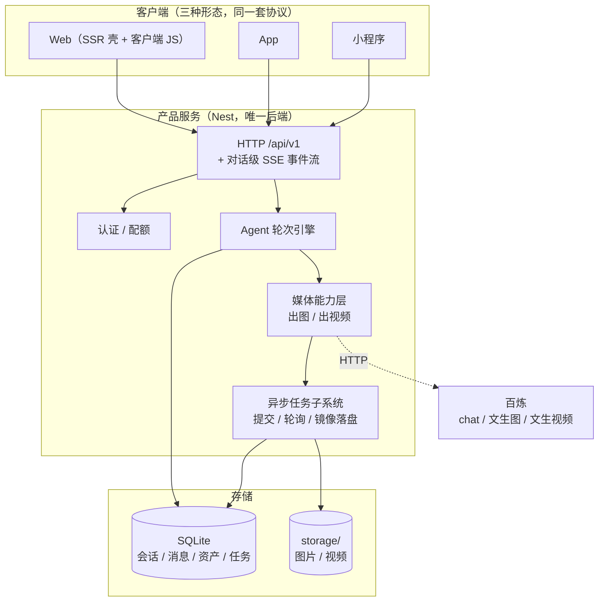

# kestrel-studio 产品扩展规划

> 本文只回答一个问题：**要往哪走**——能力扩展、多端形态、内核选型与分期。
> 与 [architecture.md](./architecture.md) 的分工：那份描述系统**现在是什么**且很少变动；
> 这份描述系统**将变成什么**，会随讨论频繁改写。

## 1. 分期

一期已完成并上线（登录 → 单会话 → 文生图 Agent 循环 → SSE 流式渲染 → 预览下载）。
原定的二期「多会话历史管理、视频工具」中，**多会话历史管理已随一期落地**（历史会话侧栏、
会话列表接口、SSR 历史回放均已验证）；其余被 §2 的产品扩展设计修订，修订后的分期如下。

| 期 | 内容 | 理由 | 现状 |
|---|---|---|---|
| 一 | 上述一期内容 | 已完成 | 端到端已验证（[verification.md](verification.md) §2） |
| 二 | 抽出 `/api/v1` + 对话级 SSE（含断线续传）+ 三模式 | 直接服务多端目标，不依赖内核决策，做完不返工 | **已全部落地**（2026-10-21）：三模式早先完成；`/api/v1` + 提交/订阅分离 + `seq` 续传见 [architecture.md](./architecture.md) §4.2，实测证据见 [verification.md](./verification.md) §8 |
| 三 | 异步任务子系统 + 视频能力 | 独立子系统，与内核决策解耦 | **已落地**，见 `nest/server/src/task/`（提交即返回、后台轮询、成功即镜像、追加消息并推送）；端到端未记录 |
| 四 | **语音会话**（独立入口 + 工具调用） | 与内核决策无关，走 §2.4.1 之外的一条独立通路。设计已迁至 [architecture.md](./architecture.md) §11 | **已落地**，本地与线上端到端实测均通过（[verification.md](verification.md) §4） |
| 五 | 内核选型落地（保持 TS 增强 / 引入 Rust sidecar） | 前面各期完成后，内核的真实收益才有可比基准 | 未开始 |
| 六 | **语言迁移**：服务端改用 Rust（`rust/server/`） | 与第五期无关的独立变量：先换宿主语言，内核选型才有对照物 | **代码已落地**（2026-10-27），见 [architecture.md](./architecture.md) §13；**已接管交付链并上线**（2026-11-02，§4.4 与 verification.md §13）；离线对拍证据见 verification.md §9 |
| 七 | **Nest/Node 技术栈退役**：服务端与 Web 客户端全部改 Rust（客户端走 Rust→WASM） | 六期把服务端迁完了，剩下的 Node 面只剩构建链与客户端；一期一期内核不掺和 | **决策已定**（2026-10-30，§4）。分期见 §4.3：P2 已上线、P3 代码到位但模板未切、P1 部分通过、**P4 未开工** |

二期至四期无论内核如何选型都不会白做。

## 2. 产品扩展设计（2026-09-22）

一期上线后的扩展方向：从「单一文生图」扩展为**对话 / 生成图片 / 生成视频**三种能力，
并把 Web 从「唯一宿主」降级为**第一个客户端**，为 App / 小程序留出接入位。

### 2.1 已定的产品决策

| 决策项 | 结论 |
|---|---|
| 能力呈现形态 | 模式选择器 + 自动路由：默认可由模型自行判断走哪条路，用户显式选择时收窄工具集强制约束 |
| 会话与模式的关系 | 同一会话内可自由切换；模式是**每一轮的属性**，不是会话的属性 |
| 多端预期 | App / 小程序在明确规划内，按多端消费来设计边界 |

### 2.2 内核选型裁决：kestrel(Rust) 暂不引入

结论：**kestrel 可以作为内核，但当前引入是负收益。** 关键依据（均经源码核实）：

| 项 | 事实 | 影响 |
|---|---|---|
| 无历史灌入入口 | `SessionStore::prompt_items()` 零调用点；`Shared.history` 恒从空开始，只有 `Op::Turn`/`Op::Steer` 两个入口且都会触发采样 | 多轮对话直接做不了，必须改 kestrel 源码 |
| `Tool` 无 `description()` | `ToolRegistry::specs()` 无条件写 `description: String::new()`（`tools/mod.rs:199-208`） | 模型只能看到参数 schema，看不到工具用途，出图质量下降 |
| 事件流单消费者 | `AgentHandle::take_event_rx()` 是 take-once | 多端订阅要自行加广播层 |
| 回合结果不可 await | `op_loop` 丢弃 `run_turn` 的返回值，只能靠 `TurnComplete` 事件侧面推断 | 需自建 oneshot 层 |
| 无服务层 | 全仓库唯一 listener 是 `bus/rpc.rs` 的 `UnixListener`；`kestrel serve` 不是 web server，是拨号连 hub 的 worker，结果只回 `result_ref` **文件路径** | 需自写 800~1500 行 sidecar |
| 无动态工具注册 | `docs/design.md` §1 将「插件/扩展系统」列为**非目标**，工具写死在 `run.rs`/`serve.rs` 的 `vec![]` | 每加一个产品能力都要改 Rust 并重走宿主机 Docker 交叉编译部署 |
| system prompt 不可变 | `shared.system` 固定在 `EngineConfig` | 三模式要换提示词，又一处补丁 |

进一步的模式性错配：

- **主产物没有通道**。`EventMsg` 中没有承载产物的位置，`ToolOutcome.content` 是回灌给模型的内容。
  一期里那个一等公民 `asset` 事件，在 kestrel 里只能塞进 `ToolUpdate` 的字符串走私——而媒体产品的**主产物就是资产**。
- **最值钱的部分用不上**。kestrel 的权限引擎与 Seatbelt 沙箱（约 2.5k 行，其最大工程量）全仓库只服务于
  `bash` 子进程（`tools/bash.rs:88` 是 `Sandbox::wrap` 的唯一调用点），本产品一行都用不到。
  （附带结论：**纯 Rust 原生工具走 `reqwest` 不受网络策略约束**，若真要引入，出图工具无需动沙箱。
  该结论由调用点反推得出，**尚未实机验证**。）

可作为正收益引入的时机：当产品的 Agent 复杂度上升到需要**星型多 Agent 编排**（如策划 Agent + 出图 Agent +
质检 Agent）时——那才是 kestrel 的形状。见 §2.6。

### 2.3 目标架构

决定多端能否复用的**不是内核语言，而是产品 API 边界**。改造前的 SSR 单体没有这条边界：`POST /api/chat`
把整个 agent 轮次挂在一条 HTTP 连接上流式返回，移动端断网、切后台、被系统回收都会让该轮作废。
因此无论内核如何选型，都必须先把「发送」与「订阅」拆开。（本节目标形态已随二期落地，
实装见 [architecture.md](./architecture.md) §4.2。）



Web 只负责首屏骨架，其余全部走同一套 `/api/v1`；App 与小程序将来接的是同一套端点，产品逻辑无需重写。

### 2.4 三个必须做的变更

#### 2.4.1 轮次级 SSE 改为对话级 SSE ——已落地（2026-10-21）

结论与设计已移入 [architecture.md](./architecture.md) §4.2（事件表 §6、日志表 §5）。
实装与本节草案的三处出入，以 architecture 为准：

- `seq` 落在新表 `conversation_events`（会话内自增，每条事件一行）而非
  `messages.seq`：续传游标要盖住增量、工具调用与后台事件，不是只数消息。
- `202` 回的是 `{conversationId, messageId}`，`messageId`（助手占位行）就是
  turn 的身份——不另造只有服务端认识的 `turnId`。
- 额外两条语义：会话已有轮次在跑时提交吃 `409`（防重复计费）；游标低于
  保留窗口时回一帧 `resync`，客户端从落库行重建而不是吃半个回放。

#### 2.4.2 异步任务子系统

视频能力强制需要。已实证的两条硬约束：参考实现（`playground/bailian-media-mcp`）的视频流程是
**最长 240s 的阻塞轮询**（间隔 8s）；且**供应商返回的媒体 URL 是短时效的**，错过成功那一刻就再也取不回。
另有两条产品级缺陷需在自研实现中修正：任务 id 不落任何服务端存储（客户端丢失即永久丢失），
以及**无幂等**（客户端超时重试会重复计费生成）。

流程：

```
generate_video 工具 → 提交 provider 任务 → 立刻返回 task_id（不阻塞本轮）
                    ↓
              落 generation_tasks 表（status=queued）
                    ↓
        后台 worker 退避轮询 → SUCCEEDED → 立刻 fetch 字节镜像到 storage/
                    ↓                              ↓
              写 assets 行 + update task        （provider URL 就此抛弃）
                    ↓
        向该会话的 SSE 流推 task_progress / task_completed
```

要点：

- **Agent 那一轮在提交后立即结束**，不等待渲染。视频完成时由服务端往会话里**追加一条新的 assistant 消息**并推送。
  用户关掉页面再回来，任务照跑，回来能看到结果。
- `status` 用显式枚举落库，不得沿用参考实现把 `task_status` 当裸字符串的做法——它把「仍在跑」与「永久失败」
  都编码成人类可读文本，客户端只能靠字符串匹配区分。
- 媒体字节必须在成功那一刻镜像到 `storage/`，**不可把 provider URL 当持久引用**（一期 `assets.source_url` 保留，
  但仅作审计，明确不再取用）。

#### 2.4.3 模式按轮次而非按会话

`mode ∈ {auto, chat, image, video}`，存在该轮的记录上，历史回放时按轮次渲染。模式决定
**该轮暴露的工具子集** + **系统提示词片段**：

| 模式 | 工具集 |
|---|---|
| `auto` | 全部，由模型自选 |
| `chat` | 零工具 |
| `image` | `generate_image` |
| `video` | `generate_video` / `get_video_task` |

显式模式的作用是让扣费可预期——`auto` 下用户无法预知这一轮会不会生成。这条在 TS 里是每次请求组装
instructions 与 tools 的一行代码，在 kestrel 里则要改 `shared.system` 与工具列表两处写死点，是内核选型的缩影。

### 2.5 数据模型增量

一期 `users / conversations / messages / assets` 基本沿用，增量：

| 表 | 变更 |
|---|---|
| `messages` | 加 `mode`（该轮能力）**已落地**；原规划的 `seq` 改为落在 `conversation_events.seq`（见 §2.4.1 的落地备注） |
| `conversation_events` | 新表（2.4.1 落地时）：`id, conversation_id, seq, message_id, type, payload, created_at` |
| `generation_tasks` | 新表：`id, conversation_id, message_id, user_id, kind, provider_task_id, model, prompt, params(json), status, attempts, error, asset_id, created_at, started_at, finished_at`（落地时字段略有调整，以 schema.ts 为准） |
| `assets` | 加 `task_id` 反查；保留 `source_url` 但仅作审计 |

### 2.6 回归路径：若日后引入 kestrel

若届时要走 Rust 内核，最小可行形态：

1. fork kestrel，打四处小补丁：`Tool::description()`（约 10 行）、历史灌入构造器（约 40 行）、
   事件广播扇出（约 30 行）、回合完成 oneshot（约 30 行）。
2. 新增 `serve-rpc` 子命令：在 UDS/HTTP 上暴露「会话 → `AgentHandle`」映射 + NDJSON 事件流。
3. **产品工具不使用原生 Rust 实现**，改用单个通用代理工具 `invoke_capability(name, args)` 回调宿主执行。
   这样媒体代码不出 Node，新增能力只改 Node，规避「无动态工具注册」的迭代税，资产通道也天然留在 Node 侧。

第 3 条是该方案能成立的前提，否则 §2.2 的账全部成立。

wire 层对接事实（供届时参考）：kestrel 只有 anthropic-messages 与 openai-completions 两条 wire，
**没有 openai-responses**——一期 chat 用的正是 Responses API，迁移后须改走 openai 兼容面。
百炼 Token Plan 主机同时提供 `/compatible-mode`（openai）与 `/apps/anthropic` 两个表面且凭据互通，
openai 面须置 compat 位 `stream_include_usage = true`，否则全程 `usage: null`。

## 3. 当前待办

- 红隼 logo 目前是占位 SVG（`nest/client/public/logo.svg`），待替换为正式图片。
- 对话页有 1 条 Chrome *issue*：`Lazy-loaded images should have explicit dimensions`，来自
  `partials/turn.hbs` 里 `loading="lazy"` 的资产 ``。不是错误也不是警告，属既有代码；要修
  得先知道图片尺寸，而尺寸由模型选，暂无好办法，先记着。
- 语音的遗留项（设计与已落地的部分见 [architecture.md](./architecture.md) §11）：
  - **真实麦克风采集尚未验证**。客户端到服务端的帧序列已有测试与实测覆盖
    （`nest/client/__tests__/voice.test.ts`、[verification.md](verification.md) §7），剩下的是
    `getUserMedia` 那一步——它要弹权限框，需由人在 `/voice` 页按住按钮走一遍。
  - **打断（barge-in）未做**：上一句还在播时按住说话不会中断它。
  - **空闲保活未做**：上游 180 秒无响应即关闭会话（close code `1007`），现由客户端提示
    "再按一次继续"并重新取票重连——重连后上游上下文重置。
  - **并发通话数未评估**：每个通话占一条到浏览器的 WS + 一条到上游。
- **多账号与超管**：代码完成、本地实测、**线上已上线**（[verification.md](verification.md) §5、
  [deployment.md](deployment.md) §8）。`role` 补列与超管账号的创建都发生在**进程启动时**，
  所以本机那个常驻的 pm2 实例要等重启才会出现 `/admin` 与超管账号。
- 后端链路与前端控制台均已实测，本地与线上均通过，详见 [verification.md](verification.md)。
  注意这条说的是**功能面**（Nest 时代验的）；服务端的宿主语言此后换过一次，见下两条。
- **线上已是 Rust 服务端**（2026-11-02 13:24 接管，当天共三次部署，在跑的是 13:47 那版；
  10.2 MB 的 `scratch` 镜像，`make deploy` 先跑 `build-linux` 再跑 `build-wasm`）。
  已过与未过的判据逐条列在
  [verification.md](verification.md) §13.5：**出图 / 视频任务 / 语音 / `/admin` 内容 /
  SSE 断线续传 / 浏览器控制台零噪音仍未在新链路上实测**。
  **2026-11-02 决定：这轮不补这些走查**（要登录态、要真人，不在当前排期里）。它们因此是
  「已知且接受的未验证」，不是待补的遗漏；要补的时候照 verification.md §13.6 末那份清单执行，
  取证工具（DEBUG 访问日志）已经在线上。
- 切换的代价按预测发生了一次：**cookie 的签名口径不同（同 HMAC-SHA256，被签的字符串一个含 `s:`
  前缀一个不含），切流当天全员被登出**——细节与线上表现见 [verification.md](verification.md) §13.4。
  只要这条口径再变一次，代价就会重现，所以切流前必须告知使用者，别让它再变成意外。
  方向还不对称：Nest 读不懂 Rust 写的 sess 行，所以**回滚也要登出一次**（§4.3 的 P2 行）。
- **P3 的 wasm 产物已随 `public/` 上线却无人引用**：模板仍引 `/assets/main.js`、
  `/assets/voice.js`（`rust/server/src/view/templates.rs`），`initChat` / `initVoice`
  仍是零调用点。切换动作按计划留给 P4 之前的一次独立改动。
- **灰度取证的盲区已补并上线**（2026-11-02 16:18）：`router.rs` 挂了 `tower_http::trace::TraceLayer`，
  每请求一行 method + uri + status + latency，**级别 DEBUG**，所以默认的 `info` 过滤下一行都不打、
  生产日志量不变（线上实测：打了若干请求之后去色计数仍为 0）；开关是 compose 里的
  `RUST_LOG=${RUST_LOG:-info}`，用法与四条限制见 deployment.md §2.1，实现与测试见
  verification.md §13.7，ANSI 那个 grep 陷阱见 §13.8。开关与清单都备好了，但**当天决定不跑这轮
  走查**（见上一条与 §4.4 的 P1 行），所以它现在是排障手段，不是待办。
  注意 `/api/voice` 刻意排除在外（它是唯一劫持连接的路径，接管未上机验过之前不在它前面放碰
  response body 的件），这条排除有测试钉住。

## 4. Nest 退役与 WASM 客户端（2026-10-30 决策）

### 4.1 决策

目标：**仓库里不再出现 Nest / Node / npm 技术栈**。服务端由 `rust/server/` 接管（第六期），
Web 客户端由 TypeScript + Vite 改为 **Rust→WASM**（选型 B），markdown 改由
`pulldown-cmark` 承担。

选 B 接受的代价，其中第一条在实测后被**推翻**（数字见 [verification.md](verification.md) §11.5）：

| 代价 | 结论 | 说明 |
|---|---|---|
| ~~首屏载荷涨 10 倍~~ | ~~不成立，实测持平~~ **现在约 6 倍** | 这行的「持平」在 2026-10-30 就被更正过一次（§12：真实语音页把模块推到约 85 KB gz），2026-11-02 对话页两项补完后复测为 **131.6 KB gz**（wasm 本体 + glue 约 142 KB gz），而现客户端是 `main.js` 18.2 + `main.css` 3.5 ≈ **21.7 KB gz**。历史数字 303 KB / 95 KB / 74 KB 仍不作数（wasm-opt 前的中间产物、`pulldown-cmark` 方案）。按用户判断体积不作为这个迁移的决策输入，但「持平」这个数字已经从近似真实变成彻底的假，别再引用它——总量见 verification.md §13.9，逐项归因见 §14 |
| JS 地板 | 约 20 行，**删不掉** | `AudioWorkletProcessor` 子类必须在 worklet 全局作用域 `registerProcessor`，那里跑不了 wasm 宿主。语音采集那小段 JS 只能作为静态资源入库（`public/capture.js`） |

真实代价改记为两条：一是**客户端从此没有类型检查与 jsdom 测试之外的运行时护栏**，
`cargo test` 只能覆盖与 DOM 无关的逻辑（这正是 `voice_core` 被拆成纯状态机的原因）；
二是 markdown 换成共享子集后**语法面曾收窄**（缺 GFM 表格与删除线），2026-11-03 已补齐，见 §4.1.1。

### 4.1.1 两个开放项（均已关闭：一个用实测回答，一个已实现）

| 项 | 现状 | 决策点 |
|---|---|---|
| ~~GFM 表格与删除线~~ **已补（2026-11-03）** | 子集此前不含两者，而线上跑的是子集这一侧，所以助手一旦写表格就会显示裸竖线——差异已生效、未被触发（49 条消息 0 命中，§15）。现在补齐：`crates/md` +153 行（含注释）、断言在 `rust/server/src/view/tests.rs`、客户端包 **+2.1 KB gz**（131.6 → 133.7，§16） | **已关闭**。四条刻意与 `marked` 不同的边界写在 helper 注释里并由测试钉住：单列表格必须两侧围栏、`\|` 是单元格内竖线的唯一写法、未转义的竖线即使在代码串里也照样分格（参考实现同此）、多出的单元格丢弃而非凭空造列。不再有"两侧同改"这回事——SSR 与浏览器编的是同一个 crate |
| DOM 层的真实体积 | **已测**（2026-11-03，verification.md §14）：两个页面的 DOM 层合计 **110.5 KB gz**，占整包 131.7 KB gz 的 84%；共享底（markdown + 解析层 + 地板）只占 16% | **已按当时写下的方式处理：先看数字再谈退路**。数字是整包对现客户端整站 24.8 KB gz 的 **5.3 倍**。当初设想的退路"服务端吐 HTML、客户端不做 markdown"经实测**不成立**——省掉 markdown 只有 5.6 KB，还剩 126 KB；真要降体积，抓手在那两个各约 55 KB 的 DOM/音频层，不在渲染器上。按用户判断体积不作为这个迁移的决策输入，因此此项**关闭但不排降体积的工作**——数字留在那里，日后要反悔不必重新量 |

顺带修掉的一个长期风险：markdown 目前有**三处**渲染口径——Nest 服务端 SSR
（`nest/server/src/view/render.ts` 用 `marked`）、Nest 客户端（`nest/client/scripts/main.ts` 同一个 `marked`，
所以这两处天然一致）、以及 Rust 服务端 `view/html.rs` 的**手写子集**。历史上这个
边界出过一次问题（用户轮次不该按 markdown 解析，提交 `e7b2911`）。改 B 之后
SSR 与客户端共用同一个 `pulldown-cmark` 配置，「实时渲染与重载回放不一致」这一类
缺陷变成结构上不可能；前提是 Rust 服务端那段手写子集也一并换成 `pulldown-cmark`，
否则 Rust 侧仍是三套里的两套。

### 4.2 前置事实更正

`architecture.md` §13.1 的"开发机无出站网络"不成立（实测见 verification.md §10.1），
crate 可按需下载。所以本期的成本中心**不是依赖供给**，而是下面三件事：
Rust 服务端从未真跑、客户端要重写、部署镜像要换形态。

### 4.3 分期（判据不过不进下一期，P4 之前不删任何 Node 文件）

| 期 | 内容 | 完成判据 |
|---|---|---|
| P1 | Rust 服务端第一次**真运行**（不在本机） | 本机禁止启动 Docker、禁止为本机起服务做测试，且仓库不保留 CI 配置（CLAUDE.md），所以判据只剩一个去处：**目标主机上的灰度实例**——与现有 Nest 容器并存、占另一个端口，跑通 `/login` 200、静态资源、SSE 续传、出图 / 视频任务 / 语音 / `/admin` 只读回放 + 控制台零噪音。需用户授权并人工执行。**取证边界（11-02 复核补，同日补访问日志后修订）**：写路径一直可正证——出图 / 视频看 `messages`+`assets`（视频另有 `generation_tasks`）的新行，语音看 `voice session opened` 日志与「语音会话」行；`/admin` 回放与 SSE 重放在 13:47 那版上**取不到**（服务端没有请求日志），现在可以看每请求一行的 DEBUG 访问日志（`RUST_LOG=debug`，见 verification.md §13.7 与 deployment.md §2.1；**16:18 已上线**，日志带 ANSI，grep 前先去色，见 §13.8）；控制台噪音任何时候都只在浏览器里，只能由操作者报告并单独标注。另：实际执行与本行设想不同——不是并存占另一端口，而是 compose 直接换掉镜像、Nest 容器被移除（回滚见 deployment.md §1.1） |
| P2 | 交付链换 Rust | 开发机构建静态 musl 二进制 → `FROM scratch` 运行镜像（服务器零下载，TLS 根证书已有 `webpki-roots`）；先确认宿主机架构；灰度前备份 SQLite 库；已知副作用：**cookie 的签名口径不同，切流时全员重新登录一次**——而且这个方向是不对称的（Nest 读不懂 Rust 写在顶层 `user` 的 sess 行），所以**回滚同样会登出一次**，见 verification.md §13.4 与 deployment.md §1.1 |
| P3 | 客户端 Rust→WASM | 装 `wasm-pack`（不能用 brew 的 wasm-bindgen CLI，版本 0.2.111 vs crate 0.2.129）；按页拆 `main` / `voice` 两个 wasm 模块；**语音帧序列逻辑与 DOM 分离**，使 `start`/`commit`/排队补发那组断言能在 `cargo test` 里跑（jsdom 测试要退役，而它正是抓住线上"永远停在正在连接…"的那个测试）；`AudioWorklet` 的 JS 留在静态资源里 |
| P4 | 删除 Node 栈 | `nest/server/`（整棵树，含自己的 `package.json` 与 `vitest.config.mts`）、`nest/client/` 的 TS 面（`scripts/`、`styles/`、`__tests__/`、`package.json`、`tsconfig.json`、`vite.config.mts`、`vitest.config.mts`，**留下 `rust/client/`**）、根的 `package.json` + `pnpm-lock.yaml` + `pnpm-workspace.yaml`（workspace 依赖已下沉到两棵树，根清单没有需要手工裁剪的残留）、Makefile 的 Node targets、Dockerfile 的 node 阶段一并移除；删前打 tag，提交按文件面拆分先给计划 |

P3 的 DOM 契约测试要同步改：现有 Rust 测试从 `nest/client/scripts/main.ts` 解析
`requireElement` 得到 17 个 id 来反向钉模板；客户端变成 Rust 后，这份清单应从
Rust 客户端源码本身取得，跨语言解析那层可以去掉。

### 4.4 进度（2026-10-30 定档，P1/P2 于 2026-11-02 更新）

| 期 | 状态 |
|---|---|
| P2 | **已实装并上线**。交叉编译：`make build-linux` 产出 9.2 MB 的 `x86_64-unknown-linux-musl` 静态 ELF；`Dockerfile` 换成 `FROM scratch`、compose 加 `tmpfs /tmp`、`deploy.sh` 不再上传 node_modules（约 300 MB → 几 MB）、`bootstrap-host.sh` 不再需要缓存基础镜像。目标机实测为 x86_64 / CentOS 7.9 / Docker 26.1.4。**2026-11-02 当天三次 `make deploy`（13:24 / 13:45 / 13:47）后，线上就是这个形态**：镜像 10.2 MB、静态 ELF 在 glibc 2.17 上直接跑、RSS 1.2 MiB、旧 cookie 按预测被拒绝。证据见 [verification.md](verification.md) §11.1-§11.2 与 §13.1 |
| P3 | **两个页面的代码基本到位**。语音页：`rust/client/src/{wire,audio,voice_page}.rs` + `rust/client/public/capture.js`（`40181fd`）。对话页：判定层 `chat_core.rs`（31 条宿主测试，`a2019a8`）+ 渲染层 `chat_page.rs`（订阅、绘制、模式选择、提交、图片预览、删除确认 `a9074d5`、轮次索引）。类型单一来源扩到事件流：`crates/proto/src/event.rs` 收了 `ConversationEvent` / `MessageView` / `AssetView` / `ToolCallRecord` / `Mode` / `TaskStatus`（`b59e8ed`），服务端的提示词与工具表用 `ModePrompt` trait 留在原处。契约测试补到两条：`/voice` 骨架与对话骨架分别按 `voice_page.rs`、`chat_page.rs` 源码里读出的 id 校验（rust 侧 161 条通过）。**仍未验证**：`initVoice` / `initChat` 无人调用，模板仍加载 `voice.js` / `main.js`。**对话页那两项已补**（2026-11-02，当天用 `make build-wasm` 重新打过包，产物体积见 verification.md §13.9）：下载对话框接上了 canvas 重编码——`render_data_url` 用 `toDataURL` 而不是 `main.ts` 的 Blob + objectURL，因为同步一条路就够、不需要回调也没有要 revoke 的对象，而预计大小直接读 base64 长度（`chat_core::decoded_bytes`），估算与成品是同一次编码；历史下拉改为**重新向 `/api/v1/conversations` 取**（`refresh_history` + `paint_history`），新建会话、删除别行、打开抽屉都走它，不再手工增删行。两项都只在编译与宿主测试层验过：`cargo test`（client）36 passed、`cargo check --target wasm32-unknown-unknown` 无 warning、shell/wasm 的 id 契约测试通过——**浏览器里一次都没跑过**。两处走法记在此处以免后人重推：删除确认用 `[data-delete-conversation]` 与 `[data-delete-choice]` 的 document 级委托，删的是当前会话就回空舞台、删别的行就重新取一次列表（原来是手工摘行，2026-11-02 起改走 `refresh_history`，行的形状因此只有 `paint_history` 一处定义），并在 `close` 事件里清掉待删 id（Esc 不是确认）；轮次索引按 `.turn-index-link[data-target]` 绑骨架已有行、`user_message` 落地时补新行，高亮跟随阅读位置而非最后一次点击（`request_animation_frame` 合帧，阈值取滚动容器顶 +24 px——必须高于 `.turn` 的 12 px `scroll-margin-top`，否则刚滚到的那一轮仍亮着上一条）。**2026-11-02 起这些文件在 `rust/client/` 下**，crate 本身未变 |
| P1 | **部分通过（2026-11-02，用户在 lavo-test 上人工执行）**。已过的判据：`/login` 200、静态资源（`main.css` 与开发机构建产物 md5 相同，`capture.js` 与 wasm 也在）、公网 HTTPS 经 openresty、`/admin` 与 `/` 的鉴权跳转、`/api/voice/ticket` 路由挂载、**一轮真模型流式对话**事件 37 行连续到 `turn_done`。**未过**：出图 / 视频任务、语音 upgrade 与真拨号、`/admin` 页面内容、SSE 断线续传、浏览器控制台零噪音——逐条见 [verification.md](verification.md) §13.5，全部需要登录态，只能人在浏览器里走。本机不跑服务、不起 Docker（硬规则）不变，运行时证据的来源也只有目标主机这一条。可逆性：Nest 管线一行未删（P4 未开工），回滚写在 deployment.md §1.1，但盘上那份 node_modules 是 9-27 的残留，回滚要重新上传，见该节 |

同日复核：**13:47 那次部署之后线上写入为 0**——按时间戳查 `messages` / `assets` /
`conversation_events` / `generation_tasks` 全是 0 行，日志只有启动 3 行。所以上面那五条「未过」
里的出图 / 视频 / 语音是**正证未跑过**，不是"跑过但没记"；另外两条（`/admin` 内容、SSE 续传）加
控制台噪音，服务器侧无痕，操作者报告的"已在浏览器中验证过"拿不到机器证据佐证，因此
**P1 仍记为部分通过**。复核命令与分类见 verification.md §13.6。
同日把盲区补了一半：DEBUG 访问日志已实现并通过本机 `oneshot` 测试（`cargo test` 164 passed，
见 verification.md §13.7），并于当天 16:18 部署上线（§13.7 末尾那张线上实测表：默认级别零输出、
打开后 `uri=` 保留查询串、`/api/voice` 仍零输出、连续三次重建容器没有登出任何人）。因此上面这
三次走查**仍然无法追认**（当时日志还没上线），P1 的判断不变。**同日决定：这轮走查跳过**，P1 因此
停在「部分通过」，不再有「下一步就是走一遍」这个排队项。直接后果：**P4（删 Node 栈）继续禁止**，
`nest/server/` 与 `nest/client/` 的 TS 面一行不删——P1 没整体通过，那两棵树是目前唯一的回滚底牌。
访问日志留在原地当排障手段，真供应商链路出问题时按 §13.6 末的清单取证。

顺序偏离原计划两处，都记下来。一是 **P2/P3 先于 P1 动了**；二是**11-02 在 P1 只部分通过的
情况下就把交付链切了**——本节原先那句「P1 未通过之前交付链不得实际切换」被实际执行推翻。
当时判断可以切的理由只有一个：`/login`、静态资源、鉴权、公网反代、一轮真实流式对话这些
**主干已经在线上跑通**，而未过的五条（出图 / 视频 / 语音 / 管理页内容 / 续传）在 Nest 时代
验过、切流不会让它们凭空变得更坏。代价也已经量化：切流当天全员被登出一次。
剩下的硬闸现在只对 **P4（删除 Node 栈）** 生效：P1 整体通过之前，`nest/server/` 整棵树与
`nest/client/` 的 TS 面一行都不删——它们是目前唯一的回滚底牌，删掉就没有底牌了。

**2026-11-02 目录前置**：仓库先拆成 monorepo 形态——`server/`（Nest 后端 + 它的
tsconfig / nest-cli / drizzle 配置）、`web/`（前端代码 + vite / tsconfig + WASM 客户端
`web/client/`）、`rust/`（Rust 服务端）、`crates/`（`proto/`、`md/` 两个共享库），
完整映射见 [architecture.md](./architecture.md) §9。**只挪目录与改引用，未动任何代码语义**；
P4 的删除清单因此收敛成「删两棵树」，见上表。质量门当天全跑过：`tsc --noEmit` 三份、
`vitest run` 30 files / 510 passed、`cargo test`（rust）161 passed、
`cargo check --target wasm32-unknown-unknown`（web/client）、`make clean && make build`
（产物落位 `server/dist` 与仓库根 `public/`）——过程与踩到的三处 cwd 暗坑记在
implementation-notes.md §17。当天 13:24 起 `make deploy` 跑了三次，线上换为 Rust 镜像
（本节 P1/P2 两行与 verification.md §13）——原先写在这里的「`make deploy` 仍未跑」是
13:24 之前的事实。

同日第二步：Node 侧改成**真 pnpm workspace**——依赖从根 `package.json` 下沉到
`server/package.json` 与 `web/package.json`（根不声明依赖，只留 `pnpm -r` 聚合脚本），
`vitest.config.mts` 也跟着拆成两份 app 内配置，根不再留测试编排文件。代价按约定经授权重写
了 `pnpm-lock.yaml`（一次 `pnpm install`）。**Rust 侧不合并 Cargo workspace**：四份
`Cargo.lock` 合成一份的收益只是少一个 `target/`。质量门复跑：typecheck 两个 app 通过、
vitest **server 461 + web 49 = 510**（与拆分前单 runner 同数，一条没丢）、`make build` 产物落位不变。

同日第三步：取消独立前端 app，按**后端技术栈**拆包——`server/` → `nest/server/`、
`web/` → `nest/client/`、`rust/` → `rust/server/`、`web/client/` → `rust/client/`；
根 `public/` 仍是两个服务端共用的产物，`capture.js` 随 Rust 客户端迁到
`rust/client/public/`。完整形态见 [architecture.md](./architecture.md) §9 与 `make help`。

本表原先把 P1 写成"本机起服务跑通"，那与项目既有规则冲突，2026-10-30 已改正。
**本机可验证的上限**（不动 Docker、不起服务，因此始终可做）：编译、单元测试、
`cargo check --target wasm32-unknown-unknown`、`wasm-pack build` 的静态产物与体积。
真相在运行时的部分，只能来自目标主机——那份 CI 配置已按要求删除，且不得重建。

P1 的载体只剩目标主机。同日曾写过一份 `.github/workflows/ci.yml`（远端 runner 起容器
烟测 + 汇报 wasm 体积 + 过渡期跑 Nest 的 typecheck/vitest），**按用户要求已删除，
不要重建**；它删除前也从未运行过，所以其中任何步骤都未经证实。因此 P1 目前没有自动化，
只有"用户在服务器上人工灰度"这一条路，真供应商那一段（出图 / 视频 / 语音 / `/admin`）
本来也只能在这条路上做。

**2026-11-02 这条路真的走了一次**：当天 13:24 / 13:45 / 13:47 三次 `make deploy`，线上换为
Rust 容器，`/login`、静态资源、鉴权跳转、公网 HTTPS、一轮真模型流式对话（37 个事件连续落库到
`turn_done`）都已确认——P1 因此是**部分通过**，逐条证据与剩下未覆盖的五项见
[verification.md](verification.md) §13。剩余五项里出图 / 视频 / 语音 / `/admin` 内容都需要登录态，
必须由人在浏览器里操作，探测脚本代替不了。
